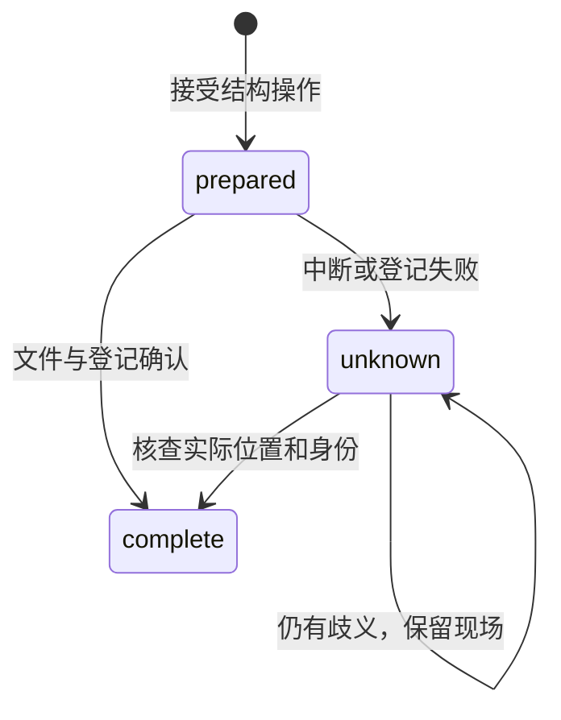

## ADDED Requirements

### Requirement: 项目创建与最近列表管理

系统 SHALL 支持创建不存在的项目目录、持久显示名和最近项目列表。新建不得覆盖已有目录；重命名不移动目录或改变身份；移出列表不删除数据、不关闭在途执行使用的存储。再次打开 SHALL 保留会话与身份并重新登记。

#### Scenario: 执行期间移出最近列表
- **WHEN** 用户移出一个正在执行的项目
- **THEN** 项目从最近列表移除，执行和磁盘内容保留，再次打开可查看结果

### Requirement: 稳定文件引用与结构管理

系统 SHALL 按需登记稳定文件身份，支持创建目录、重命名文件及非空目录、回收及恢复。成果和撤销引用 SHALL 跟随应用确认的结构变更，历史路径与正文不被改写。普通写授权 SHALL 明确包含结构操作，已有项目需重新确认扩大的权限。操作 SHALL 与相交路径的保存协调，保留并失效旧读取依据，不自动重建已移走目标。

#### Scenario: 原路径复用
- **WHEN** 一个已登记成果被改名或回收，原路径随后创建另一文件
- **THEN** 成果仍指向原文件身份，不能打开或撤销另一文件

#### Scenario: 目录与保存竞争
- **WHEN** 人或 Agent 保存子文件的同时重命名父目录
- **THEN** 短暂提交按相交路径协调；旧依据保存拒绝或在已确认的原提交前完成，草稿与实际文件保留

### Requirement: 回收恢复与结构操作核查

回收 SHALL 保存完整文件或目录载荷；恢复默认原路径，也允许指定新路径，不能覆盖已有内容。系统 SHALL 保存稳定结构操作身份和可查询结果；重复身份不同参数应拒绝，回执丢失不能重复副作用。中断后先核查实际位置，无法确定时保留现场和未知状态，不盲目重放。备份 SHALL 明确包含的回收载荷和图片，缺失载荷不能报告完整恢复。

#### Scenario: 恢复位置已存在
- **WHEN** 回收后原路径已有后续成果
- **THEN** 原内容和回收载荷均保留，用户可选择其他恢复位置

#### Scenario: 落盘后登记失败
- **WHEN** 结构操作已改变实际位置但元数据提交失败
- **THEN** 结果为未知，重启后可按原操作身份核查，不能再次搬移或覆盖内容

### Requirement: 有界本地图片读取

系统 SHALL 经共同授权接口读取项目内 PNG、JPEG、GIF、WebP 图片，检查实际格式、真实路径和读取权限，单张不超过 1 MiB。私有路径、越界、外部链接及其他格式 SHALL 拒绝，错误不能泄露私有内容。

#### Scenario: 预览引用越界图片
- **WHEN** Markdown 引用项目外路径、私有文件或未经读取授权的图片
- **THEN** 不交付资源，预览保留正文并显示该资源不可用
