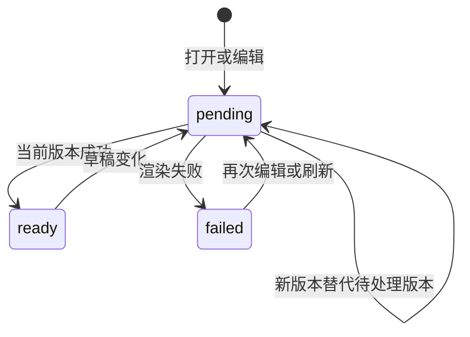

## ADDED Requirements

### Requirement: 可操作项目与文件工作台

真实工作台 SHALL 提供项目新建、打开、显示名修改、最近列表移出、设置与文件管理入口；目录按需展开且分页，文件变化只刷新相关已展开目录和打开文档。真实首页不以默认占位 tab 遮蔽已交付功能。项目切换 SHALL 保留各自 tab 状态与草稿，文件结构变化不得改变指令接收者或覆盖迟到请求之后的编辑。

#### Scenario: 项目切换和结构操作
- **WHEN** 用户编辑文件后切换项目，或重命名其父目录
- **THEN** 草稿和会话保持独立，原文件可按新位置继续编辑，旧回执不会覆盖新状态

### Requirement: 同一文档的 Markdown 编辑预览

Markdown 的源码、预览与并排查看 SHALL 使用同一草稿，沿最多两个 tab 组展示；预览说明未保存及旧结果状态。支持常用正文、表格、代码块、本地图片与数学公式；不执行原始 HTML、工程代码或不可信公式扩展，不自动请求外部图片。相对文档链接经共同文件入口打开，外链仅经用户明确点击打开安全协议。

连续编辑 SHALL 合并渲染请求，仅展示当前文档最新版本；失败保留最后成功结果并说明状态。干净文档可随 Agent 保存更新；存在草稿时保留草稿并提示磁盘变化。解析与公式排版不阻塞输入和取消。

#### Scenario: 快速编辑与旧请求晚到
- **WHEN** 两次编辑的预览结果以相反顺序到达
- **THEN** 仅新版本更新展示，输入与未保存状态保持

#### Scenario: 不可信内容
- **WHEN** 文档包含脚本、危险 URL、远端图片或不可信公式命令
- **THEN** 不执行和自动外发，正文仍可阅读，源码保留
