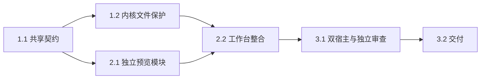

# 执行任务

## 1. 项目与文件内核

- [x] 1.1 主 Agent 完成共享协议、迁移及 UI 设计更新，核对 OpenSpec strict；以本change specs为契约。
- [x] 1.2 主 Agent 实现项目管理、稳定文件引用、相交保存协调、结构操作回执、回收恢复与图片／备份；扩展现有内核测试核对实际载荷、路径复用、迁移和中断。
- [x] 1.3 主 Agent 接入共同 RPC 和 Agent 文件工具，验证执行中结构变化、持久工具状态及成果定位。

## 2. 工作台闭环

- [x] 2.1 辅助实现者仅负责独立 Markdown 预览和 Worker；接口由主 Agent 固定，核对受控链接／图片、公式、最新版本及字体打包。
- [x] 2.2 接入项目控件、设置、按需文件树和回收站；共享文件文档支持源码／预览／并排、稳定草稿与项目 tab；更新开发说明和路线图。

## 3. 整合与交付

- [x] 3.1 扩展双宿主用户路径、安全与并发用例，核对截图及256KiB下输入／取消响应；完成独立数据保护审查并运行 pnpm check。
- [x] 3.2 按实际结果填写 delivery.md，核对完成判据与未验证边界。

## 续做入口

先读本change的design/specs和已有delivery（如存在）。任务进度只在本文件维护。
