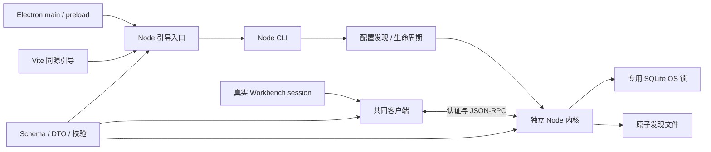
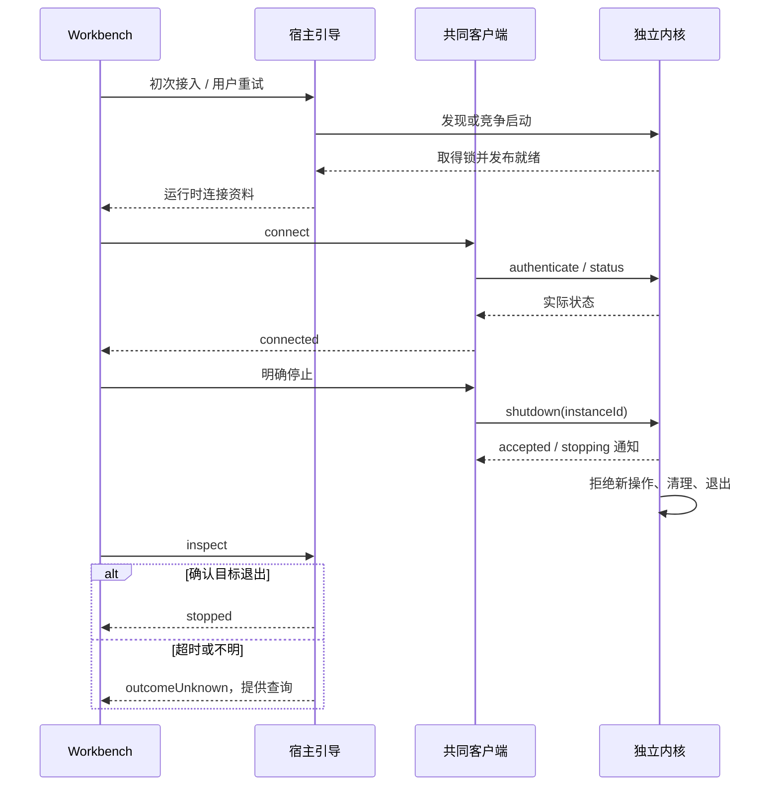

# 实现设计

## 变更总览

## 方案与接口

沿 investigation 复用既有 Workbench、assistant-ui 和 Playwright。protocol 是跨端 Schema/DTO 的唯一来源。client 不含 Node 引导，提供 KernelClient 的 connect/status/shutdown、连接 snapshot/subscribe 和 dispose。dispose 只关连接。CLI 和宿主引导共用内核生命周期实现；bootstrap 是纯 Node 子进程调用接口，Electron 不直接使用 node:sqlite。

启动候选进程自己取得 runtime/lifecycle.sqlite 的 BEGIN EXCLUSIVE，未取得锁不监听或发布记录。锁文件持续保留，不按心跳抢占、不删除重建。状态查询通过独立进程对 sqlite_master 作只读查询来探测占用，再认证查询发现端点，不竞争启动锁或写领域事实。SQLite_BUSY 表示配置占用，不能当作服务就绪；没有可认证端点则报告不可达或未知。并发重启留下的旧发现记录在启动预算内重读，存活但不可达的实例保持原样。运行区仅用于本地文件系统，POSIX 目录/凭据文件为 0700/0600，Windows 在运行区限制当前用户访问。发现文件在同一目录临时写入后 rename；日志只保存去除凭据的启动和停机诊断。

开发默认目录为仓库根 .scholoom-dev，在 bootstrap.ts 定义并由 lifecycle 复用，优先级 --data-dir > SCHOOLOOM_DATA_DIR > 默认值。测试全部传入独立临时目录。Electron 引导用 SCHOOLOOM_NODE_EXECUTABLE 或 PATH 中的 node，测试传入 process.execPath；不使用 Electron executable 运行内核。Node 24.12.0 的 SQLite 告警作为已知运行时限制记录。

服务监听 127.0.0.1 随机端口。首帧 kernel.authenticate 传 token/protocolVersion/instanceId，返回不含凭据的 KernelStatus；kernel.status 返回同一状态；kernel.shutdown 传 instanceId，返回 stopping 受理结果，kernel.stopping 广播同一目标。Schema 校验信封、参数和结果，未知双向请求返回 Method not found。认证等待 3 秒、请求等待 5 秒，帧上限 64 KiB；启动/退出确认最多 10 秒。重连间隔 250/500/1000/2000 毫秒，不重放操作。

Vite 启动时 ensure；页面通过 POST /__scholoom/kernel/bootstrap 请求 mode=inspect 或 ensure。端点校验当前监听 origin、Host、本机地址、JSON 和自定义 X-Scholoom-Bootstrap 请求头，不开放 CORS，响应 no-store。页面初次 inspect，手动重试 ensure。Electron preload 仅暴露同形 bootstrap(mode)，校验 IPC sender 为本应用主 frame；首次 ensure。共享 session 保留 Composer 实例，展示连接状态、错误、重试、查询和明确停机确认；真实来源的发送始终禁用，样例仍按原约定工作。

Vite 保留默认 fs.deny，并保护运行区及敏感文件名。静态根、/@fs/、publicDir 和模块加载入口均核对真实路径，阻止目录或改名文件的链接别名绕过；规范化目标同时复用 Vite 的 isFileLoadingAllowed 规则。客户端收到停机通知后维持 stopping／结果未知，迟到的状态响应或连接成功、失败均不能覆盖该状态；由 inspect 确认实际退出。

## 文件变化

- packages/protocol/src/index.ts 及 package.json：Schema、推导类型、运行时校验和直接 Ajv 依赖。
- packages/client/src/index.ts：替换未使用的 URL 接口骨架，提供浏览器/Node 共同连接模块。
- apps/kernel/src/{cli,lifecycle,server,bootstrap}.ts、package.json：CLI、OS 锁/发现、服务和宿主引导出口；新增 ws/@types/ws/client 依赖。
- apps/desktop 的 main/preload、renderer main/session/Workbench/styles、vite.config.ts 和 package.json：薄宿主桥及真实 session；新增 renderer 类型声明与 kernel-session.tsx。
- tests/kernel、playwright.kernel.config.ts、已有 smoke/UI fixture/spec/config、公共测试生命周期 fixture：真实进程、协议和双宿主检查及自有进程清理。
- 根 package.json、pnpm-lock.yaml、.github/workflows/checks.yml、.gitignore：检查入口、依赖、三平台接线、开发配置忽略。
- docs/development.md、README.md：更新实际入口、隔离配置、错误/停机语义和验证范围。

## 验证与风险

从 CLI 和用户界面核对同一 instanceId/PID。覆盖并发/别名/隔离、错误凭据与协议、非法消息、关窗续留、重连保留草稿、退出后手动启动、多客户端停机和结果未知。故障输入由已确认 #23 场景定义，受控网络或进程边界不替换内部服务实现。复用样例测试，只调整默认来源预期。

Electron fixture 经原生窗口关闭／应用退出并核对进程退出，验证关窗不停止内核。浏览器配置位于隔离的 test-results 目录，以真实静态访问检查凭据保护；Windows 若不能创建文件符号链接，记录该项未验证并继续目录 junction 检查。

独立审查认证、协议、锁持有/释放、发现发布和跨进程停机；检查只处理本轮样本及进程。Linux 本机运行 lint/typecheck/build/kernel/smoke/UI；CI 三平台运行相同脚本，未运行平台如实记录。不升级 Node、不引入领域数据库、科研任务、全量事件订阅或产品 Node 分发，不提交或归档。
