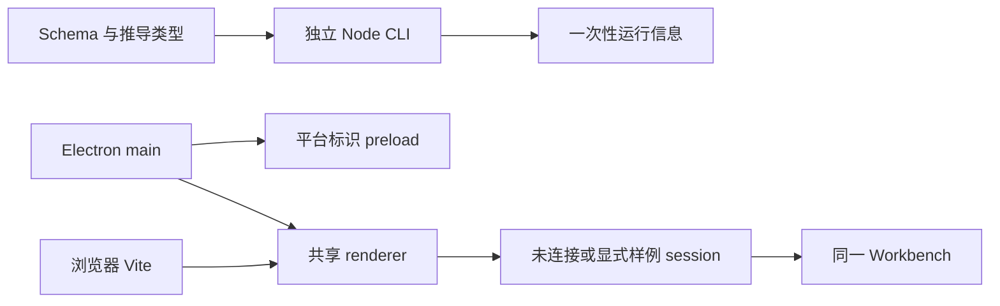

# 调查依据

## 当前事实与复用选择

本会话只读核对 apps/kernel/src/cli.ts、packages/{protocol,client}/src/index.ts、桌面 main/preload/Workbench/session、tests/smoke、tests/ui 及构建配置。CLI 只提供帮助与运行信息；客户端尚未接线；JSON Schema 仅用于类型推导。默认工作台未连接，dev 样例与正式工作台共用组件。已有 Playwright Chromium/Electron fixture 可复用，不能沿用“默认入口永远未连接”的预期。

实施前工作区干净。当前 Node 为 24.12.0，Electron 为根 package.json 中的 44.5.1；浏览器和 Node 具有原生 WebSocket 客户端，无内置服务端。ws 8.22.0 和 @types/ws 8.18.2 为 MIT；Ajv 8.20.0 已在锁文件中作为传递依赖，需声明直接依赖。Schema 类型继续使用已有 json-schema-to-ts 3.1.1。

图中关系经上述源码静态核对；真实服务及共同客户端尚不存在。

## 影响方案的未知项与实验

单实例需要进程存活但不可达时仍保持排他，并在崩溃后安全释放。proper-lockfile 4.1.2 按 mtime 超时抢占，不满足此约束。node:net 命名管道在 Windows 由 OS 释放，但 POSIX 文件 socket 的遗留清理存在 unlink/bind 竞态及路径长度限制。

选择专用 node:sqlite 运行锁。依据 [SQLite transaction](https://sqlite.org/lang_transaction.html)、[OS 锁说明](https://sqlite.org/lockingv3.html)及 [Node 24 API](https://nodejs.org/docs/latest-v24.x/api/sqlite.html)。运行锁保留 DELETE journal，以 BEGIN EXCLUSIVE 持有；状态不存该数据库，使用原子发现文件及认证查询。SQLite_BUSY 只说明占用，不能当作服务已就绪。

计划阶段已在 Linux Node 24.12.0 / SQLite 3.50.4、独立临时目录中验证：持锁子进程阻止竞争者；只终止本轮子进程后竞争者取得锁；同进程的两个 SQLite 连接也正确拒绝第二次取得锁。临时样本已清理。该实跑支持当前平台上的协调选择，不能代替真实内核或 Windows/macOS 验收。当前版本发出 SQLite ExperimentalWarning；不为本变更升级 Node。

## 结论与承接

复用既有工作台和测试 harness；不复用原型业务服务器。采用 ws 服务端、原生 WebSocket 客户端、Ajv Schema 校验及专用 SQLite 系统锁。领域持久化仍沿已选 better-sqlite3/Drizzle，本变更不创建领域数据库。真实服务、认证、双宿主、并发及恢复由 tasks 验证；跨平台实际结果按 delivery 如实记录。
