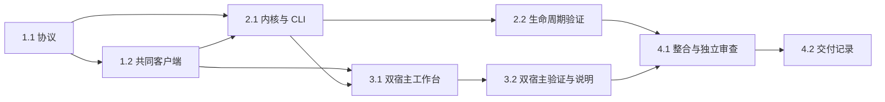

# 执行任务

## 1. 共同协议与连接

- [x] 1.1 建立 Schema/DTO/运行时校验及必要直接依赖；共享协议由主 Agent 维护，类型检查和非法输入检查通过。
- [x] 1.2 实施共同客户端的认证、请求关联、状态及有界重连；辅助 implementer 仅写 packages/client，验证真实服务和结果未知语义后完成。

## 2. 真实内核与 CLI

- [x] 2.1 建立配置归一化、OS 单实例锁、原子发现、驻留服务、CLI/Node 引导和确认停机；独立 Node 启停和状态闭环通过。
- [x] 2.2 经 test:kernel 验证并发、隔离/别名、遗留发现、存活不可达、认证/协议、错误消息、断线/停机未知及明确停机；同步本地/三平台检查入口。

## 3. 双宿主工作台

- [x] 3.1 接入 Electron 窄桥、浏览器同源引导及真实 session；同一 Workbench 的连接、重试、查询和停机保留草稿，发送禁用，样例仍隔离。
- [x] 3.2 调整 smoke/UI fixture，实跑双宿主连接、关窗续留/重开、重连、退出后手动启动、多客户端停机及原样例场景；更新开发说明、README 和开发目录忽略。

## 4. 整合与交付

- [x] 4.1 完成 lint/typecheck/build/kernel/smoke/UI 和独立审查；修复相关问题，三平台配置与实际运行范围分别记录。
- [x] 4.2 根据实际结果完成 delivery.md，对应 proposal 完成判据、审查、限制和平台证据；必要未完成项保留未完成。

## 续做入口

使用 openspec instructions apply --change connect-shared-kernel-lifecycle --json；从未完成任务继续，已有执行结果见 delivery.md。
