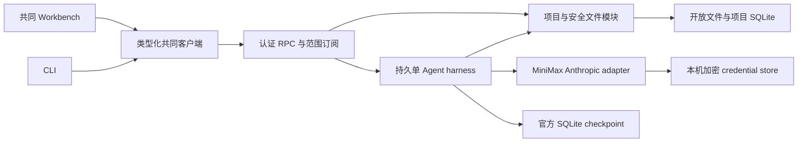
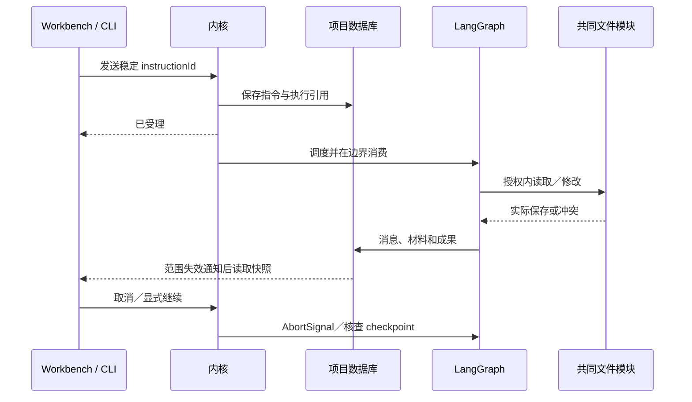

# 实现设计

## 变更总览

## 方案与接口

调查见 investigation。领域 SQLite 和 checkpoint 分库，项目元数据目录 .scholoom；应用配置保存项目位置和模型凭据，项目保有稳定身份及授权，恢复副本重置授权。每个项目保存会话、指令、执行、消息、文件历史与成果引用；无项目的普通会话在应用工作区使用同一实现，文件权限为空。项目根变化时路径重定位，身份不变。

Schema 与 DTO 在 protocol，业务 RPC 使用明确命令／结果校验；KernelClient 复用现有私有 request，不暴露无校验传输。长操作返回稳定引用。订阅以递增修订号的失效通知通知客户端读取有界快照；注册订阅与快照在同一事件循环边界衔接，慢客户端仅失效自身范围；不建设全量事件回放。追加文本先持久保存再发布，客户端按消息身份替换投影。

文件读取返回不透明 basis，服务器保存整份原内容；提交以实际整份内容比较，不新增 hash。按真实文件路径串行保存，原子替换及有限历史。basis 丢失要求重读，保留草稿。明确限制外部进程在核对与替换之间的竞态。UTF-8 文本保存上限 256 KiB，传输上限 2 MiB；列表每页最多 100，消息默认每页 50。大文件仍可有界读取但本期不编辑。

Credential store 使用 AES-256-GCM 随机 nonce、独立主密钥文件和原子发布；保存凭据优先于环境注入。POSIX 目录 0700／文件 0600，Windows 沿已有权限处理方式核对。存储不可读或解密失败不重建覆盖。主密钥与密文同机不抵御同权限进程。模型端点不暴露成任意可配置 URL；测试通过构造依赖注入固定 loopback HTTP fixture，生产只使用内置端点。禁用外部 tracing。

模型默认 medium、adaptive thinking、16384 输出 tokens、180 秒请求超时、连接并发 1。SDK fetch 统一覆盖模型与压缩请求的授权、取消和重试。临时确定失败最多额外重试两次，尊重 Retry-After；流式已输出或执行结果未知不重放。每次推进最多 32 次模型请求，每会话只运行一个图，追加在模型调用边界消费；消费身份写入图状态并与指令表核对，完成推进后保存交付游标，接续时重列未完成推进的指令。`read_instructions` 可按需分页发现旧要求。取消后不调度待处理消息。成果先写文件，再保存私有待登记收据并登记，以执行／路径去重；重启读取待核查收据，`artifacts.reconcile` 核对实际文件后补齐。

备份采用数据库 backup 加文件副本，描述未包含范围，不承诺跨数据库与文件的全局事务；五分钟变化检查、十份保留，可手动备份及关闭。恢复仅创建新的独立目录，复制项目自身数据与选用文本，校验后打开；选择性取回复用普通文件保存。数据库迁移前备份，错误保留现场。GUI 草稿通过浏览器本地存储按配置／项目／会话／文件保存，不成为文件权威。

## 文件变化

- apps/kernel/src：新增 credentials/store.ts、models/minimax.ts、projects/ 与 harness/；修改 server.ts、lifecycle.ts、cli.ts 装配及受理接口。
- packages/protocol/src：新增业务 Schema，index 导出；packages/client/src 扩展类型化调用和订阅。
- apps/desktop/src/renderer/src/workbench：真实 session、设置与项目入口、CodeMirror 文件页、会话控制和草稿；shell 仅承接事件和投影。
- package.json、各受影响包清单、pnpm-workspace.yaml、锁文件、迁移配置与源码：固定依赖及独立 Node native build。
- tests/kernel、tests/ui、既有 fixture：文件保护、真实 SDK HTTP 边界、恢复和双宿主用户路径。
- docs/development.md、docs/implementation-roadmap.md、相关初设：同步实际入口与契约引用；AGENTS 仅补充必要运行入口并保留原有修改。

## 验证与风险

复用 Playwright，按模块结果与公共客户端接口测试；再通过真实工作台保存并核对磁盘。模型 HTTP 替身不替代工具、图、文件与数据库。使用环境 key 对隔离合成样本进行受限真实验证。现有生命周期、样例及双宿主回归继续维护。独立审查文件保护、凭据与恢复，不以新实现输出作为唯一预期。长历史与持续输出检查有界查询、取消受理及调度响应，记录实测而非提前设毫秒门槛。Linux 为本轮实际环境，三平台分发另验。

## 待办边界

P3d、P4 以后领域能力，shell、插件 MCP、多 Agent 与分发不进入本变更。
