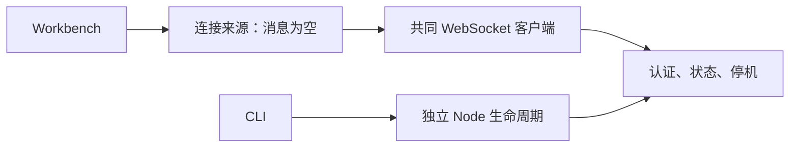

# 调查依据

## 当前事实与复用选择

2026-10-15 静态核对：server 仅处理认证、状态及停机；client 尚无业务请求与订阅；kernel-session 的真实 adapter 禁用发送。lifecycle.sqlite 只作排他锁，不承载领域表。现有 Playwright kernel fixture、transport proxy 和 browser／Electron 双宿主 fixture 可复用。bootstrap 仅调用独立 Node CLI，不导入领域模块。路线图第 2 节的工程基线需要更新。

上图依据 apps/kernel/src/server.ts、bootstrap.ts、lifecycle.ts，packages/client/src/index.ts 及真实 kernel-session.tsx；不包含尚未实现的执行路径。

选定 npm 稳定发布：deepagents 1.15.0、langchain 1.5.16、@langchain/core 1.2.17、@langchain/langgraph 1.5.0、@langchain/anthropic 1.5.12、@langchain/langgraph-checkpoint-sqlite 1.1.0、better-sqlite3 12.11.1、drizzle-orm 0.45.4。驱动 12 系列与官方 saver 的 ^12.10.0 共用；领域表用 Drizzle，checkpoint 表由官方 saver 管理。来源为 registry.npmjs.org 元数据及相应 npm tarball 源码，尚未运行集成。

MiniMax [中国区其他工具配置](https://platform.minimax.cn/docs/m-plan/other-tools.md)确认 https://api.minimax.cn/anthropic 与 MiniMax-M3.1-Flash-Preview；[Anthropic 接口](https://platform.minimax.cn/docs/api-reference/text-anthropic-api.md)要求多轮保留完整 content 块。M Plan 与按量 key 独立，不能静默切换模型或端点。ChatAnthropic 1.5.12 能保留 thinking／signature；ChatOpenAI 会丢弃对应回程字段，因此不采用后者。显式 adaptive thinking 避免无工具流式调用被转为纯文本。LangChain AsyncCaller 默认重试六次，显式 maxRetries: 0 后由应用统一重试。来源核对日期同上，未调用模型。

Deep Agents 1.15.0 提供自定义 filesystem backend、middleware、harness profile 和 summarization；禁用 generalPurposeSubagent 并排除 task、execute、delete，backend 执行实际权限检查。其许可 MIT；Drizzle 为 Apache-2.0。沿 #12 的 CodeMirror 6 接入文本编辑，不扩展阅读器或可视写作。

## 结论与承接

无改变方向的未知项。MINIMAX_CN_API_KEY 已仅检查存在状态。真实额度错误的 HTTP 映射和原生模块加载需要实施测试；未知供应商错误按结构化失败呈现，不依赖文案匹配，也不为探测额度耗尽发起大量调用。独立 Node 24 与 Linux 为本轮验证环境，其他平台不冒称通过。
