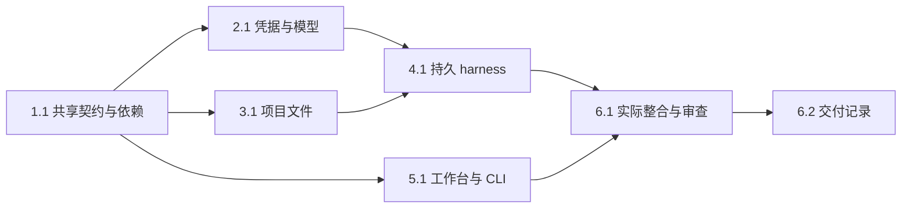

# 执行任务

## 1. 共享接口
- [x] 1.1 完成业务 Schema、类型化客户端和固定依赖接入；构建及输入输出边界检查通过。主 Agent 统筹共享接口。

## 2. 模型与凭据
- [x] 2.1 完成自研 credential store 与 MiniMax adapter，验证环境注入、保存重启、损坏保护、流式内容块与共同重试。

## 3. 项目与文件
- [x] 3.1 完成稳定项目身份、安全文件保存、差异历史、撤销、备份与副本恢复；冲突、越界和恢复测试通过。

## 4. 单 Agent 执行
- [x] 4.1 完成持久会话、可靠指令、调度、实际材料与成果、订阅、取消与 checkpoint 接续；真实内部接线集成测试通过。

## 5. 用户入口
- [x] 5.1 工作台接入设置、项目、文件编辑、会话控制和草稿；CLI 使用共同客户端。可在共享接口确定后委派辅助 UI 实现，独占 renderer 写入范围，主 Agent 负责内核与整合。

## 6. 整合与交付
- [x] 6.1 完成双宿主 e2e、受限真实 MiniMax 样本、长历史与流式检查、必要独立审查、相关静态与回归检查，并更新开发说明、路线图和初设引用。
- [x] 6.2 根据实际执行结果完成 delivery.md，核对完成判据与必要验证，再更新本项状态。

## 续做入口

使用 openspec instructions apply --change establish-basic-agent-harness --json；实际结果及后续线索见执行后填写的 delivery.md。
