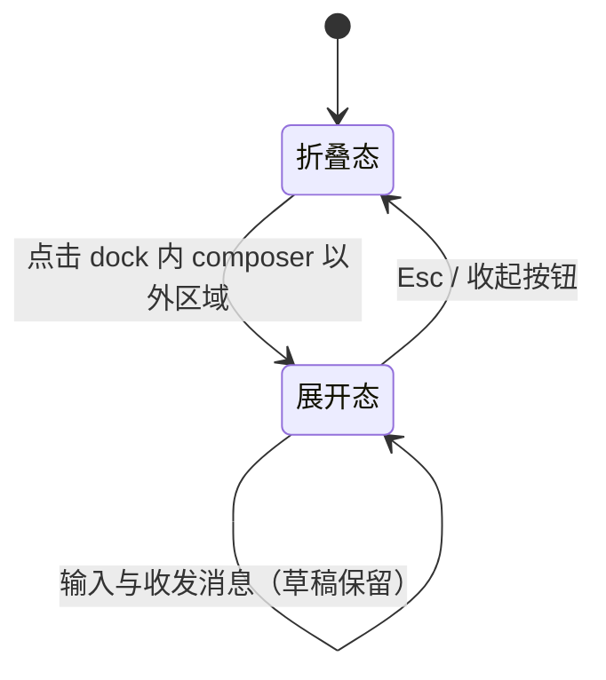

# Spec Delta

## Purpose

工作台外壳为文献库、阅读器、编辑器、交互预览与 Agent 会话提供统一的宿主结构：三区布局、可折叠辅助区、tab 组与 Agent 面板双形态，使后续业务模块以 tab 或面板形式接入，而不各自发明布局。视觉与交互契约来自已确认的 `docs/ui-design/` 设计。

## ADDED Requirements

### Requirement: 三区骨架与折叠

工作台 SHALL 呈现固定三区骨架：左区为操作菜单、Agent 会话列表与内核状态；中间区为 tab 组与 Agent 面板；右区为文件树与任务列表。左区与右区 SHALL 各自支持折叠为图标轨与恢复展开，折叠与展开 SHALL 可通过按钮与键盘快捷键触发。窗口与各区 SHALL 具有最小尺寸约束；空间不足时 SHALL 以滚动或文本截断处理，MUST NOT 挤压破坏布局结构。内核连接状态与生命周期操作 SHALL 位于左区底部，行为沿用既有连接契约。

#### Scenario: 折叠与恢复左右区

- **WHEN** 用户点击左区或右区的折叠按钮，或按下对应快捷键
- **THEN** 该区域折叠为图标轨，中间区占用让出的空间；再次触发后恢复原布局

#### Scenario: 窄窗口防挤压

- **WHEN** 窗口宽度低于工作台最小宽度
- **THEN** 布局保持各区最小尺寸并出现横向滚动，输入框、发送按钮与状态指示保持可用，不发生重叠或挤压变形

### Requirement: Agent 面板双形态

Agent 面板 SHALL 固定属于中间区，具有折叠态与展开态。折叠态 dock SHALL 固定在中间区底部：transcript 区域 SHALL 只呈现最新一条 tool 消息与最新一条 agent 消息；tool 消息 SHALL 固定在 dock 顶部，单行、超长截断并带状态指示灯，其位置 MUST NOT 随 agent 消息长度变化；agent 消息 SHALL 占据剩余高度，超出时截断头部、显示尾部；dock 右侧 SHALL 保留精简 composer。展开态 overlay SHALL 占满整个中间区且不遮挡左右区，呈现完整消息流与完整 composer。

#### Scenario: 点击展开与 Esc 收起

- **WHEN** 用户在折叠态点击 dock 内 composer 以外的区域
- **THEN** Agent 面板以 overlay 占满中间区，焦点进入 composer 输入框；按下 Esc 或收起按钮后回到折叠态，焦点回到 dock

#### Scenario: 形态切换保留草稿与消息

- **WHEN** 用户在折叠态 composer 中编辑草稿后展开 overlay，再收起
- **THEN** 草稿内容与既有消息在两种形态间保持一致，不丢失、不重复

#### Scenario: 折叠态只显示最新进展

- **WHEN** Agent 会话存在多条历史消息
- **THEN** 折叠态 transcript 只显示最新一条 tool 消息（固定顶部、单行截断、带状态灯）与最新一条 agent 消息（超出高度时截断头部）

### Requirement: tab 组管理

中间区 SHALL 以 tab 组承载文献库、阅读器、编辑器、交互预览等内容页。tab SHALL 支持激活与关闭；tab 组头部 SHALL 提供"向右拆分"按钮把当前 tab 移入新组；横向 tab 组 SHALL 最多两个，组内无 tab 时 SHALL 合并回剩余组；无任何 tab 时中间区 SHALL 呈现空态入口。

#### Scenario: 按钮拆分与合并

- **WHEN** 用户在单组状态点击"向右拆分"
- **THEN** 当前 tab 移入右侧新组，两组并排；第二组内 tab 全部关闭后，布局合并回单组

#### Scenario: 空态

- **WHEN** 中间区没有任何打开的 tab
- **THEN** 显示空态，提供进入常用内容的入口，Agent 面板仍保持可用

### Requirement: 主题与设计 token

工作台样式 SHALL 以语义 token 定义（背景、表面、浮层、边框、三级文字、强调色、状态色），并映射浅色与深色两套主题。主题 SHALL 默认跟随操作系统，组件结构在两套主题下 SHALL 保持一致。

#### Scenario: 跟随系统与手动切换

- **WHEN** 系统主题为浅色或深色，或用户手动切换主题
- **THEN** 工作台整体呈现对应主题，正文、次级文字、状态色与焦点描边保持可读

### Requirement: 占位数据与空态

会话列表、文件树与任务列表 SHALL 从会话来源读取可选只读数据；来源未提供时 SHALL 呈现空态而非模拟数据。tab 内容类型在本期 SHALL 以占位呈现，不包含业务实现。

#### Scenario: 来源无数据时呈现空态

- **WHEN** 当前来源未提供会话、文件树或任务数据
- **THEN** 对应区域显示空态提示，不显示虚构条目
