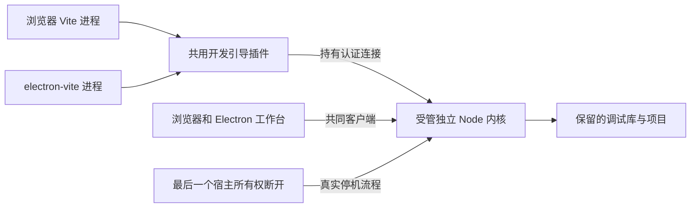
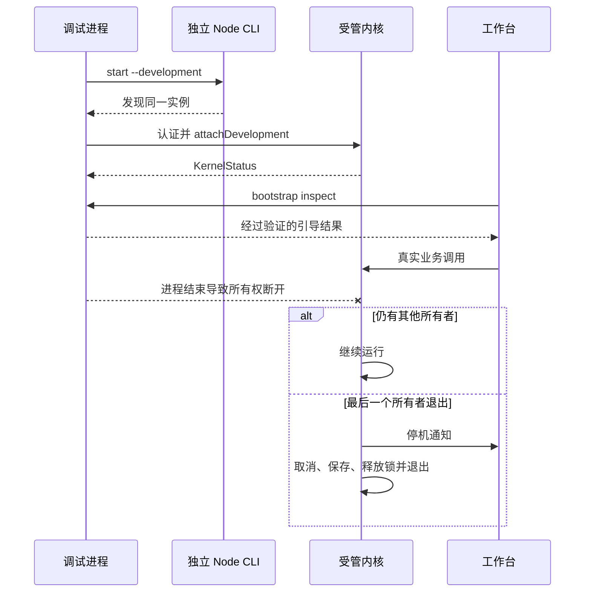

# 实现设计

## 变更总览

## 方案与接口

复用 investigation 的现有接线。所有权是内核生命周期内部职责，不建立额外协调服务、租约文件、PID 轮询或构建 hash。

- 在独立 CLI 的 start/serve 增加 `--development`，沿现有排他锁启动开发受管实例；普通 start/serve 保持独立驻留。
- 共同客户端提供 `attachDevelopment()`；认证后的 `kernel.development.attach` 使用空参数并返回既有 KernelStatus。仅受管实例接受，所有权与该连接绑定；重复登记幂等。首次登记期限复用 limits.lifecycleMs，最后断开调用现有 stop。
- `createDevelopmentKernel({dataDirectory?,nodeExecutable?})` 隐藏引导、单实例登记和清理，提供 `bootstrap(mode)` 与 `dispose()`。默认目录为 defaultDataDirectory/debug。并发 bootstrap 合并；停机不自动重启，inspect 只发现、ensure 才可创建。关闭期间的引导不得遗留所有权。
- 从浏览器配置抽取 kernelBootstrap 插件供两个 Vite 配置使用；由 Vite 进程持有所有权，服务器关闭时 dispose。主进程开发桥转发同源 bootstrap HTTP 请求；生产桥继续独立 CLI。引导端点的本机同源、凭据隔离和静态文件拒绝规则保留。
- 测试中替换模型的内核同样可受管；UI fixture 使用受管引导，避免无意补起独立内核。现有业务 DTO、数据库及领域授权不改变。

## 文件变化

- 修改 `packages/client/src/index.ts`：增加类型化所有权登记，复用既有状态响应 schema。
- 修改 `packages/protocol/src/index.ts`：新增开发登记空参数 schema 供服务端验证，结果复用已有 KernelStatus；默认调试目录由内核引导维护。
- 修改 `apps/kernel/src/bootstrap.ts`、`cli.ts`、`lifecycle.ts`、`server.ts`：开发引导、启动标记及连接所有权。
- 新增 `apps/desktop/kernel-bootstrap.ts`，修改两个 Vite 配置和 `src/main/index.ts`：复用受管引导及开发桥。
- 修改 `tests/model-kernel.ts`、`tests/ui/fixture.ts` 与相关接线夹具；新增 `tests/kernel/development.spec.ts` 和 `tests/smoke/development.spec.ts`：真实进程和命令回归、显式 live UI 场景。复用现有 UI 业务测试。
- 更新 `docs/development.md`、`docs/architecture.md`、`AGENTS.md`：入口、生命周期和实际验证边界；修正阅读器占位描述。

Vite 内部重启会复用插件对象，因此每次 configureServer 单独建立所有者，中间件和 HTTP close 只捕获该所有者。新服务登记成功后才允许旧服务关闭；同插件交接失败时让新服务创建失败，保留原服务及内核。已用真实 server.restart 验证成功和失败分支。

## 验证与风险

经已确认的 CLI/共同客户端、实际开发命令和工作台 seam 验证。先运行一个失败的真实所有权用例再实现，逐步扩展正常和异常退出、并发共享及数据读回。命令测试通过现有 Playwright 和 Electron CDP 驱动真实 electron-vite；预构建 Electron 测试继续覆盖原生桥。

默认自动回归隔离配置、清除真实模型凭据并只在外部模型边界注入受控响应。真实模型场景显式选择，使用环境凭据和合成样本，通过 UI 授权和发送；核对观测 2/4/6 的数量3、合计12、均值4及合成样本含义，不锁定输出文案。测试只停止本轮进程，失败保留日志；并发回收安排独立审查。运行 pnpm check 及 live UI 验收，平台范围如实记录。

## 待办边界

独立驻留路径继续由专门生命周期测试维护；不增加内核代码热替换、不迁移旧默认目录、不实现尚未交付的科研功能。内核更新需结束整轮调试后重启。
