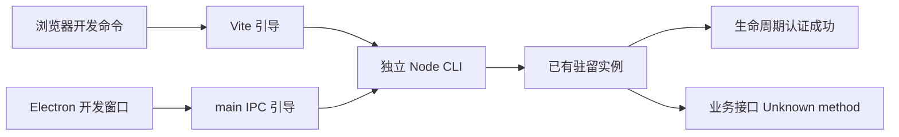

# 调查依据

## 当前事实与复用选择

- `main.tsx` 默认加载 KernelWorkbench，ui-foundation 仅由开发查询参数显式启用。`business-session.tsx` 已经通过共同客户端调用真实业务。
- 浏览器 Vite 插件调用 bootstrapKernel；Electron main 经 IPC 调用同一 CLI。ensureKernel 直接返回已有实例，因此构建不会替换内存中的旧实现。
- 本轮只读实跑：`node apps/kernel/dist/cli.js status` 返回默认目录内核正在运行，启动时间 2026-10-15T02:54:26.099Z；当前客户端合法的 library.status 和 workbench.snapshot 均收到 invalidRequest / Unknown method。业务层首次引入提交 00c26b4 晚于该实例启动。没有停止或修改该实例。
- 既有 UI fixture 使用真实内核；模型受控响应仅在外部 HTTP 边界。Electron UI fixture 使用预构建 main，尚不能证明实际 electron-vite dev 命令的启动和回收。
- 已安装 electron-vite 5.0.0 支持 remoteDebuggingPort；renderer Vite server 与 Electron 应用重建分离，适合由调试命令持有所有权。Node 24.12.0、显示服务、Electron 及 MiniMax 环境凭据均可用；未输出凭据。

图依据上述源码及只读请求；UI 新行为和受管回收尚待实施实跑。

## 影响方案的未知项与实验

已确认旧驻留实例会被复用且缺少业务接口，足以选择按调试进程所有权回收。新方案的并发、异常退出及真实命令接线通过实施测试核对，不继续对旧实例做写入实验。

## 结论与承接

复用现有协议认证、单实例锁、共同客户端、真实业务及停机逻辑。在独立固定配置内增加开发所有权，抽取共同 Vite 引导；不新增领域模型、依赖或消息控制器。验收和证据记录由 tasks/delivery 承接。
