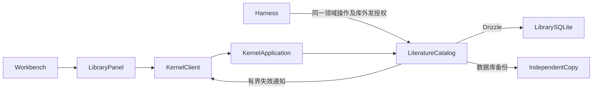
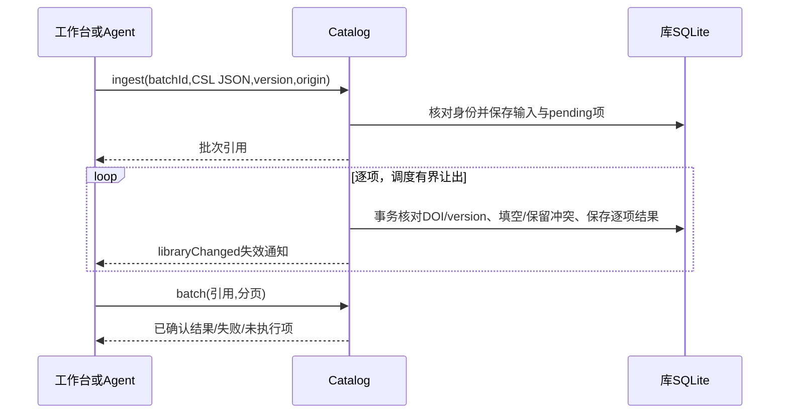

# 实现设计

## 变更总览

## 方案与接口

新增深层模块 LiteratureCatalog，统一摄取、去重、并发更正、集合和版本关系、批次与恢复。`<data>/library/library.sqlite` 为题录权威，TS Schema 单独维护，生成 SQL 迁移随内核分发。复用私有目录和 better-sqlite3 backup；项目库不加库表、不承载全局事实。首轮元数据保留 CSL JSON 的扩展字段，但题名必须非空，总输入有界；版本标签由调用方明确给出，`unspecified` 不触发自动去重。精确匹配规范 DOI+版本，其余候选不做模糊自动合并。

共享 DTO/运行时校验在 protocol business Schema：LiteratureSource（metadata/version/revision/tags/collectionIds/relatedIds/origins、attachmentState=unavailable、analysisState=notGenerated）、LibraryStatus（id/read/write/send/autoBackup/revision）、Collection、IngestBatch/Entry。读取默认只读库，写入及外发单独保存；Agent 工具不提供 grant/restore/任意本机路径入口。GUI/可信客户端授权，Agent 受库 send 和当前会话的外发授权双重约束。

RPC：`library.status/grant/list/get/ingest/batch/resume/update/collections/saveCollection/history/backups/backup/restore`。ingest 接收稳定 batchId、原 CSL JSON 文本、版本标签、来源和可选集合；手动建项也生成一条 CSL JSON 批次，同一摄取模块。批次输入不超过256KiB/1000条，读取每页默认25/最多100；逐项事务同时提交来源与结果，单项间用 setImmediate 让出调度。权限撤回/关闭时保存中断，显式 resume 只处理 pending 项，失败输入留在原批次供更正后新提交。正常关闭等待本轮处理结束，不抛弃已受理输入。

更正使用 sourceId+revision，保留旧值历史；DOI/version 匹配唯一索引避免并发重复。集合父级需存在且不得形成循环。关系校验同库存在，版本关联对称更新；更正冲突不自动覆盖。库变化经现有订阅附加 libraryChanged 标志，UI只在标志/连接/用户查询变化时有界重读，不把会话流式更新当作库全量刷新。

工作台草稿按库和条目保存原修订号，页面刷新后不自动升版。保存等待期间仍可输入和切换条目，禁用再次保存与显式重读；成功回执结算对应离屏草稿，保留后续编辑并推进修订号，不影响当前其他条目。相同修订的详情刷新不替换输入。Agent 成功读取库后在项目 meta 标记会话使用了库上下文，每次模型请求及重试都重新核对库读取/外发授权，旧 checkpoint 也不绕过撤权。

手动备份与五分钟可关闭自动备份先覆盖题录数据库（不含未实现附件），备份清单含范围与时间；恢复到新的独立配置目录的 library 子目录，副本 id 独立、写/外发关闭，批次不自启，当前库保留。迁移前已有库使用备份接口保护；损坏停止打开该库并保留现场。

自动备份的已备份修订号持久保存，重启仍识别待备份变化；内部备份不依赖交互读取授权。恢复先解析目标父目录真实路径，拒绝经路径别名落入当前配置目录。

## 文件变化

- protocol business Schema、client 只读分类、内核 application/server/harness 接线。
- 新增内核 literature/catalog、storage/library-schema 与迁移/配置；内核构建复制迁移。
- 新增 workbench/LibraryPanel，Workbench/session/TabGroups/ActivityPane/business-session 接入，同一 library tab。
- UI 设计先补题录库交互，样式沿已有 token/类；docs/development、roadmap/初设补范围与接续链接。
- 必要 catalog 模块/真实 RPC/恢复测试及双宿主 UI、外部模型边界夹具。

## 验证与风险

public seam 为 Catalog、真实共同 RPC 和工作台用户入口，沿已确认项目验证方式。样本使用合成 DOI、预印本/正式版、同版本字段冲突、非法记录、多个集合；核对真实 SQLite 持久化、并发修订、重启/批次、备份副本和库发送授权。P3d 工具/进程生命周期回归按影响运行，独立审查关键身份、权限及数据保护。双宿主从入口导入、查找、更正、整理并检查实际库；仅模型边界可替换。

## 接续边界

本 change 交付 P4a 的题录闭环；下一 P4a 变更接托管/外链附件与本地材料摄取。PDF解析/阅读/批注、全文索引、分析、生态兼容、合并/回收站分别沿原路线，不因题录模块完成视为已交付。
