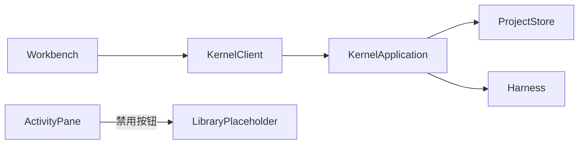

# 调查依据

## 当前事实与复用选择

- 内核 `KernelApplication`/共同 RPC 与 `ProjectStore` 已用 better-sqlite3 12.11.1、Drizzle 0.45.4；SQLite 备份与 privateDirectory 可复用。项目库不是全局文献权威，新增单独 library 目录和数据库，沿 TS Schema→生成 SQL 迁移；不把文献存入项目 meta。
- 工作台 `ActivityPane` 文献库按钮禁用，TabGroups 已有 library 类型；business-session 提供真实客户端。沿同一 tab/样式/会话路径接入，不新建独立界面。
- 已读初设 L-01/L-02、D-01/D-06、文献 PRD、#13/#32 及数据库选型。CSL JSON 为首项标准题录入口，文献本地文件/附件与解析在后续 P4a/P4b，首次入库只交付题录。
- Scout 核对原型 `bbt-minimal-host-prototype/literature-store.mjs`：标为 throwaway，node:sqlite 存储/四类类型/空集合/硬编码时间仅服务兼容实验；不迁入生产。可复用独立稳定 sourceID 与通知语义。zotero-agents HEAD f47a048 的摄取耦合20k行宿主 broker；参考现有资料，不复制其宿主层或许可不明插件。

以上为本地源码静态核对，不视为文献能力运行证据。

## 影响方案的未知项与实验

无需要原型才能决定的未知项。同版本确认采用规范化 DOI 加明确版本标签；未知版本不自动去重，题名相同只保留候选。CSL JSON 字段保留，合法记录逐项摄取，解析失败与记录缺项分开。输入上限、备份副本、授权与跨客户端通知按真实接口测试核对，不预填性能结论。

## 结论与承接

实施独立全局题录模块和真实工作台闭环，不安装依赖。附件完整范围仍由接续 P4a 变更承担，不宣称整个 P4a 完成。真实接线、并发/恢复、数据保护与双宿主验证进入 tasks。
