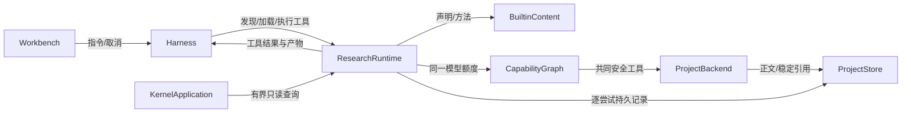
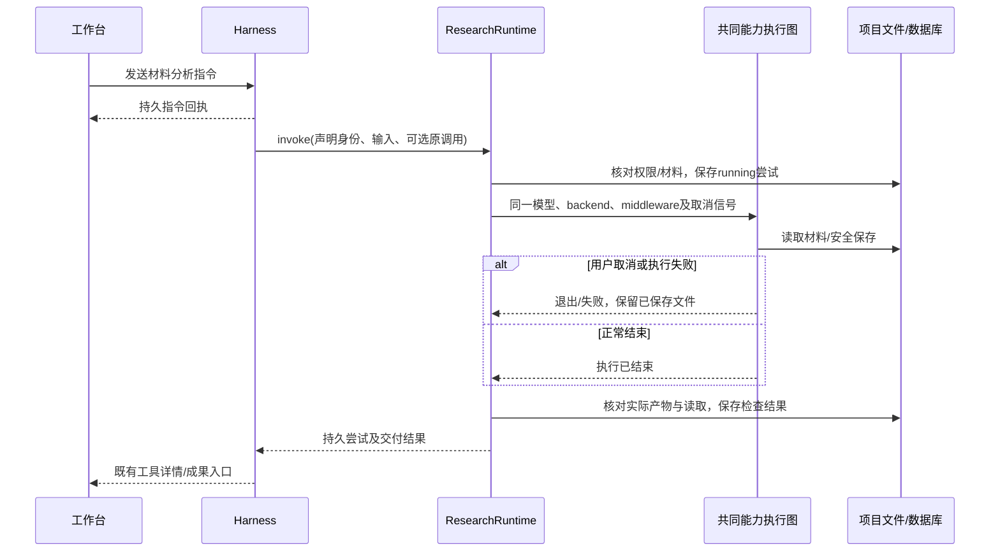

# 实现设计

## 变更总览

## 方案与接口

沿 investigation 复用 `ProjectBackend`、模型实例、harness 中间件及保存回调。新增深层模块 `ResearchRuntime` 管声明校验、发现/加载、输入预检、调用身份/尝试、结果核对与持久查询；其执行 seam 接收获授权模型/文件后端/取消，运行绑定是通用短寿命 `createDeepAgent` 图，不为第一项能力写专用分析流程，不开放多 Agent 委派。父 harness 独占会话、指令与生命周期；科研模块不创建会话或任务。

`packages/protocol` 提供 method descriptor、输入、attempt 及查询 Schema，所有 DTO 从 Schema 推导。内置 `capability.yaml` 使用 JSON 形式 YAML，引用已注册输入 Schema 身份，不复制参数定义；绑定 Skill 及所需 read/write/send、报告产物。内置正文随内核构建复制到 dist。方法内容按需读取，不常驻整个目录。

RPC 为 `research.methods`、`research.method`、`research.attempts`，全部只读。Agent 工具对应发现、加载、查询及 `invoke_research_capability`；执行工具一次返回 attempt，包括 invocationId、attemptId/number、方法版本、输入材料身份、实际材料、产物、结构检查与 `researchAssessment: notAssessed`。重试可显式提供 invocationId，必须匹配原输入及会话；同一次调用同时只允许运行一个尝试。

尝试逐行存 meta 的 `research-attempt:<UUID>`，项目库为权威；按 JSON 的 sessionId/invocationId SQL 筛选、排序、limit/offset，默认25上限100；不把全部历史加载后截断。检查产物为本尝试保存且读取可用的稳定身份，记录读取输入与保存回调；缺项、失败及部分成果分别表达。报告的稳定身份随重试固定，执行上下文将它传入共同文件接口，在保存保护范围内核对 expectedFileId，避免路径复用把重试写向新文件。重启仅标记运行中的记录为 interrupted。已有工具 pending 回执阻止未知重放，Agent 可查询研究记录并显式决定下一步。

## 文件变化

- 新增 `apps/kernel/src/research/{content,runtime}.ts` 及内置 `material-analysis/{SKILL.md,capability.yaml}`：内容及共同运行职责；`SOURCE.md` 保留方法来源与许可。
- 修改 `packages/protocol/src/business.ts`：共享 Schema/DTO/只读 RPC；`packages/client/src/index.ts` 标记新查询为只读。
- 修改 `apps/kernel/src/{application.ts,harness/runtime.ts}`：共同入口、工具、同一执行资源及重启初始化；`apps/kernel/package.json` 复制内容资产。
- 扩展 `tests/model-server.ts`，新增必要科研模块/真实客户端测试，扩展 `tests/ui/harness.spec.ts` 双宿主产品入口。
- 更新 `docs/{development,implementation-roadmap}.md`、初设 R-03/R-04 的已实现子集链接；不替换尚未实现的全文契约。

## 验证与风险

测试 public seam 为 ResearchRuntime、共同 RPC 客户端及已确认工作台用户入口。采用独立约定的合成样本：材料给定结果42，报告保存后查实际文件；缺产物、未读材料、权限/越界、重试、取消、重启及分页检验稳定行为，不断言文案排版。外部模型 HTTP 可替换，图、工具、文件、持久化均真实运行。复用现有 kernel harness、客户端与 UI 用例验证接线及生命周期；运行 lint、typecheck、build、内核及双宿主相关检查。

风险集中于嵌套模型事件和并行工具上下文；复用每工具 AsyncLocalStorage 并给能力尝试独立的持久回执命名空间，保存/读取归属不依赖全局变量。LangGraph 的取消可能早于实际工具函数退出，父执行与能力执行均跟踪实际后端/工具 Promise，退出前等待其结清，再发布终态和释放锁。交付读回及重试输入均复核稳定文件身份；有效非空分页内容才登记为实际使用。新增事实不改数据库结构，仍需备份/恢复沿现有数据库副本核对。真实供应商效果与跨平台分发单独记录，不以受控响应通过代替。

## 待办边界

P4c 接入完整 Digest 及文献来源；P5a 接入用户/项目方法、内容编写/启用与任务。未开放受管计算、插件工具及多 Agent，不提前建立它们的执行适配层。
