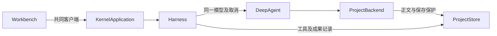

# 调查依据

## 当前事实与复用选择

- `apps/kernel/src/harness/runtime.ts` 使用 deepagents 1.15.0／LangGraph 1.5.0，已持久化工具回执、取消信号及文件产物。`ModelAccess.create` 形成每次推进的 32 请求额度，共享同一模型实例即可沿用额度与应用并发限制。
- `ProjectBackend` 已承担授权、整份文件依据、冲突保护和保存回调；复用它，不另建能力文件工具。`ProjectStore` 的 meta 是现有 JSON 事实存储，可逐尝试保存独立键，通过 SQL 范围与分页查询，无需变更数据库结构；数据库备份自然包含这些记录。
- `packages/protocol/src/business.ts` 的 Schema 为 DTO 事实源；内核 application 分发及客户端泛型调用已支持新增 RPC。工作台现有工具详情与成果打开可展示能力输入、结果和产物，不增加 UI 状态来源。
- 已完整读取正式 `agent-harness`、`project-files` 规格；初设 R-03/R-04 仅此次 P3d 子集转为正式规格。#18/#25 明确允许方法执行绑定及运行时自动核验，不需手动 start/finish 登记工具；不因调用创建任务。
- 旧 `../zotero-agents` 来源提交 `f47a04849a26aec63a2ff08bcbce5ef7bf63caba`，许可 AGPL-3.0，与本项目 AGPL-3.0-only 可共同保留来源。静态核对 `skills_builtin/literature-analysis/SKILL.md` 及 `references/digest_generation.md`：来源支撑、问题/方法/结果/限制的分析职责可吸纳，Python 阶段机、固定 Digest slots 和宿主耦合不迁入本步。首次材料分析方法按此重新组织；完整 Digest 契约留给 P4c。ResearchSpec 的 CC BY-NC 内容不引入。

以上是源码静态核对，尚不构成本变更运行证据。

## 影响方案的未知项与实验

共同能力可通过无 checkpoint 的短寿命 LangGraph 执行绑定复用同一模型与 backend；调用及尝试由科研模块独立持久化，父 harness 仍唯一管理会话与取消。SDK 嵌套事件及工具回调接线由实际受控模型测试验证，不能以类型通过替代。

内置能力声明采用 JSON 形式的 YAML（YAML 1.2 子集），由现有 Schema 校验，避免本步新增解析依赖。首轮只接受这一内置声明格式；用户/项目 YAML 加载器随 P5a 实现，不承诺任意 YAML 支持。

## 结论与承接

无改变方案的未决项。按已授权范围实施：通用执行绑定先跑材料分析，后续文献能力复用；权限、失败、产物核验、重试、取消及重启由模块与整合测试承接。真实科研充分性与三平台成品不在此次受控接线验证中声称通过。
