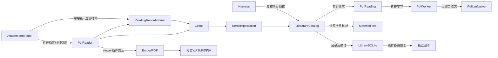
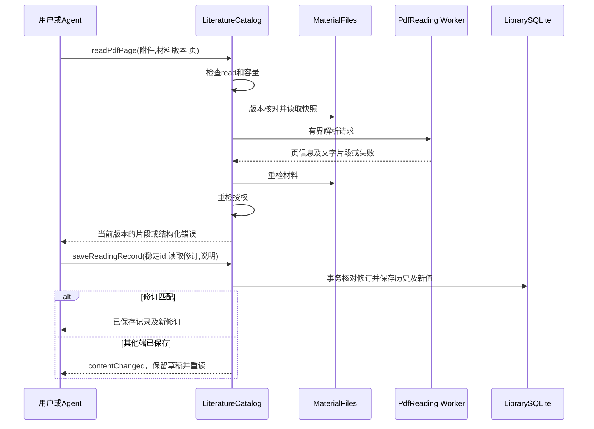

# 实现设计

## 变更总览

## 方案与接口

### 复用与职责

依据 investigation，`LiteratureCatalog` 是唯一共同入口，继续负责授权、材料归属、记录与修订事务、变更及备份。新增 `PdfReading` deep module 隐藏 Worker、SDK、任务失败和生命周期；它只接收经材料核对的字节及有界请求，不接收客户端绝对路径。不将 PDF 解析塞入 `ProjectFiles`、模型实现或工作台业务状态。

`PdfReader.tsx` 只负责 SDK 呈现、当前选区及记录编辑；SDK 是 adapter，不是批注持久权威。用官方完整 React viewer，直接包固定 `2.15.1`，具体清单见 `artifacts/pdf-reading-dependencies.md`。启用读取、搜索、选区和高亮，关闭本轮未支持的印章、签名、涂黑、表单编辑、任意文件打开及导出写回操作，避免界面产生无法保存的成果。PDF 原有批注保留为材料中的既有内容，不将其自动伪装为本轮创建记录。书签和文献笔记沿共同记录面板保存。

共同记录面板由 `ReadingRecordsPanel.tsx` 承接，亦可从附件详情明确展开，每次只挂载一个所选附件的记录面板。这样无阅读窗口或原材料失效时仍可读取摘录与编辑说明；独立笔记创建也使用相同 catalog interface。SDK 授权等待期间先验收此路径，不提前开放尚未完成几何核对的高亮／书签创建。

### 共享契约

`packages/protocol/src/business.ts` 继续作为 DTO／Schema 唯一事实源，新增：

- `PdfInfo`：attachmentId、materialVersionId、pageCount；仅当前请求所需信息，不返回全书文本或全页几何。
- `PdfPageText`：相同材料引用、pageIndex、width／height、offset、text、可选 nextOffset、hasText。每次只读取一页，文字默认16Ki字符、上限32Ki字符，单页可续取。页索引从0开始；无文字层成功返回 hasText=false，解析失败使用已有结构化错误。
- `ReadingRecord`：id、sourceId、attachmentId、materialVersionId、kind（bookmark/highlight/note）、可选 location、quote、body、createdBy、updatedBy、createdAt、updatedAt、revision。location 为 pageIndex 及最多128个有限矩形，采用材料自带旋转后的页点单位、左上原点坐标，与 readPdfPage 的 width／height 一致；SDK adapter 用公开 rotateRect／restoreRect 转换其未旋转的选区与批注，不把 CSS 像素持久化。highlight 要求非空摘录与区域；bookmark 要求页位置；note 可不带位置。quote／body 各最多16Ki字符，整条编码后最多64KiB。
- 作者是 `user` 或 `agent`，Agent 记录附当前 sessionId；创建者、来源及材料版本一旦保存不可由更正改变。工具上下文和可信 GUI 入口注入作者，不把任意作者字段暴露给模型参数。
- `library.pdfInfo`（attachmentId、materialVersionId）；`library.readPdfPage`（同一引用、pageIndex、offset／limit）；解析上限复用128MiB附件上限，拒绝非 PDF 或加密材料并返回可诊断原因，不新增密码凭据流程。
- `library.readingRecords`（attachmentId、materialVersionId、offset／limit）默认25、最多100条，另有512KiB响应预算；按稳定身份分页，仅查当前材料。
- `library.readingRecord`（recordId）精确核查保存结果；`library.readingHistory`（recordId、分页）查询旧修订。
- `library.saveReadingRecord`：recordId、材料引用、kind、location／quote／body、可选 expectedRevision。新建无 expectedRevision；更正必须给匹配 revision。事务内核对权限、材料归属和修订；创建原输入另存，重复创建相同输入返回当前记录，不用旧创建输入覆盖后续更正。
- `library.removeReadingRecord`：recordId、expectedRevision；明确移除记录并保留其历史，不删除材料。记录身份不复用，旧更正不能复活已移除记录；精确读取区分已移除与不存在。

现有 schema 参数校验和响应校验均扩展；client 将新读取方法列入只读失败分类；application 与 harness 都进入同一 catalog interface。GUI／Agent 创建入口分别绑定可信作者，避免模型冒充用户。全部 Agent 库工具沿既有 library-context 标记，在异步返回及后续模型请求／重试时重查 read/send；保存另查 write。

### 取文执行和材料保护

先在 catalog 检查附件及要求的材料版本，然后通过 `MaterialFiles` 当前版本核对读取构造有界材料快照，异步分段取用，向 Worker 转移 ArrayBuffer，避免额外复制。获取执行容量前不读取全材料。首版同时只运行一个解析 Worker，等待队列最多8项，单请求自受理起最多30秒；满额明确 unavailable，超时终止该 Worker，后续请求可继续。内核停止拒绝新请求、终止本轮 Worker并拒绝等待者，不遗留 interval／句柄。

Worker 使用 `init({wasmBinary})` + `PdfiumNative`，只调用公开文档／按页文本 interface；不需要 sharp 或 canvas。每个请求结束在 finally 关闭文档和 engine，异常由 module 规范化为既有错误码，不回传路径或内部内存对象。输入体积、输出文字和队列都有界；WASM 自身内存另受运行时约束，不能将 Worker 的 JS heap 限制宣称为整个 WASM 的硬内存配额。

返回前重检材料版本及 read（Agent 另重检 send），发生内容变化不交付旧快照为当前材料。文本缓存暂不新增，避免撤权／外链变化下维护第二套有效性政策。无文字层如实返回空结果，不接 OCR。诊断通过调用错误码、Worker 失败原因和当前材料状态提供，不新建监控系统。

### 记录持久化与并发

新增 Drizzle 记录及历史表，按 attachmentId/materialVersionId/id 建索引；保存与旧修订写入、revision提升、库 changed 在同一串行事务中完成。并发失败返回 contentChanged。新增及更正核对实际附件版本、位置合法范围和非空高亮，不要求原材料失效后才能读取已有记录；失效时允许修改旧记录说明，但不可新设或改变其位置／摘录，避免伪称核对了无法取得的原文。原摘录与材料引用不会因说明更正丢失。

SQLite v2 升至 v3，迁移前沿既有机制备份数据库；新表和迁移保持同一 Drizzle 事实源，不增加第二套迁移器。既有库授权本已覆盖附件取用、共同库数据写入与材料外发，不新增任意路径或文件覆盖权限。现有数据库备份天然包含新表，独立恢复保留记录／材料身份，副本关闭 write/send；新增测试实际核对，不只假定机制兼容。

### viewer 接入与同步

从附件详情的“打开 PDF”以 attachmentId/materialVersionId 创建 tab，名称来自附件，保留会话。初次打开按原字节通道有界分段取得单份材料，再用 Blob URL 交给 viewer；取消或切换对象丢弃旧请求结果，卸载撤销 URL、取消订阅并销毁 viewer。SDK 资源通过 Vite 本地资源 URL 和 Node 包导出解析，后备字体配置覆盖默认 CDN，UI 字体设为 null 并继承现有 token。

viewer 当前选区只在该阅读实例处理，不监听全库 DOM。SDK 的文字和页坐标（含材料自带旋转）按页映射到共同记录草稿，多页选区逐页选择保存；只有 catalog 回执确认后呈现已保存。使用同一记录面板明确创建、更正及移除，SDK annotation 锁定为已保存成果的呈现，避免保留第二套未提交编辑状态；投影只导入／移除本应用记录的 annotation，不触发保存，也不清除 PDF 原有批注。失败及未知回执复用共同草稿与稳定身份核查，不让 SDK 内存状态冒充成功。外部库变化只重读当前材料记录的当前列表页，不覆盖未保存编辑；投影处理这组有界记录，不整库加载。单条提交使用原修订，不整体替换持久 annotation 数组。

本轮共享高亮类型只保留标准颜色与区域；body 在记录编辑区保存。原文摘录、用户说明和 Agent 解释分别显示。记录草稿按库、材料、记录身份沿既有 draftKey／本地存储模式保存；保存期间继续编辑时保留后续文本。阅读器状态独立于当前会话，库通知不重建 viewer；切换项目会话时，项目布局缓存只收纳非材料 tab，共同 PDF 沿原 group.id 保持挂载。SDK web component 断开时负责 registry／engine 销毁，adapter 仅清理订阅与自有 BlobURL。主题通过语义 token 映射 SDK theme，不在 Scholoom 组件写具体颜色／字号。

## 文件变化

- 修改 `packages/protocol/src/business.ts` 及必要导出：数据和调用 schema；`packages/client/src/index.ts`：只读分类。
- 新增 `apps/kernel/src/literature/pdf-reading.ts`、`pdf-worker.ts`：受管解析；扩展 `material-files.ts` 的已核对快照读取，保持原分段读取兼容。
- 修改 `literature/catalog.ts`、`storage/library-schema.ts` 和新增 Drizzle migration：共同记录、历史、SDK调用及关闭；`application.ts`、`harness/runtime.ts`：GUI／Agent接线及可信作者。
- 新增 `workbench/PdfReader.tsx`、局部 SDK adapter 及 `ReadingRecordsPanel.tsx`；修改 `AttachmentsPanel.tsx`、`LibraryPanel.tsx`、`Workbench.tsx`、shell tab类型：打开实际材料；必要扩展 `session.ts`，保持 reader 与会话独立。
- 修改 `styles.css`、`docs/ui-design/README.md`（先补阅读器交互设计再改 UI）：token映射、现有tab内阅读及记录面板。
- 修改两应用 `package.json`、`pnpm-workspace.yaml`、`pnpm-lock.yaml`，以及必要 Vite／构建资源入口和第三方许可声明；只有依赖授权后执行。
- 新增合成 PDF fixture 及阅读 module／RPC／双宿主测试，复用现有 fixture；更新 `docs/{development,architecture,implementation-roadmap}.md`、`docs/initial-spec/literature.md` 对应已正式化的PDF契约，保留后续 EPUB／网页初设。

## 验证与风险

依既有 TDD 约定先用明确预期建立稳定行为检查。合成两页 PDF 使用独立文字、不同页面尺寸及旋转页；分别核对页码、文字片段和区域回显，不能只以 adapter 自己的转换结果作为预期。补无文字层、损坏／加密、越界和超时／停止代表性边界，不对错误全文或SDK内部DOM做大快照。

共同 module 验收记录创建／幂等、Agent作者、陈旧修订冲突、旧修订、材料失效／新版隔离、重启、撤权和备份副本。真实 RPC／受控模型夹具证明无窗口读取与记录操作确实经过工具；不运行真实供应商，不把合成结果当科研充分性。

双宿主从库附件入口打开、搜索、选择及保存，再核对内核记录、重启读回和原始字节；验证会话／说明草稿不丢失、关闭tab释放资源。截获网络确认无需外部字体／CDN，实际查看截图。最小相关测试后执行 lint、typecheck、build、kernel、smoke 和受影响 UI；许可资源与原字节保护、并发和授权安排独立审查。发布前另验三平台实际包，不以本机双宿主代替。

## 待办边界

EPUB／网页沿 P4b 下一变更按 #12 Q14 成组吸纳 Zotero DOM 阅读模块。OCR、跨版本定位迁移、PDF 编辑／签名／涂黑或写回副本、全部批注类型不进入本轮；后续有已确认产品需求时按共同材料保护契约扩展。v2 维护窗口无公开承诺，后续版本升级需独立兼容验证。
