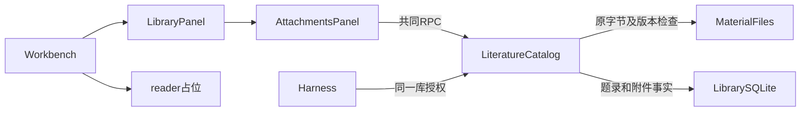

# 调查依据

## 当前事实与复用选择

- 基线提交 `516378a`：`LiteratureCatalog` 已管理稳定附件及材料版本、库 read/write/send、范围变更与 SQLite 备份；`MaterialFiles` 已按段核对原字节。复用这两个 module，不增加任意路径读取入口。相关现有测试是 `tests/kernel/literature-{catalog,attachments,integration,attachment-integration}.spec.ts` 与 `tests/ui/{library,attachments}.spec.ts`。
- `Workbench.tsx` 的 reader tab 尚无实际内容；附件详情已在 `AttachmentsPanel.tsx`。复用 tab、共同 client、主题 token 和既有草稿保存路径；Worker 生命周期参照现有 Markdown worker，但 PDF 使用自己的有界调度，避免解析 PDF 阻塞消息预览。
- 正式 `literature-attachments` 已覆盖版本核对、同内容重定位和原文件保护；正式 `literature-catalog` 已覆盖备份与副本恢复。共享阅读成果尚无正式规格。初设 L-03/L-04 及 PRD 是新增契约依据。
- #12 Answer Q7 明确首选 EmbedPDF v2，PDF.js 是备选；Q14 将 Zotero reader DOM 视图用于后续 EPUB／网页。`references/Zotero` 没有可直接构建的 reader 源码；早期 PDF 原型依赖临时 PDF.js 和私有 DOM 操作，不能作为生产实现。

以上关系已按当前源码核对；图不表示 PDF 阅读或共享批注已实现。

## 上游依据

2026-10-16 只读核对 npm 发布包及官方 v2 源码：

- [`@embedpdf/react-pdf-viewer@2.15.1`](https://registry.npmjs.org/@embedpdf/react-pdf-viewer/2.15.1) 导出 React `PDFViewer`、`onReady(registry)`，依赖同版 snippet。snippet 带完整成熟工具栏、插件及 Preact；不为减少包数重新实现阅读器。
- [`@embedpdf/engines@2.15.1`](https://registry.npmjs.org/@embedpdf/engines/2.15.1) 的 `/pdfium` 导出 `PdfiumNative`，公开按页文本、文本区域、文档打开／关闭 interface。`@embedpdf/pdfium@2.15.1` 导出 `init` 及 `pdfium.wasm`，无原生编译或安装脚本。Node 纯文本不需要图像编码库。
- [`v2` 源码](https://github.com/embedpdf/embed-pdf-viewer/tree/v2) 与 tag `v2.15.1`（`dfb2df818065c704a0241beb0791e2fd0d55a10e`）为选用路线。默认分支的 v3 为预发布，不使用其包名或许可说明代替 v2 发布产物。
- v2 发布包声明 MIT；运行时 PDFium fork 声明 Apache-2.0，字体包声明 OFL-1.1。安装后核对实际包内 notice，随产品保留必要文本。
- `fontFallback` 默认 jsDelivr，UI 字体默认 Google Fonts；必须配置本地资源和禁用外部 UI 字体。WASM 用打包资源，不能让默认 CDN 成为离线阅读依赖。
- annotation 插件可导出／导入记录并通知 create/update/delete；engine 的直接写入不会同步 viewer 状态。共同库必须接收逐条变更并由保存结果投影回插件，不能用整页／整文档快照覆盖另一客户端更改。印章、签名、涂黑和表单写回不属于首条共享阅读路径。
- 多个 v2 包为所有框架声明非 optional peers，即使只使用 React／Node 入口也可能自动安装 Vue、Svelte。依赖方案显式关闭 peer 自动安装；React 使用已有版本，Preact 由 snippet 的正常运行依赖满足；PDF 插件 peers 由 snippet 完整依赖满足。安装后验证锁文件和构建，不以忽略缺失掩盖实际导入。

## 有限实验

问题：选定的 PDFium WASM 能否在没有 DOM 或阅读窗口的 Node 中读取真实 PDF 字节？

输入为自行生成的一页标准 PDF 1.4（Helvetica），独立预期字符串 `Scholoom PDF evidence 42`。边界仅在 `/tmp` 下载及解包官方产物、运行 Node v24.12.0；未安装项目依赖或改写源码。判据是页数为1、文字与独立预期完全一致，达成即停止。

结果：`init({wasmBinary})` 成功；通过返回值的 `pdfium.wasmExports` 分配内存，`FPDF_LoadMemDocument`、`FPDFText_LoadPage` 和 `FPDFText_GetText` 成功返回预期。`typeof window === 'undefined'`。资源随后关闭／释放。原探针误用顶层 `wasmExports` 失败，依据发布类型修正后通过；失败不算读取证据。

实际证据 `/tmp/scholoom-pdf-engine-probe.json`；可复核调用与结果摘要保存于 `artifacts/pdf-reading-dependencies.md`。这只证明选定底座可独立取文，不代表高层 adapter、Worker、中文字体、坐标、UI 或双宿主已通过。

## 结论与承接

沿既定 EmbedPDF v2 形成方案，无需更换 PDF 底座。新增依赖清单已由用户批准并执行，见 artifacts。高层 SDK adapter、旋转页坐标、离线网络请求、资源打包与双宿主真实接线由对应实施任务验收，实际结果见 delivery；扫描件没有文本应如实返回空正文，不增设 OCR。实际发布的 LICENSE.pdfium 同时包含 PDFium 的 BSD 文本和 Apache-2.0，构建保留原文件。

架构文档当前基线遗漏 P3d／P4a，且会话工作台链接仍指向活动目录；更新当前基线及归档链接，不重复维护进度清单。
