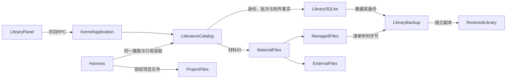
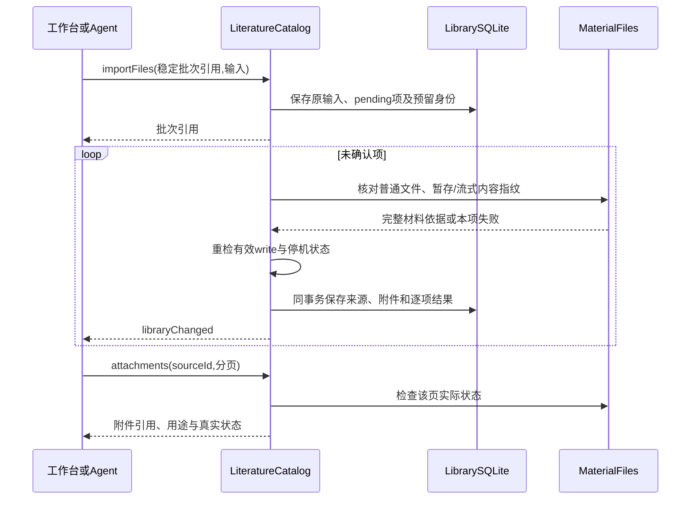

# 实现设计

## 变更总览

## 方案与接口

沿 investigation 的已核对事实，`LiteratureCatalog` 仍是 GUI、Agent 与测试的共同 interface，统一附件归属、源条目、批次及授权。新增内部深模块 `MaterialFiles`，隐藏安全打开、流式复制、材料指纹、分页对象状态、分段读取与同内容重定位；不放宽 `ProjectFiles` 的项目根限制。复用现有批次表、逐项回执、调度及 libraryChanged，不另写附件任务系统。

### 共享数据和调用

`packages/protocol/src/business.ts` 是 DTO/Schema 唯一事实源：

- `LibraryAttachment`：id、sourceId、materialVersionId、name、purpose、storage（managed/linked）、byteLength、createdAt、state（available/missing/changed/unavailable）及可选结构化 error。实际路径、内容指纹与文件状态依据仅在库内记录，不能作为调用方绕过引用读取的入口。
- `LibrarySource.attachmentState` 区分 unavailable/recorded，recorded 只表示已登记，由附件表投影；实际可读性在附件有界查询及读取时检查。文件名创建的候选用 metadataOrigin=filename 标明，现有及明确提供题录为 provided；不假定文件名就是已核对论文题名。
- `LibraryBatch` 增加 kind=metadata/files；`LibraryEntry` 可携带 attachmentId。库内 request 为判别联合，v1 题录批次迁移补 kind；题录请求的原输入/idempotency 语义保留。
- `library.importFiles`：batchId、paths（1–100个绝对路径）、可选 sourceId、purpose、storage（默认managed）、version（新建来源使用，未知填unspecified）、origin、可选集合。每项预留附件/材料版本和必要来源身份，不能从路径生成身份。
- `library.attachments`：sourceId + offset/limit，默认25/最多100；只检查该页对象。`library.readAttachment`：attachmentId + offset/limit，默认64KiB/最多256KiB，返回材料引用、总长度、offset、base64原字节及下一位置，不表示已解析正文。`library.relocateAttachment`：attachmentId、明确新路径，核对同一材料后更新外链位置。
- `LibraryBackup.scope` 支持 catalog-database / catalog-and-managed-files，可选 exclusions 清单列出附件引用与未包含原因，旧备份如实保留原范围。

可信客户端直接提交明确路径。另提供共同 `library.importProjectFiles`，输入为 projectId 和 projectPaths 及相同批次选项，由当前项目授权入口解析普通文件；Agent 工具只接受 projectPaths，由 harness 注入当前 projectId。原项目与项目相对路径保存在批次原输入中，不仅保存首次解析出的绝对路径。Catalog 接受项目访问 resolver 依赖，每项准备及异步发布前重新检查项目 read 和有效根内位置，重启接续仍用同一授权上下文。Agent 不获得原始 importFiles/relocate 的任意路径参数。全部库工具复用现有 library-context 持久标记及每次模型请求/重试的库 read/send 检查，另需有效项目 send。await 读取完成到返回模型前再检查读取/外发，避免期间撤权后仍发内容。

### 文件归属与版本

单文件上限128MiB；用标准库异步流处理，不整份读入内核内存。不移动、覆盖或删除输入。拒绝目录、符号链接终点及特殊文件；明确路径规范化后打开并检查真实普通文件，文件句柄前后状态不一致则不发布结果。

托管文件保存至库私有 `materials/<attachmentId>`，暂存使用同项拥有的文件名，成功完整写入后发布，不覆盖已有目标。外链只记录实际位置。每项记录材料内容指纹，用于确认版本；列表仅 stat 当前页。实际分段读取首次核对完整内容，后续使用文件身份/大小/mtime/ctime 相同的有界核对缓存（最多128项），文件变化使缓存失效；每段读取前后核对打开句柄，防止返回混合版本。外部写入不能被应用锁住，核对后再变化的竞态沿既有文件政策如实说明。

同一来源、用途、方式及相同内容可复用附件，保持原材料身份；不同方式不悄悄改变管理归属。人工重定位只面向外链，同内容恢复位置，不同内容返回 contentChanged，保留旧关联。新内容通过新附件进入，不替换旧材料。

### 逐项摄取与恢复

共同 batch kind 分派到题录同步摄取或异步文件准备。受理时保存原输入与每项预留身份；文件复制在 SQLite 事务外，最终发布前重检 write，随后来源、附件及逐项结果同事务提交。IO失败只影响本项；撤权或停机使批次 interrupted，未确认项保持 pending。来源及附件归属在提交事务中重查，唯一约束处理同来源的并发重复，不在异步 IO 期间持有数据库事务。

重启不自动接续。完整材料在发布前写入本项的持久完成依据（内容指纹和长度）；显式 resume 对完整暂存及已发布文件都核对该依据，不重新用变化后的原输入定义预留材料版本。普通发布 IO 错误也保留完整暂存，只有没有完成依据的部分复制可重新准备。只有已确认记录对外可见；待核查项保留批次、预留身份及原路径以便诊断。多余的本项临时文件只在能够确认归属和没有已保存引用时清理。

### 迁移与备份

Drizzle 新增 attachments 表和 sourceId 索引、同来源/用途/方式/内容唯一约束；库 user_version 升为2。已有 v1 库迁移前保留数据库备份，补齐 kind/metadataOrigin 并在同一迁移事务中关闭旧 write/send，再更新版本号，保留 read/autoBackup，由用户重新确认扩大的文件管理及材料外发能力。授权文案使用“发送文献材料到模型”，包含题录及附件原字节。损坏或不兼容时沿现有停止写入及保留现场路径。

备份先由 SQLite backup 取得快照，再从该副本的附件引用分页复制托管文件。托管文件通过本服务保持不可变，库快照与材料引用一致；IO缺失或外部修改列为 exclusions，不承诺外部编辑器下全局瞬时一致。外链不自动复制，清单明确 externalDependency。自动备份仍沿持久 lastBackupRevision。

恢复复制快照及其中托管文件到新独立配置目录，打开副本后先设置新库身份/关闭写入及外发，再复制材料；旧 catalog-database 备份仍可恢复。托管位置始终按当前库目录和附件身份计算，不信快照中的原库绝对路径，因此中途失败的副本也不会回读原库。缺项保留在清单并在附件状态中可查，不编造完整材料。当前库、外部文件及备份后新增成果保留。

## 文件变化

- protocol business Schema/types、client 只读调用分类；kernel application 和 harness 新调用/项目路径适配。
- 新增 `apps/kernel/src/literature/material-files.ts`；扩展 `catalog.ts` 的共同批次、附件查询/读取/定位与备份，保持 metadata 路径不重复。
- `storage/library-schema.ts`、`library-migrations/` 新表与迁移，复用已有 Drizzle 配置和构建复制。
- 新增 `workbench/AttachmentsPanel.tsx`，接入现有 LibraryPanel 的全库摄取及所选来源附件区；沿已有类/token，界面设计先更新。来源行展示有附件登记，实际状态从详情读取。
- 复用/扩展 kernel 文献测试、真实 RPC/模型夹具和双宿主文献测试；更新开发说明、路线图、初设已转正式契约部分及必要 AGENTS 约束。正式规格只在交付后同步。

## 验证与风险

测试 seam 为已有 LiteratureCatalog、真实共同 RPC/Agent 及工作台用户入口，符合项目既定验证政策，不测试私有结构。按垂直行为推进：托管字节与多附件 → 外链失效/内容不同/重定位 → 批次与撤权 → 备份/迁移 → 真实接线。现有题录测试继续运行。

合成样本使用带已知字节的文本/二进制，缺失路径和同名不同内容；核对片段拼接为独立已知输入，托管后移走输入、外链移动、并发添加、暂停/进程终止与显式继续、迁移旧库和独立副本中实际字节。双宿主从现有入口操作并检查相同 RPC 事实及原会话草稿；下载附件只在用户动作后逐段读取并生成有界 Blob，不自动在浏览时加载全文。PDF/EPUB/网页解析、真实供应商和科研效果不在本轮证据中。

权限、文件归属、异步发布/数据库提交窗口、内容核对缓存及备份恢复安排独立审查。若实跑暴露此方案的假设不成立，先更新此设计及对应规格，再调整实现；不通过扩大特殊分支绕过数据保护。

## 待办边界

原生文件选择器和网络上传不是本机路径入口的必要接线；后续体验增强可复用此模块。格式解析/阅读沿 P4b，分析沿 P4c，删除/合并/回收站沿 P4d；本 change 不删除旧附件或重新绑定旧证据。
