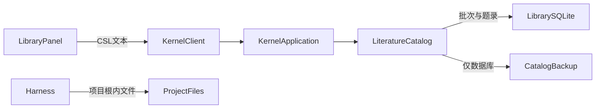

# 调查依据

## 当前事实与复用选择

- 当前基线 `3214544` 已交付题录库。`LiteratureCatalog` 的摄取队列、批次/逐项事务、授权、恢复及 `libraryChanged` 可直接扩展，`active` 管理批次执行，不是文件锁。现有 `tests/kernel/literature-catalog.spec.ts` 5 项及整合 2 项均实跑通过，见前一变更交付记录。
- `library-schema.ts` 无附件表；库 `user_version=1`，迁移使用 Drizzle 与构建复制。`LibrarySource.attachmentState` 固定为 unavailable，`LibraryBackup.scope` 固定为 catalog-database；必须扩展共享 Schema 和实际投影。
- `ProjectFiles` 的引用与权限属于项目，`ProjectStore.path()` 限制项目根及内部目录；不能将库外链放入该表或放宽现有项目授权。Agent 摄取从这个安全入口解析项目文件，随后进入共同库摄取模块；可信客户端才接受明确本机路径。
- 工作台与 preload 没有原生本机选文件接口。CSL JSON 的 File API 只读取内容，不提供路径。首轮附件沿已有项目目录输入方式明确输入本机路径，两个宿主调用同一接口，无需新增宿主桥或大文件上传协议。
- #13/#32 及 PRD 明确默认托管、支持外链/人工重定位、多附件用途和缺项诊断；#44 明确文件移动后的路径重指定可做，但不把新内容当成旧版本。D-01 要求材料版本与路径分开；D-06 要求备份范围、缺项和独立恢复。
- Node 标准库流式读取/复制、crypto 内容指纹、现有 `privateDirectory` 和 SQLite backup 足以实现。本次指纹只用于材料版本核对及重定位，避免同名新文件冒充旧材料，不做普通题录或所有 UI 刷新的额外 hash 检查。既有旧宿主代码耦合和原型限制沿前一题录库调查，不复制宿主文件层或增加依赖。

上述附件缺口为当前代码静态核对；前一题录闭环的实跑不等于附件已验证。

## 影响方案的未知项与实验

无需原型才能决定的未知项。采用库内独立附件表及材料版本身份，共用现有批次协调；物理文件处理作为内部深模块，GUI/RPC/Agent 仍跨同一 `LiteratureCatalog` interface。本机路径输入的宿主限制、外链不复制与托管备份均在本变更直接验证。

附件操作有界：批次最多100文件、单文件128MiB、读取每段最多256KiB、列表默认25/最多100。列表只核对该页文件状态，不读取所有文件或逐次计算内容指纹；按引用实际读取与人工重定位时核对材料内容。格式解析、内容语义和真实科研效果由 P4b/P4c 承接。

## 结论与承接

新增附件事实及物理文件模块，扩展已有摄取队列、共同协议、备份和工作台。内容不同不迁移旧身份，新的材料显式另行添加；本轮不实现替换或删除。单项文件暂存与持久回执的崩溃窗口、权限变化、外链失效、旧库迁移、备份字节与双宿主入口是后续测试和独立审查重点，不预填通过结论。
