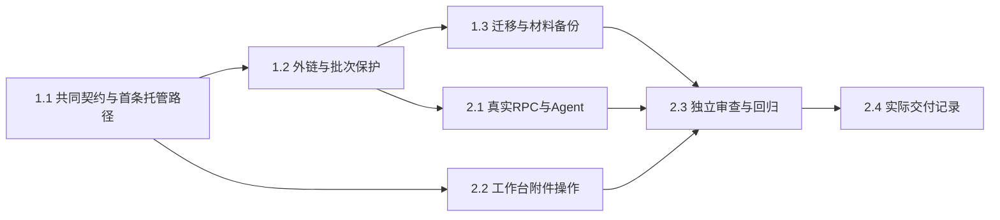

# 执行任务

## 1. 共同附件模块

- [x] 1.1 主 Agent 统筹 Schema/DTO、库 v2 迁移和共同批次分派，扩展 LiteratureCatalog 与内部 MaterialFiles；从已知字节文件托管入库、关联既有或文件名候选题录、按引用分段读回的首条路径通过公共 interface 测试，源文件保留。
- [x] 1.2 实现多附件用途、同内容复用、当前页状态、外链失效/不同内容/同材料人工重定位；批次逐项失败、撤权、进程中断及显式接续保留已确认身份。复用既有文献测试并验证来源/附件/逐项事务一致性及文件发布窗口。
- [x] 1.3 实现 v1 库迁移前副本与写授权重确认，数据库快照所引用托管材料的备份、外链/缺失清单及独立恢复；测试实际字节、旧题录备份兼容及当前库和后续成果保护。

## 2. 接线与交付

- [x] 2.1 共同 RPC、客户端重试分类及 Agent 项目文件摄取/引用读取接同一模块；真实客户端和受控模型验证路径权限、项目/库撤权（含异步准备和重启接续）及有界结果，无任意路径 Agent 入口。
- [x] 2.2 UI 设计先补附件约定，再在同一 library tab 接入批次路径、托管/外链和用途、附件分页、下载及人工重定位；真实双宿主验证部分失败、外链移动/内容冲突和会话草稿。协议稳定后可委派 implementer 仅负责 AttachmentsPanel.tsx 与限定 LibraryPanel 接点及对应 UI 用例，主线程保留共享接口、核心文件/数据库安全与最终验收。
- [x] 2.3 独立审查权限、文件归属、材料版本缓存、发布/提交窗口、迁移和备份恢复；修复后运行按影响选择的 lint/typecheck/build、内核/双宿主/smoke 回归，更新开发说明、初设、路线图和必要项目约束。
- [x] 2.4 取当前 delivery instructions，根据实跑记录完成 delivery.md，核对本变更完成判据、模拟边界及 P4b 接续范围后完成本项。

## 续做入口

从 1.1 的共享 Schema 和首条公共 interface 行为开始。正式规格在交付后同步；规划不创建 delivery。
