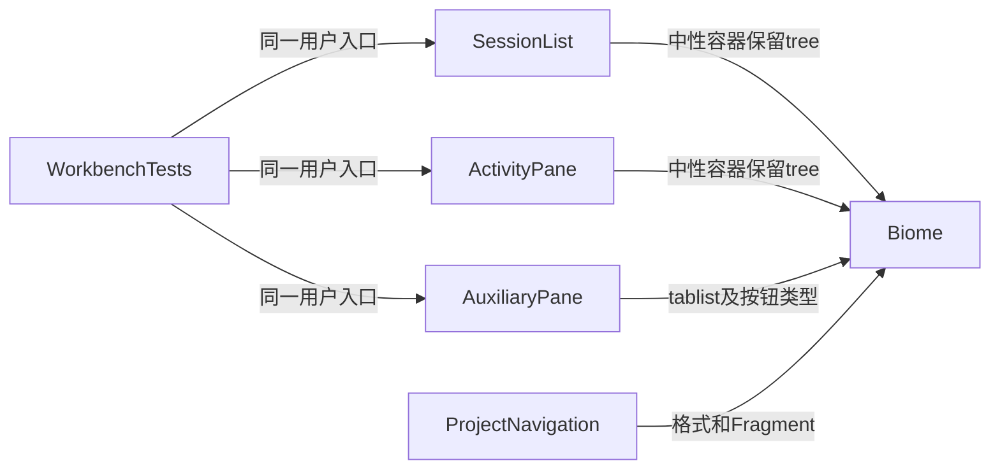

# 实现设计

## 变更总览

## 方案与接口

只修正文法和元素承载方式，沿既有 role、样式类及会话来源，不增加状态来源或模块。没有领域/协议/存储变化，skip_specs。Biome 的 stdin 输出先生成补丁，再经内置 apply_patch 应用。

## 文件变化

- `SessionList.tsx`、`shell/ActivityPane.tsx`：tree 容器改用 div，保留 role/class/子项；整理格式/import。
- `shell/AuxiliaryPane.tsx`：tablist 容器改用 div，三个 tab 按钮显式 type=button，整理 import。
- `ProjectNavigation.tsx`：简化单一 permission Fragment，按现有 Biome 格式化。
- 既有 artifacts 基线记录标记处理结果并引用 delivery，避免保留过时阻塞。
- `tests/ui/workbench.spec.ts`：实际双宿主验证发现右区已有可访问名从“文件与任务”变为“辅助面板”，同步单条既有折叠断言，保留其余断言和动作。

## 验证与风险

全仓 `pnpm lint`、`pnpm typecheck`、`pnpm build`；双宿主复用 conversation 与工作台折叠/展开/tab 拆分的既有回归，不新增测试。容器角色保持，class 样式不变；核对没有依赖 nav 标签的调用或 CSS。没有数据迁移、执行或第三方依赖风险。
