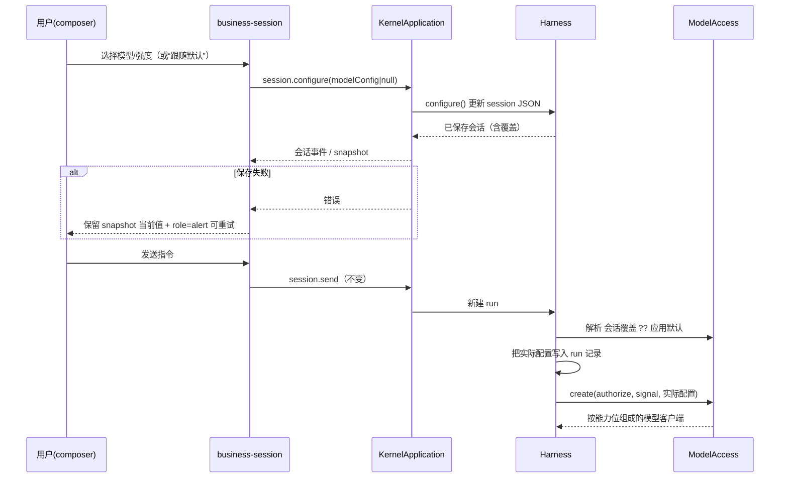

# 实现设计

## 变更总览

```mermaid
flowchart LR
  subgraph UI[Workbench]
    MENU[shell/menu.tsx<br>共享菜单/确认/右键原语]
    DLG[shell/dialog.tsx<br>居中弹窗原语]
    SL[SessionList.tsx<br>项目一级·会话二级·滚动加载]
    SS2[SessionSearch.tsx<br>查找会话弹窗]
    PO[ProjectOnboarding.tsx<br>添加项目弹窗]
    PN[ProjectNavigation.tsx<br>设置页归档管理]
    IC[InstructionComposer.tsx<br>模型/强度选择·紧凑配置行]
    SS[session.ts / business-session.tsx<br>executionContext 派生与接线]
  end
  subgraph ELEC[Electron 宿主]
    PICK[main/preload<br>pickDirectory 窄桥]
  end
  subgraph PROTO[packages/protocol]
    SCH[business.ts<br>schema 唯一事实源]
  end
  subgraph KERNEL[apps/kernel]
    KA[KernelApplication<br>snapshot + RPC]
    MC[models/config-store.ts<br>目录 + 默认配置原子持久化]
    MX[models/minimax.ts<br>ModelAccess.create 按能力组请求]
    HAR[harness/runtime.ts<br>configure / run 钉入配置 / 跨项目搜索]
    DB[projects/directory-browser.ts<br>目录浏览]
  end
  MENU --> SL
  DLG --> SS2
  DLG --> PO
  MENU --> PN
  SL --> SS
  PN --> SS
  SS --> IC
  SS2 -->|session.search| SCH
  PO -->|project.browseDirectories| SCH
  PO --> PICK
  SS -->|provider.setDefaults / session.configure| SCH
  KA -->|snapshot.provider| SCH
  KA --> MC
  KA --> HAR
  KA --> DB
  MC --> MX
  HAR -->|create(authorize, signal, config)| MX
  SCH --> KA
```

## 方案与接口

### 协议（唯一事实源，`packages/protocol/src/business.ts`）

- 新增 `effortSchema = ['low','medium','high','xhigh','max']`。
- 新增 `modelOptionSchema`：`{ id, supportsEffort }`；新增 `modelPreferenceSchema`：`{ model?, effort? }`，`null` 表示清除会话覆盖。
- `providerSchema`：`id` 保持固定，新增当前默认 `model`、`defaultEffort`、`models: ModelOption[]`、`efforts: Effort[]`，保留凭据状态字段；`model` 不再是 const。
- `sessionSchema` 增加可选 `modelConfig: modelPreferenceSchema`；`runSchema` 增加可选 `modelConfig: { model, effort? }`，记录该次 run 的实际配置。
- 新增 RPC：`provider.setDefaults`、`session.configure`；`session.send` 保持不变，避免把执行配置混入指令幂等键。
- 新增 `session.search`：参数为 `query` 与 `limit`，结果为按 `updatedAt` 排序的 `{ project, session }[]` 与 `truncated`；跨最近项目一次有界合并，避免 UI 端逐项目查询。
- 新增 `project.browseDirectories`：参数为可选 `path` 与 `limit`，结果包含当前真实路径、父路径、目录条目 `{ name, path }` 与 `truncated`；只列目录，不列文件。

### 内核

- 新增 `apps/kernel/src/models/config-store.ts`：默认配置的私有原子读写（`credentials/provider.json`，文件 0600、目录 0700）；缺失时返回出厂默认 `MiniMax-M3.1-Flash-Preview + medium`；损坏时报可诊断错误且不覆盖原文件。
- 模型目录放内核（`models/minimax.ts` 或同模块常量）：4 个当前模型及 `supportsEffort` 能力位；目录外模型 `invalidRequest`，不静默回退。
- `ModelAccess` 对外收窄为 `status()`、`setDefaults()`、`create(authorize, signal, config?)`；凭据读取仍由 `CredentialStore` 负责。`create` 按能力位组请求：M3.1 传 `thinking: adaptive` 与所选 effort；M3 传 adaptive thinking 但不传 effort；M2.7 系列不传 `outputConfig.effort`。并发、超时、重试与 loopback 测试约束保留现状。
- `Harness` 新增 `configure()` 更新 session JSON 的 `modelConfig`；`send()` 新建 run 时解析“会话覆盖 ?? 应用默认”并写入 run 记录；busy 追加沿用旧 run；`resume()` 沿用原 run 配置；旧 session/run 无新字段时按当前有效配置兼容读取。
- `KernelApplication`：snapshot 的 provider 改由 `ModelAccess.status()` 提供；新增 `provider.setDefaults` 与 `session.configure` 两个 RPC case；`provider.configure` 保存凭据后返回新 status（现状语义保留）。
- 新增 `apps/kernel/src/projects/directory-browser.ts`：默认从用户主目录或调用方指定路径开始；`realpath` 后要求普通目录，只列目录、排除符号链接、隐藏项与应用私有配置目录，按名称排序并限制单页数量；路径不存在或非目录时报可诊断错误，不静默回退。`KernelApplication` 接入 `project.browseDirectories`。
- `Harness` 新增跨最近项目的有界 `search()`：复用现有标题匹配语义，合并各项目活动与归档会话，按 `updatedAt` 与 id 排序，超限返回 `truncated`；空查询返回最近会话。搜索是显式动作，不订阅全库变化。

### Workbench UI

- 新增 `workbench/shell/menu.tsx`：基于现有 `<details>` 机制实现 `Menu`、`MenuItem`、`MenuFormItem`、`ConfirmAction`；迁移 `useDetailsDismiss`，补 Esc 不冒泡、外点关闭、焦点进入/归还、方向键循环，双宿主可测试。本轮在同一文件扩展受控 `ContextMenu`：固定定位到右键坐标并做视口边界收束，复用 `MenuItem`／`MenuFormItem` 与同一键盘语义，同时支持 `Shift+F10`／ContextMenu 键触发。
- 新增 `workbench/shell/dialog.tsx`：居中弹窗原语，提供 `role="dialog"`、Esc 关闭、backdrop 点击关闭、初始焦点与焦点归还；查找会话与添加项目两个弹窗共用。
- 扩展 `shell/icons.tsx`：新增 `IconSearch`、`IconFolderOpen`、`IconSidebarLeft`；项目行折叠状态分别使用关闭／打开文件夹图标，左区折叠按钮使用左侧栏图标。
- 新增 `workbench/SessionSearch.tsx`：渲染左区顶部“查找会话”按钮及弹窗，折叠轨会话入口打开同一弹窗；弹窗打开后聚焦输入框，空查询显示跨最近项目的最近会话，输入后 150ms 防抖调用 `session.search`，迟到响应不得覆盖新查询；结果行显示状态、标题、项目名、归档标识与相对时间，选择后切换到对应项目／会话并关闭弹窗，草稿仍按项目／会话键隔离保存。
- 新增 `workbench/ProjectOnboarding.tsx`：左区顶部标准尺寸的“添加项目”按钮及弹窗，内含“打开项目”与“新建项目”两种模式；打开只选择目录，项目名取目录最后一级；新建先选择父目录再输入新文件夹名称，最终调用 `project.create({ path: parent/name })`，不传显示名。Electron 调用系统 picker；浏览器用 `project.browseDirectories` 的目录浏览器，不提供手填项目路径；新文件夹名做基本非法字符校验，内核错误原地显示。
- `SessionList.tsx`：删除假的多项目分组、内联搜索框、活动／归档切换、分页按钮与底部 `AddProject`；项目节点显示当前项目显示名并挂“管理项目 …”菜单；活动会话固定查询 `archived: false`，滚动接近底部时用 `nextCursor` 追加下一页，变更通知重读当前已加载范围并按 id 去重，不改变当前会话选择；`SessionRow` 移除行尾菜单，整行 `onContextMenu` 与键盘 ContextMenu 快捷键打开同一右键菜单，重命名、归档/恢复及原地错误沿用现有 `session.rename`／`session.archive` 逻辑；归档在排队/运行/取消中禁用并显示原因。
- `ProjectNavigation.tsx`：项目操作表单迁出 `ProjectControls`；设置页保留“模型设置”（应用默认模型与默认推理强度，经 `provider.setDefaults`）与“项目权限与备份”，并新增“归档会话” section：按当前项目（含 `application` 范围）调用 `session.list { archived: true }` 滚动列出，提供“恢复会话”，成功刷新归档与活动列表，失败错误留在对应行内；文件回收确认改用共享 `ConfirmAction`。
- `ActivityPane.tsx`：标题行改为左侧 Scholoom 标题、右侧依次主题按钮（可访问名保持“切换主题”）与折叠按钮（左侧栏图标）；删除 `StopKernel` 及内核停止确认接线；底部内核状态固定单行 LED + 状态文字，实例 id、错误详情、“重试连接”“查询状态”移入 hover/focus 弹出层；样例 `ProjectNode` 与真实项目行样式对齐。
- `session.ts` / `business-session.tsx`：扩展 `executionContext`，从 snapshot 派生有效模型、effort、能力位与覆盖状态；接线 `provider.setDefaults` 与 `session.configure`；失败保留当前值并在 composer 上下文内显示 `role="alert"` 可重试错误，不做乐观更新。本轮移除 UI 层 `resume` 接线（内核 `session.resume` RPC 与 harness 逻辑保留，供协议能力继续使用）。
- `InstructionComposer.tsx`、`AgentDock.tsx`、`AgentOverlay.tsx`：激活选择器，移除 `value='medium'` 死值；归档、未连接、无会话时禁用；模型不支持 effort 时禁用推理强度并说明原因，偏好保留。本轮配置行左侧为权限与模型／推理强度聚合入口（Codex 式：overlay 显示当前值，dock 只留图标，点击后在共享 `Menu` 弹层内以两组单选设置），右侧固定取消／发送动作区，错误提示不挤压发送按钮；删除“继续执行”按钮及 `resume` prop。
- `styles.css`：提取共享 menu/confirm 样式，补项目行选中态、composer 控件布局；只用语义 token，必要时新增 `--row-h` 并同步 token 表。本轮调整 `.side` flex 高度分配（会话导航 `flex: 1; min-height: 0`，底部状态 `flex: none` 不换行），新增搜索弹窗、项目弹窗、目录浏览器、右键菜单与内核详情弹出层样式，全部只使用现有语义 token，必要时先在 token 表补语义值。

### Electron 目录选择窄桥

- `apps/desktop/src/main/index.ts` 新增受校验的 `dialog:open-directory` handler，使用 `dialog.showOpenDialog`，只启用 `openDirectory`／`createDirectory`，取消返回 `null`；沿用现有 senderFrame 与 workbench URL 校验。
- `apps/desktop/src/preload/index.ts` 与 `renderer/src/desktop.d.ts` 增加窄桥方法 `pickDirectory(options?)`，只返回路径字符串或 `null`。
- `tests/ui/fixture.ts` 增加双宿主目录选择辅助：Electron 下在主进程 stub 原生对话框；浏览器下预置弹窗目录浏览器的起始位置，再驱动真实 UI 选择。



### 文档同步（先更新事实源，再改代码）

- `docs/ui-design/README.md`：项目操作位置、会话归档菜单与恢复失败、dock/overlay composer 配置行、模型/推理强度真实选择、左区两级结构、token 表漏项；本轮补充左区顶部动作（查找会话／添加项目弹窗）、文件夹开／关图标、会话滚动加载、设置页归档管理、右键菜单、内核状态单行与详情弹出层、主题按钮移入标题行、composer 紧凑配置行与取消／发送分工。
- `docs/development.md`：替换“固定 MiniMax-M3.1-Flash-Preview”描述，说明模型目录、默认配置、会话覆盖、effort 支持边界与调试方式；本轮补充目录浏览 RPC、`session.search`、Electron `pickDirectory` 窄桥与工作台停机入口变化。
- 不改 `docs/reference/`（仅参考依据）。

## 文件变化

新增：

- `packages/protocol/src/business.ts` 内新 schema 与新 RPC（修改既有文件，无新增协议文件）。
- `apps/kernel/src/models/config-store.ts`：默认配置原子持久化。
- `apps/kernel/src/projects/directory-browser.ts`：目录浏览 RPC 的内核实现。
- `apps/desktop/src/renderer/src/workbench/shell/menu.tsx`：共享菜单/确认原语（本轮扩展受控 `ContextMenu`）。
- `apps/desktop/src/renderer/src/workbench/shell/dialog.tsx`：居中弹窗原语。
- `apps/desktop/src/renderer/src/workbench/SessionSearch.tsx`、`ProjectOnboarding.tsx`：查找会话与添加项目弹窗。

修改：

- `packages/protocol/src/business.ts`：`providerSchema`/`sessionSchema`/`runSchema` 扩展，新增 `session.search` 与 `project.browseDirectories`。
- `apps/kernel/src/models/minimax.ts`：模型目录、能力位组请求、`status()`/`setDefaults()`/`create(config?)`。
- `apps/kernel/src/harness/runtime.ts`：`configure()`、run 钉入配置、resume/busy 沿用、跨最近项目有界 `search()`。
- `apps/kernel/src/application.ts`（KernelApplication 所在文件）：snapshot provider 与各 RPC case（含 `project.browseDirectories`、`session.search`）。
- `apps/desktop/src/main/index.ts`、`preload/index.ts`、`renderer/src/desktop.d.ts`：`dialog:open-directory` 与 `pickDirectory` 窄桥。
- `apps/desktop/src/renderer/src/workbench/SessionList.tsx`、`ProjectNavigation.tsx`、`ActivityPane.tsx`、`session.ts`、`business-session.tsx`、`shell/InstructionComposer.tsx`、`AgentDock.tsx`、`AgentOverlay.tsx`、`shell/icons.tsx`、`styles.css`：如上分工。
- `docs/ui-design/README.md`、`docs/development.md`：事实源同步。
- 测试：`tests/kernel/model-access.spec.ts`、`tests/kernel/sessions.spec.ts`、`tests/kernel/project-files.spec.ts`、`tests/ui/fixture.ts`、`tests/ui/file-workbench.spec.ts`、`tests/ui/harness.spec.ts`、`tests/ui/conversation.spec.ts`、`tests/ui/workbench.spec.ts`、`tests/ui/pdf-reading.spec.ts`、`tests/smoke/development.spec.ts`。

删除：

- `SessionList.tsx` 中按 projectId 的假分组逻辑、内联搜索框、活动／归档切换、分页按钮与 `AddProject`，`ProjectControls` 中迁出的项目操作表单（随上述修改移除，不单独删文件）。
- 工作台“停止内核”按钮与 `WorkbenchConnection.stop` 的 UI 接线、composer“继续执行”按钮及 UI 层 `resume` 接线；内核停机 RPC、CLI、调试宿主回收逻辑与 `session.resume` 保留。

## 验证与风险

- 内核测试（合成 loopback，不消耗真实 Key）：请求体含所选 model 与 effort；目录外模型拒绝且零 HTTP 请求；不支持 effort 的模型不发送 effort；默认配置持久化与损坏诊断；`session.configure` 设置/清除；新 run 钉入配置；busy 追加与 resume 不换配置；旧记录兼容；`provider.setDefaults` 影响后续 run、不影响已排队 run。本轮新增：目录浏览的普通目录、文件排除、链接排除、私有配置拒绝／隐藏、分页截断与不存在路径错误；跨项目搜索、归档结果标识、空查询最近列表、查询转义与 `truncated`。
- UI 双宿主测试：依赖“当前项目 combobox”的流程改为项目行与“管理项目/添加项目”菜单；归档/恢复失败错误行、归档时 composer 禁用、恢复不自动发送；设置默认、会话覆盖与“跟随默认”、dock/overlay 一致、reload 保留；模型 fixture 断言请求体 `model` 与 `output_config.effort`；菜单 Esc/外点关闭基本行为；可访问名保持稳定或同步更新断言。本轮新增：搜索弹窗打开、跨项目／归档结果、旧查询不覆盖、右键重命名与归档、设置页恢复、折叠轨搜索入口；添加项目流程改为弹窗 + 目录选择（Electron stub 系统对话框，浏览器驱动真实目录浏览 UI），新建项目只输入文件夹名并断言项目名取目录名；滚动加载替代分页按钮；工作台无停止内核入口，停机经 CLI/client 后验证通知、草稿保留与重试，底部单行与 hover/focus 详情；“继续执行”路径改为取消后发送新的明确指令。
- 最终验证：`pnpm lint`、`pnpm typecheck`、`pnpm build`、`pnpm test:kernel`、`pnpm test:ui`、`openspec validate polish-project-session-model-context --strict`；环境允许再跑 `pnpm check`；不以启动开发服务器替代验证。
- 风险：MiniMax 各模型对 `thinking`/`output_config` 接受范围不同——用能力位分别组请求，失败直接报告不自动回退模型；M Plan 是否放行全部 4 个模型只能真实调用确认，本轮记录未验证范围。原生 `<select>` 在 dock 宽度下会把配置行挤成多行，实测后改为聚合入口弹层（单选组），沿用共享 `Menu` 原语，不另建下拉组件。目录浏览 RPC 会暴露本机目录名：只接受已认证本机客户端，只列目录、不含文件，排除链接与应用私有目录，并保持单页上限。滚动加载沿用内核游标，刷新只重读已加载范围，不无限扩大投影。移除 UI 停机按钮改变既有 kernel-lifecycle 契约，因此先改 spec delta 与开发文档，再删 UI 接线。

## 待办边界

- 项目/任务级模型覆盖、命令面板、toast 层、真实目录删除与项目归档：本轮协议之后另行扩展，不在本变更任务内。
- 真实 Key 下 4 个模型的可用性核对：由后续真实环境验证承接，交付时记录未验证范围。
