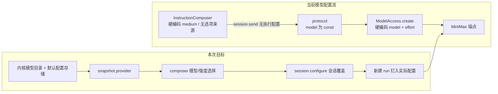

# 调查依据

本工件复用已批准方案（`america-chavez-sentry-psylocke.md`）中的调查结论，并在本次规划时对关键事实做了静态核对，结果一致。证据等级：除供应商目录为官方文档静态阅读外，其余均为当前工作区代码静态核对。

## 当前事实与复用选择

### 项目/会话组织（UI）

- `apps/desktop/src/renderer/src/workbench/SessionList.tsx` 先按当前 `projectId` 调 `session.list`，再把单项目结果按 `projectId` 分组，组头显示裸 ID——“项目一级、会话二级”是假层级。项目操作堆在 `ProjectNavigation.tsx` 的 `ProjectControls` 下拉与 `
` 折叠表单中；移出当前项目无确认且硬跳 `application`。已核对，与计划一致。
- 既有契约已确认“移出最近列表只改变最近记录，不删除目录”（`docs/ui-design/README.md`），本次落实该交互，不新增磁盘删除或项目归档。
- 内核已拒绝归档排队/运行/取消中会话且归档可逆（`apps/kernel/src/harness/runtime.ts`、`openspec/specs/agent-harness/spec.md` 可逆会话归档）；UI 侧恢复失败没有原地错误行（`business-session.tsx` 通知条 callout）。归档能力复用现有内核实现，本次只重做入口与失败呈现。
- 菜单/确认逻辑已在会话行菜单、`ActivityPane` 内核停止确认、文件回收确认三处手写 `
` 实现；`docs/reference/paseo-ux-patterns.md` 明确不要继续各组件手写 dropdown。结论：沉淀一个共享 menu/confirm 原语并迁移三处用法，复用现有 `useDetailsDismiss`。

### 模型与推理强度（协议/内核/UI）

- `packages/protocol/src/business.ts:76-85` 已核对：`providerSchema` 中 `model` 为 `{ const: 'MiniMax-M3.1-Flash-Preview' }`，`session.send` 不接受执行配置。
- `apps/kernel/src/models/minimax.ts` 已核对：`ModelAccess.create()` 硬编码 `model: minimaxModel`、`thinking: { type: 'adaptive' }`、`outputConfig: { effort: 'medium' }`；凭据读取由 `CredentialStore` 负责，并发/超时/重试机制已具备并应保留。
- `shell/InstructionComposer.tsx` 已核对：`ExecutionContext` 已支持 `modelOptions/effortOptions/onModelChange/onEffortChange`，但全仓库无调用方传入，effort `<select>` 的 `value` 硬编码 `'medium'`——休眠 UI，本次激活而非重建。
- 供应商事实（官方文档静态阅读，计划附出处）：MiniMax Anthropic 兼容接口当前列出 `MiniMax-M3.1-Flash-Preview`、`MiniMax-M3`、`MiniMax-M2.7`、`MiniMax-M2.7-highspeed`；仅 `MiniMax-M3.1-Flash-Preview` 支持 `low/medium/high/xhigh/max` 五档 effort（默认 `max`）。已安装的 `@anthropic-ai/sdk` 类型确认同一五档。M Plan 是否放行全部 4 个模型只能由真实调用确认，本轮测试使用合成 loopback，不消耗真实 Key。

（上下两段均为已核实的现状与本次方案关系，无未知环节。）

### 规格基线

- `model-access` 现有 2 条 Requirement（凭据保护、授权与共同模型控制），本次在其内新增模型目录/默认/覆盖/实际配置记录契约，凭据要求不变。
- `agent-harness` 现有 7 条 Requirement，本次补充 run 钉入实际配置与 resume/排队不变更的要求，不动既有状态机。
- `ui-workbench-shell` 现有 13 条 Requirement，本次修订“会话整理与独立选择”“工具详情与实际执行上下文”“可操作项目与文件工作台”等相关条款。

## 影响方案的未知项与实验

无影响方案选择的未知项。MiniMax 各模型对 `thinking`/`output_config` 的接受范围按能力位分别组请求，不套用同一模板；该边界已在计划中确定，实施时以内核能力位落实，真实 Key 的全模型可用性验证由后续真实环境工作承接（本轮不消耗真实 Key）。

## 结论与承接

事实已足以选择方案，直接按批准计划进入 specs/design/tasks。剩余验证承接：协议 schema 形状由实施期 `pnpm typecheck` 与内核测试核对；双宿主交互由 `tests/ui/` 更新后的用例验收；真实模型目录可用性记录为交付时的未验证范围说明。
