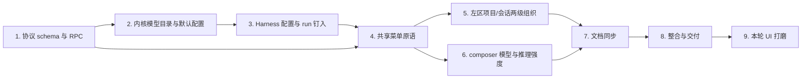

# 执行任务

## 1. 协议 schema 与 RPC

- [x] 1.1 在 `packages/protocol/src/business.ts` 新增 `effortSchema`、`modelOptionSchema`、`modelPreferenceSchema`；`providerSchema` 改为携带 `model`、`defaultEffort`、`models`、`efforts` 及凭据状态字段（`model` 不再 const）；`sessionSchema` 增加可选 `modelConfig`；`runSchema` 增加可选 `modelConfig: { model, effort? }`。完成依据：`pnpm typecheck` 通过，schema 为唯一事实源。
- [x] 1.2 新增 `provider.setDefaults` 与 `session.configure` 两个 RPC 定义；`session.send` 保持不变。完成依据：客户端生成类型可见两个新方法，既有 `session.send` 签名不变。

## 2. 内核模型目录与默认配置

- [x] 2.1 新增 `apps/kernel/src/models/config-store.ts`：默认配置写入 `credentials/provider.json`（文件 0600、目录 0700、原子写）；缺失返回出厂默认 `MiniMax-M3.1-Flash-Preview + medium`；损坏报可诊断错误且不覆盖原文件。完成依据：`tests/kernel/model-access.spec.ts` 持久化与损坏诊断用例通过。
- [x] 2.2 在 `apps/kernel/src/models/minimax.ts` 提供模型目录（`MiniMax-M3.1-Flash-Preview`、`MiniMax-M3`、`MiniMax-M2.7`、`MiniMax-M2.7-highspeed` 及 `supportsEffort` 能力位）与五档 effort；`ModelAccess` 收窄为 `status()`、`setDefaults()`、`create(authorize, signal, config?)`；目录外模型 `invalidRequest` 且零 HTTP 请求。完成依据：目录外模型拒绝用例通过。
- [x] 2.3 `create` 按能力位组请求：M3.1 传 `thinking: adaptive` 与所选 effort；M3 传 adaptive thinking 不传 effort；M2.7 系列不传 `outputConfig.effort`；并发/超时/重试与 loopback 约束保留。完成依据：请求体断言（`model` 与 `output_config.effort`）用例通过，不支持 effort 模型不发送 effort。
- [x] 2.4 `KernelApplication` snapshot 的 provider 改由 `ModelAccess.status()` 提供，新增 `provider.setDefaults` RPC case；`provider.configure` 保存凭据后返回新 status。完成依据：`pnpm test:kernel` 相关用例通过。

## 3. Harness 配置与 run 钉入

- [x] 3.1 `apps/kernel/src/harness/runtime.ts` 新增 `configure()` 更新 session JSON 的 `modelConfig`（含清除覆盖）；不支持的组合拒绝且原覆盖不变。完成依据：`tests/kernel/sessions.spec.ts` 设置/清除覆盖用例通过。
- [x] 3.2 `send()` 新建 run 时解析“会话覆盖 ?? 应用默认”并写入 run 记录；busy 追加沿用旧 run 配置；`resume()` 沿用原 run 配置；已排队 run 不受后续默认变更影响；旧 session/run 无新字段按当前有效配置兼容。完成依据：新 run 钉入、busy/resume 不变、旧记录兼容、`provider.setDefaults` 只影响后续 run 的用例全部通过。

## 4. 共享菜单原语

- [x] 4.1 新增 `workbench/shell/menu.tsx`：`Menu`、`MenuItem`、`MenuFormItem`、`ConfirmAction`，基于现有 `
` 机制，迁移 `useDetailsDismiss`，补 Esc 不冒泡、外点关闭、焦点进入/归还、方向键循环。完成依据：双宿主菜单键盘/外点基本行为用例通过。
- [x] 4.2 迁移三处既有手写实现：会话行菜单、`ActivityPane` 内核停止确认、文件回收确认；`styles.css` 提取共享 menu/confirm 样式（只用语义 token）。完成依据：三处调用共享原语，相关双宿主用例不回归。

## 5. 左区项目/会话两级组织

- [x] 5.1 `SessionList.tsx` 删除按 projectId 的假分组；项目节点显示当前项目显示名、整行折叠展开会话列表；行尾“管理项目 …”菜单承载切换最近项目、重命名、移出最近列表（确认文案说明不删除目录、不停止执行）；`application` 不提供移出入口；移出当前项目后选择下一个最近项目或回退 `application` 并清理会话选择。完成依据：ui-workbench-shell delta“可操作项目与文件工作台”场景对应双宿主用例通过。
- [x] 5.2 项目区底部“添加项目”行提供新建/打开两份现有单步表单，成功后选择新项目并清空会话选择；`ProjectNavigation.tsx` 项目操作表单迁出 `ProjectControls`，设置页保留“模型设置”和“项目权限与备份”。完成依据：`tests/ui/file-workbench.spec.ts` 等依赖“当前项目 combobox”的流程改为项目行与菜单后通过。
- [x] 5.3 会话行尾“管理会话 …”菜单承载重命名、归档/恢复；排队/运行/取消中归档禁用并显示原因；归档/恢复失败错误留在菜单内；当前会话恢复失败在消息区原地显示错误行；归档时 composer 禁用、恢复不自动发送。完成依据：归档相关双宿主用例（含失败路径）通过。

## 6. composer 模型与推理强度

- [x] 6.1 `session.ts` / `business-session.tsx` 扩展 `executionContext`：从 snapshot 派生有效模型、effort、能力位与覆盖状态；接线 `provider.setDefaults` 与 `session.configure`；失败保留当前值并显示 `role="alert"` 可重试错误，不做乐观更新。完成依据：覆盖设置/“跟随默认”/失败路径用例通过。
- [x] 6.2 `InstructionComposer.tsx`、`AgentDock.tsx`、`AgentOverlay.tsx` 激活选择器并移除 `value='medium'` 死值；配置行统一为权限只读段、模型选择、推理强度选择与发送动作；归档、未连接、无会话时禁用；不支持 effort 的模型禁用推理强度并说明原因、偏好保留。完成依据：dock/overlay 一致性、reload 保留、设置默认生效的双宿主用例通过；模型 fixture 断言请求体 `model` 与 `output_config.effort`。

## 7. 文档同步

- [x] 7.1 先更新 `docs/ui-design/README.md`（项目操作位置、会话归档菜单与恢复失败、composer 配置行、模型/推理强度真实选择、左区两级结构、token 表漏项，含新增 `--row-h` 如使用），再更新 `docs/development.md`（模型目录、默认配置、会话覆盖、effort 支持边界与调试方式）。完成依据：文档与实现一致，`docs/reference/` 未改动。

## 8. 整合与交付

- [x] 8.1 整体整合验收：`pnpm lint`、`pnpm typecheck`、`pnpm build`、`pnpm test:kernel`、`pnpm test:ui` 全绿；`openspec validate polish-project-session-model-context --strict` 通过；环境允许再跑 `pnpm check`。主 Agent 负责跨模块路径核对，独立审查关键接口（协议 schema、run 配置钉入、共享菜单原语）。完成依据：上述命令实跑结果记录。
- [x] 8.2 根据实际执行结果完成 delivery.md，核对本次完成判据及必要验证（含真实 Key 未验证范围的记录），再更新本项状态。

## 9. 本轮 UI 打磨

契约与设计事实源（`docs/ui-design/README.md`、`docs/development.md`、proposal/design、ui-workbench-shell delta 修订及 project-files、kernel-lifecycle 新 delta）已随本组创建同步完成；以下任务对应实施与验证，全部未完成。

- [x] 9.1 协议与内核：`packages/protocol/src/business.ts` 新增 `session.search`（`query`+`limit`，结果按 `updatedAt` 排序、含归档标识与 `truncated`）与 `project.browseDirectories`（可选 `path` 与 `limit`，返回真实路径、父路径、目录条目与 `truncated`）；新增 `apps/kernel/src/projects/directory-browser.ts`（realpath 后要求普通目录，只列目录，排除符号链接、隐藏项与私有配置目录，按名称排序、单页有界）；`harness/runtime.ts` 跨最近项目有界 `search()`；`application.ts` 接入两个 RPC。完成依据：`tests/kernel/project-files.spec.ts` 目录浏览用例与 `tests/kernel/sessions.spec.ts` 跨项目搜索用例通过，`pnpm typecheck` 通过。
- [x] 9.2 Electron 目录选择窄桥：`main/index.ts` 新增受校验 `dialog:open-directory` handler（只启用 `openDirectory`/`createDirectory`，取消返回 `null`）；`preload/index.ts` 与 `desktop.d.ts` 暴露 `pickDirectory`；`tests/ui/fixture.ts` 提供双宿主目录选择辅助（Electron stub 原生对话框，浏览器预置目录浏览起点并驱动真实 UI）。完成依据：双宿主添加项目流程经该桥通过。
- [x] 9.3 共享弹层与右键菜单：新增 `shell/dialog.tsx` 居中弹窗原语（`role="dialog"`、Esc/backdrop 关闭、初始焦点与归还）；`shell/menu.tsx` 扩展受控 `ContextMenu`（右键坐标定位、视口边界收束、复用 `MenuItem`/`MenuFormItem`、支持 Shift+F10／ContextMenu 键）；`shell/icons.tsx` 新增 `IconSearch`、`IconFolderOpen`、`IconSidebarLeft`。完成依据：弹窗与右键菜单的键盘/指针行为双宿主用例通过。
- [x] 9.4 左区导航与会话列表：新增 `SessionSearch.tsx`（顶部与折叠轨入口、150ms 防抖、迟到响应不覆盖、结果含归档标识、选择后切换项目/会话）与 `ProjectOnboarding.tsx`（打开/新建两模式弹窗，项目名取目录最后一级，内核错误原地显示）；`SessionList.tsx` 删除内联搜索、活动/归档 tab、分页按钮与 `AddProject`，活动会话固定 `archived: false` 滚动加载、变更通知重读已加载范围并按 id 去重；项目行与样例换文件夹开/关图标；`SessionRow` 移除行尾菜单改整行右键。完成依据：`tests/ui/conversation.spec.ts` 搜索/右键/折叠轨用例与滚动加载用例通过。
- [x] 9.5 设置页归档管理：`ProjectNavigation.tsx` 的 `ProjectControls` 新增”归档会话” section，按当前项目（含 `application` 范围）调用 `session.list { archived: true }` 滚动列出并提供恢复，成功后刷新归档与活动列表，失败错误留在对应行内；归档当前会话后的消息区恢复提示保留。完成依据：设置页恢复双宿主用例通过。
- [x] 9.6 左区头部与底部状态：标题行改为 Scholoom 标题 + 主题按钮（可访问名保持”切换主题”）+ 折叠按钮（左侧栏图标）；`.kernel-status` 固定单行 LED + 状态文字，实例 id、错误详情、”重试连接””查询状态”移入 hover/focus 详情层；删除 `StopKernel` 与 `WorkbenchConnection.stop` 的 UI 接线；`styles.css` 调整 `.side` flex 分配与新组件样式（只用语义 token）。完成依据：`tests/ui/workbench.spec.ts` 单行状态与 hover/focus 详情用例通过，无 UI 停止入口断言残留。
- [x] 9.7 composer 收尾：`InstructionComposer.tsx` 以 Codex 式聚合入口设置模型/推理强度（overlay 显示当前值，dock 只留图标，点击后在共享 `Menu` 弹层内两组单选）；配置行左侧权限与聚合入口、右侧固定取消/发送，错误提示不挤压发送按钮；`AgentDock.tsx`/`AgentOverlay.tsx` 删除”继续执行”及 `resume` prop；`session.ts`/`business-session.tsx` 移除 UI 层 `resume` 接线；内核 `session.resume` 保留。完成依据：`tests/ui/harness.spec.ts` 取消后发送新明确指令的路径通过，dock/overlay 一致且无”继续执行”断言残留。
- [x] 9.8 测试与交付收尾：`tests/ui/file-workbench.spec.ts`、`tests/smoke/development.spec.ts` 添加项目流程改为弹窗 + 目录选择；`tests/ui/workbench.spec.ts` 停机改经 CLI/client 后验证通知、草稿保留与重试；核对文档与实现一致；按序运行 `openspec validate polish-project-session-model-context --strict`、`pnpm lint`、`pnpm typecheck`、`pnpm build`、`pnpm test:kernel`、`pnpm test:ui`（环境允许补 `pnpm check`），再更新 `delivery.md` 记录本轮成果、双宿主验证结果、Electron picker stub 边界、浏览器 RPC 浏览边界及未验证平台差异。完成依据：上述命令实跑结果与 `delivery.md` 记录。

## 续做入口

- 下一步：第 9 组任务从 9.1 开始实施，入口文件 `packages/protocol/src/business.ts`；契约见 `specs/`、模块分工见 `design.md`。
- 执行后的结果与交接背景写入 `delivery.md`，不在本文件追加进度说明。
