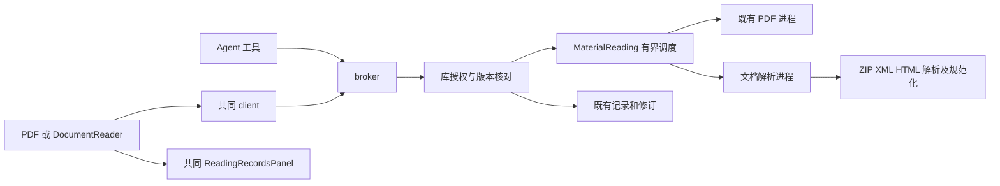
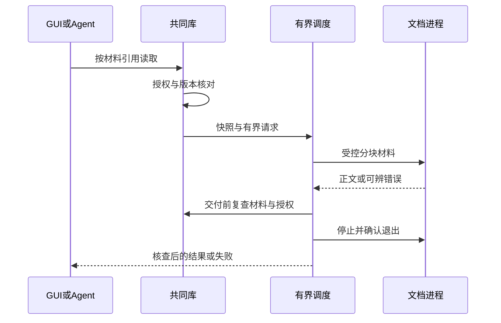

# 实现设计

## 变更总览

## 方案与接口

protocol 是唯一 DTO／校验源。新增 documentInfo（分页章节）、readDocumentSection（章节／offset／limit）、searchDocument（有界命中及继续游标）、readDocumentResource（章节／资源身份、有界字节）。位置增加 kind=text、normalizationVersion=1、sectionId、start、end。PDF 原形状保留，以 pageIndex 区分。记录沿 JSON 存储，不改 SQL 表。

正文以扁平有限标签节点、父索引及文字区间表示；文本叶含规范化正文，标签和可用属性由解析器重新构造，前端用 React 渲染，不注入原始 HTML。章节文字由同一节点序列派生，换段分隔符进入共同文本。只处理当前有界片段的选区和高亮。同章节内部锚点与包内章节链接解析为受控目标；外链仅 http(s)／mailto。HTML 单文件仅内嵌栅格图，EPUB 从容器内按受控引用读图，不解包到文件系统。

阅读器每批呈现至多8张图片，其余由用户选择；可见图片沿阅读器内串行队列读取，离开片段、撤权或关闭 tab 时跳过尚未发送的任务并忽略在途回执，释放本轮 Blob URL。已经受理的单项 RPC 沿共同截止时间收尾，不因图片自动加载挤满解析等待队列。

MaterialReading 由原 PDF 调度泛化，依请求选择 PDF 或文档进程，保留容量、快照、30 秒和退出确认。原材料 128MiB、块 256KiB；文档展开条目最多10000、单文档8MiB、累计256MiB；正文默认16384／最大32768 UTF-16 单元、每次安全节点最多4096、资源最多1MiB并按256KiB块返回。目录／搜索默认25／最大100。搜索每次最多扫描16章节，返回后续章节／偏移；超时仍按失败收尾。阶段内没有跨请求持久缓存，不增加第二份权威。

## 文件变化

实际新题录详情的 AttachmentsSection 替换占位，接入现有 AttachmentsPanel；LibraryTab 修正选择闭包并向详情传递当前库授权和范围刷新，确保新旧阅读器均从真实附件打开。删除已恒定委派到 LibraryTab 的 LibraryPanel 及其不可达旧实现，business-session 直接装配当前库 tab。其他未实现题录入口不在本次扩展。

- protocol/library.ts 及派生类型：文档契约和位置联合；architecture.json、manual.ts 和 harness 工具清单同步接线。
- library：pdf-reading.ts 改为 material-reading.ts；新增 document-parser.ts、document-execution.ts 及共用的 material-execution.ts 传输；catalog.ts 接文档读取与位置核对，PDF进程及 node 导出同步类型。material-files.ts 将读取端的原生缺失错误归为共同 notFound，避免解析调度丢失原因。package.json／锁文件登记批准依赖。
- renderer：新增 DocumentReader.tsx；工作台 session／business-session／Workbench／TabGroups／AttachmentsPanel 泛化 reader；ReadingRecordsPanel 和 PdfReader 区分位置类型；styles.css 仅加语义样式。
- tests：新增合成文档夹具、文档 kernel／双宿主用例，扩展现有记录／Agent／容量回归。
- docs：先更新 ui-design，再同步 development、architecture、implementation-roadmap、initial-spec/literature 和 third-party 文档。

## 验证与风险

复用独立库测试和真实 WS／broker／Agent 接线，模型仅替换外部 HTTP。核对跨节点、中文／代理对、换段偏移、来源保留、恶意资源、ZIP配额、取消／崩溃、撤权、备份及双宿主。保留 PDF 回归。关键接口、数据保护和资源收尾安排独立审查。Linux 本地结果不代表其他平台或科研质量验收。
