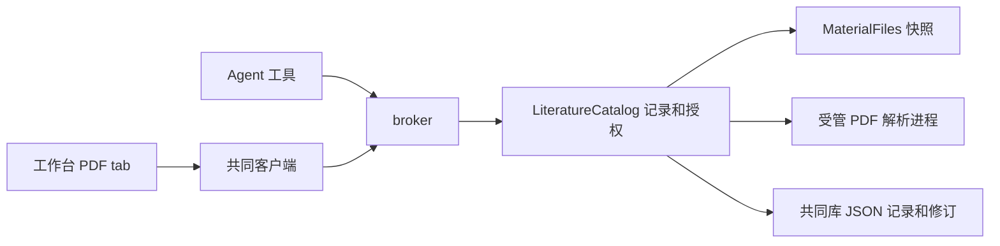

# 调查依据

## 当前事实与复用选择

静态核对：`packages/protocol/src/library.ts` 的位置只有 pageIndex／rects；`packages/library/src/catalog.ts` 带位置保存强制走 PDF geometry。记录与创建输入存于 JSON 列，已有历史、幂等及备份无需新增表。`pdf-reading.ts` 已有 1+8 队列、30 秒预算、受管 Node 进程和快照复查；`manual.ts` 负责装配及 broker 注册。前端按 PDF 后缀开放入口，reader tab 与记录面板可复用。相关 oracle 是 PDF、literature-reading、附件 RPC 及双宿主阅读测试。

旧 zotero-agents 的 EPUB 位置调用委托 Zotero Reader 的 CFI，不能直接用于独立 Node 解析；不迁入其宿主耦合。采用成熟解析依赖而非自写 ZIP／XML／HTML 解析器。

官方资料：npm registry 实查上述四个固定版本、MIT 许可及 Node 要求；[yauzl README](https://github.com/thejoshwolfe/yauzl) 的 lazyEntries／validateEntrySizes／fromBuffer 支持按需读取，但累计配额须调用方提供；[xmldom](https://github.com/xmldom/xmldom) 解析 XML、不取回外部实体；[parse5](https://github.com/inikulin/parse5) 处理 HTML。沿 [EPUB 3.3](https://www.w3.org/TR/epub-33/) 的 container、spine、navigation 及 [EPUB 2 OPF](https://idpf.org/epub/20/spec/OPF_2.0.1_draft.htm) 的 NCX。以上是静态／只读远程核对，不是解析运行证据。

## 影响方案的未知项与实验

用户已确认单文件快照及统一排版，消除在线抓取和资源包摄取歧义。安全正文用有限标签的扁平节点及规范化 UTF-16 区间，避免递归 DTO、前端重复解析及原始 HTML 注入。运行时的 EPUB、HTML、字符映射、资源配额、取消和双宿主结果由实现任务验证。

## 结论与承接

整合时补核实际工作台：LibraryPanel 已默认进入新 LibraryTab，而 CatalogItemPane 的附件区仍是占位；选择控制器首次闭包持有初始空列表。这与开发说明所述真实附件入口存在漂移。本次在当前题录详情中复用 AttachmentsPanel 并修正局部选择，不切回旧界面，不扩展其他占位功能。

无阻塞项。复用共同调度、记录与附件权威；增加文档解析入口。当前工作区无未提交改动，架构基线 12 模块、143 文件、0 findings，scholoom-dev schema 有效；均不表示新功能已实现。
