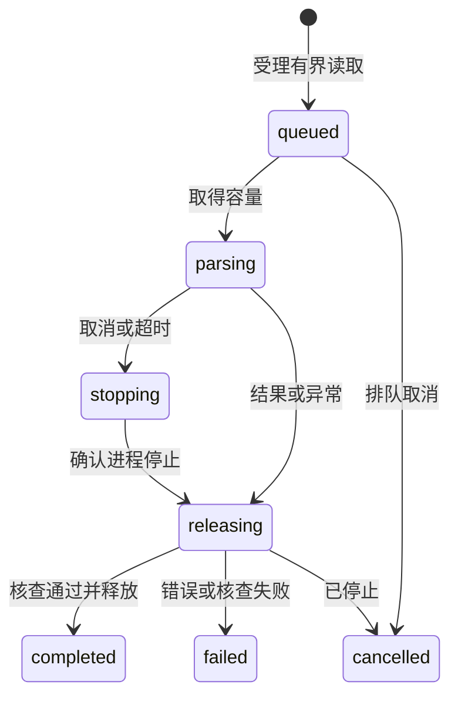

## MODIFIED Requirements

### Requirement: 共同书签批注与笔记

系统 SHALL 通过共同内核保存和有界查询书签、高亮批注及文献笔记，GUI 和 Agent 使用同一数据权威。记录 SHALL 有独立身份、来源条目、附件及材料版本、类别、创建者、最后修改者、时间和修订号；原文摘录与记录者说明分别保存。PDF 位置 SHALL 使用该材料的页索引及可选区域，不绑定窗口 DOM 或文件路径；其高亮须有摘录与区域，书签有页位置，笔记可针对该材料整体或某页。EPUB／HTML 位置沿同版本规范化文本位置要求。界面产生的临时选区不等于持久保存成功。

#### Scenario: 人与 Agent 分别作批注
- **WHEN** 用户保存带摘录的高亮，Agent 随后在同一材料保存解释笔记
- **THEN** 双方读取同一组记录，能分辨摘录、原作者身份和 Agent 的解释，不混成文献作者原文

#### Scenario: 重启后读取
- **WHEN** 关闭阅读窗口并重启内核，再按材料引用查询阅读成果
- **THEN** 已确认的书签、批注和笔记仍可读，临时选区不会伪装成已保存记录

## ADDED Requirements

### Requirement: 独立有界文档取文

系统 SHALL 从已收录的 EPUB 2／3 重排版或单文件 HTML 材料提供章节目录、规范化正文、允许的结构、搜索及受控栅格资源；GUI 与 Agent 使用同一解析结果和文字位置，不要求可见阅读窗口。目录、正文、资源和搜索 SHALL 有界并提供继续位置，搜索说明实际覆盖，不将部分扫描表示为全文无命中。固定版式、受保护正文、损坏、超限及材料变化 SHALL 返回可辨失败。解析不执行脚本、不取回外部实体、样式、字体、图片或网络正文，不访问 HTML 配套目录，原材料保持不变。缺图片不妨碍可用正文，外链仅由明确用户动作打开。

解析 SHALL 沿共同受管操作系统进程、容量及截止时间执行，授权、材料核对、取消和实际退出确认遵守共同 PDF 读取相同要求。

#### Scenario: 无窗口继续读取
- **WHEN** Agent 按材料引用分段读取 EPUB 或 HTML
- **THEN** 取得共同规范化正文、章节及继续位置，可查询人类保存的阅读记录

#### Scenario: 不可信资源和损坏材料
- **WHEN** 材料包含脚本、外部资源、逃逸 ZIP 路径或超限展开内容
- **THEN** 脚本及外部访问不执行，非法结构或超限明确拒绝，已有材料和记录保留

#### Scenario: 搜索未覆盖全书
- **WHEN** 本次搜索达到结果或扫描预算
- **THEN** 返回已有命中、实际覆盖及继续位置，不报告完整无命中

### Requirement: 同版本规范化文本位置

EPUB／HTML 的书签、高亮及可选带位置笔记 SHALL 沿共同记录、可信作者、修订、幂等、未知回执核查及独立恢复契约保存。位置 SHALL 指向实际材料版本、规范化版本、章节和 UTF-16 文字区间；高亮须有非空摘录及有效非空区间，保存时核对摘录与正文一致。书签可为章节内的零长度位置，笔记可不带位置。PDF 既有位置和记录继续有效。原材料失效或规范化位置不可用时保留原摘录，不自动重绑新版。仅修改说明且原依据不变时，允许沿既有修订规则更正已失效材料上的记录。

#### Scenario: 同一摘录在人与 Agent 间共享
- **WHEN** 用户在章节中保存高亮，Agent 随后读取记录
- **THEN** 双方获得同一文字区间、原摘录及可信作者，Agent 说明不混作原文

#### Scenario: 错误摘录和旧材料
- **WHEN** 提交的摘录与章节区间不同，或将旧位置用于新材料版本
- **THEN** 拒绝保存，保留既有记录及调用方草稿

#### Scenario: 独立恢复
- **WHEN** 含文档记录的库备份恢复到独立配置
- **THEN** 副本保留原位置、记录和修订，当前库后续成果不变
