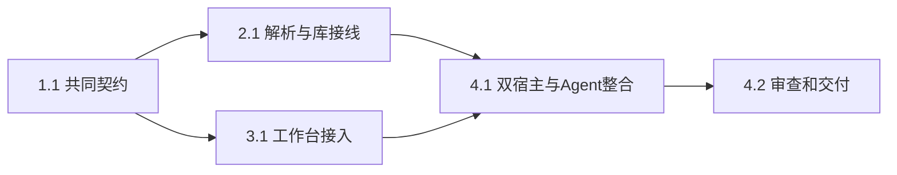

# 执行任务

## 1. 共同契约

- [x] 1.1 主 Agent 完成文档操作及位置联合、类型派生和依赖安装，类型／运行时校验同源，先更新 UI 设计。

## 2. 独立文档读取

- [x] 2.1 主 Agent 完成共享受管调度、EPUB／HTML 解析、目录／分段／搜索／资源和库位置验证；独立 kernel 测试核对来源、配额及安全结构。
- [x] 2.2 接通实际 broker 和 Agent 工具、授权／版本复查、取消／故障恢复及备份，扩展真实 RPC 测试并回归 PDF。

## 3. 工作台阅读

- [x] 3.1 主 Agent 完成 DocumentReader，辅助 implementer 完成共同 reader 分流及真实题录附件入口，记录面板适配与整合已核对。
- [x] 3.2 双宿主从附件入口核对章节、搜索、跨节点选区、图片、高亮／书签／笔记、重开、草稿及资源清理。

## 4. 整合与交付

- [x] 4.1 主 Agent 完成类型、lint、架构、构建、相关 kernel／UI／smoke 及 OpenSpec 验证；同步开发、架构、初设、路线图和第三方许可文档。
- [x] 4.2 独立审查契约、数据保护及资源收尾，处理发现；按实际结果完成 delivery.md，核对 proposal 完成判据。

## 续做入口

使用本 change 的 apply instructions，沿任务读取当前代码；实际结果和交接集中在 delivery。
