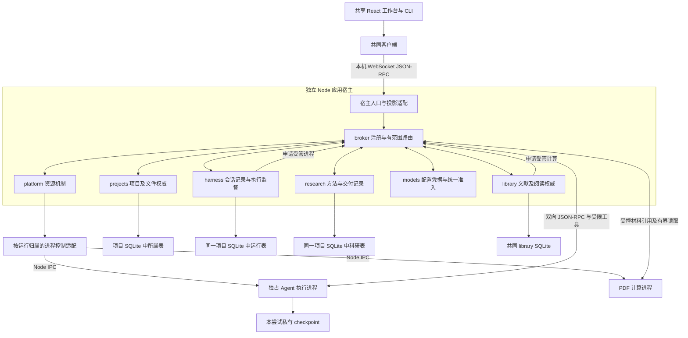
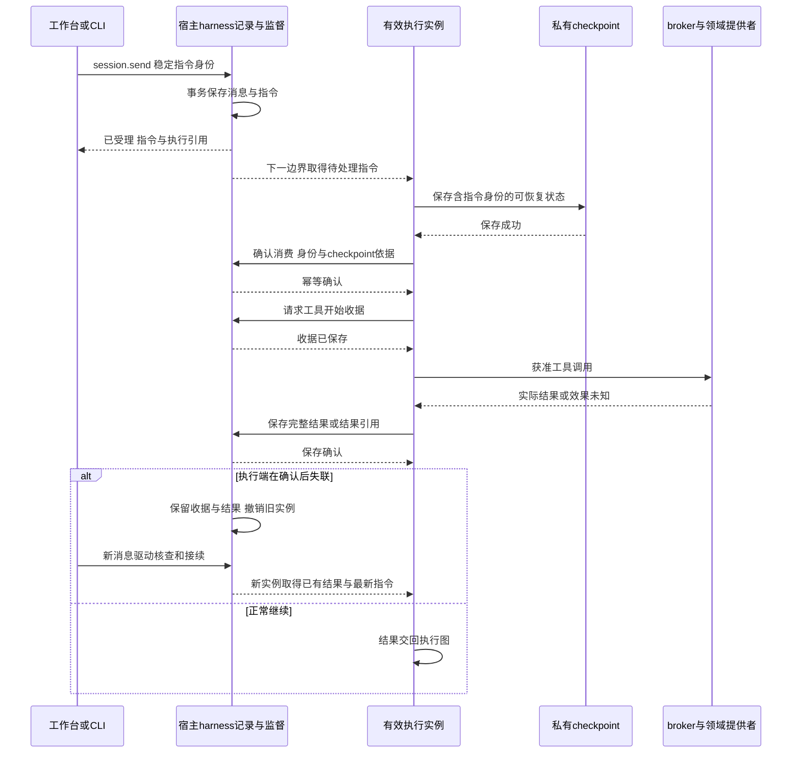

# 实现设计

## 变更总览

目标及取舍依据见 [proposal](proposal.md)，实现基线和实验证据见 [investigation](investigation.md)。本设计选择保留数据库物理布局和现有依赖，先明确记录与资源归属，再沿实际路径迁入私有包；不为本次未使用的能力预建提供者。

图中的存储箭头表示所属模块内部的受控原生适配，不是允许普通核心直接访问 OS。执行进程只直接管理本尝试的私有框架恢复资料；工作台没有另一份领域数据库。框架、模型 SDK、SQLite 和 PDF 依赖保留当前锁定版本。

## 方案与接口

### 1. 包、接口和装配

| 私有包 | 责任与公开入口 |
| --- | --- |
| `@scholoom/broker` | 通用注册、范围调用、结果及事件校验；`/rpc` 提供通用双向 peer。只依赖公共契约核心，不依赖全产品操作聚合。 |
| `@scholoom/platform` | 有范围的文件、条件保存、进程控制、网络与宿主设施；`/node` 等适配入口允许受控系统访问。 |
| `@scholoom/projects` | 项目、授权、文件身份、编辑、回收、成果关系及项目备份；核心和自身 SQLite 适配分别导出。 |
| `@scholoom/library` | 题录、材料、阅读记录、批次、库授权与备份，以及受控 PDF 计算入口。 |
| `@scholoom/harness` | 宿主侧会话仓储及监督、通用执行入口、工具收据和 checkpoint 接入；`/execution` 为子进程装配入口。核心不导入文献、项目或科研实现。 |
| `@scholoom/research` | 方法内容、能力输入、尝试、领域工具绑定和交付检查；向 harness 提供业务适配。 |
| `@scholoom/models` | 凭据、目录、默认配置及宿主准入；执行侧 SDK 适配复用其选定配置和受限接入。 |

模块创建时只依赖自身及所需领域契约，接收只暴露所需操作的受限、类型化消费端口及自身适配，不依赖全产品操作集合或取得整个应用对象。生产装配由宿主将消费端口接到 broker；模块测试可用满足同一端口的替身，无需启动 broker、完整宿主或无关模块。沿现有接口直接注入，不为测试额外增加通用抽象层。模块内普通函数不经过 broker。`apps/kernel` 负责创建平台与 broker、绑定资源、迁移存储、装配模块和关闭顺序。初始化所需系统操作收在宿主及受控适配中，避免“通过 broker 创建 broker”的循环。

broker 统一能力路由、约束模块可消费范围并传递可信上下文，同时执行上述同源边界校验。领域模块在实际操作入口保留最终授权、业务规则与持久化顺序；应用级进程、模型并发及推进预算由宿主侧准入负责。通过 broker 转送准入请求不改变这些归属，broker 不编排领域流程或保存另一份业务权威。

`KernelApplication.call` 的大 switch 被契约约束的提供者映射替代；`workbench.snapshot` 由宿主投影适配经 broker 组合模块快照，事件继续按当前项目／会话／library 范围发布。现有工作台的 UI 投影、草稿及渲染 Worker 保留职责，不将投影类型误当第二套 DTO。

Electron 目录包保留独立 Node 所需的解包依赖与实际入口，不能依赖 Electron 对 ASAR 的读取能力；引导适配只转换自身 CLI 路径。包中保留锁定 SDK 自带的运行代码、原生模块与 WASM；本机 Node 24 要求不变。打包后的默认配置使用宿主 userData，显式配置目录仍优先，源码调试目录沿既有约定。

### 2. 契约、角色和 RPC

`packages/protocol` 提供 `/core`、`/platform`、`/projects`、`/library`、`/harness`、`/research`、`/models` 入口，提供方维护各自声明。产品入口聚合只由宿主和客户端消费，普通模块仅依赖所需入口。保留现有可用业务操作名，删除 `session.resume`；命令行 `continue` 同步删除，帮助、测试及文档改用 `send`。

载荷类型直接从原 schema 推导。当前 TypeScript 7／json-schema-to-ts 在聚合注册中出现 TS2589／TS2590，因此产品聚合及受此限制的内部操作保留逐键类型映射；每个成员仍为原 schema 的 `FromSchema` 引用，不复制 DTO。`pnpm generate:contracts` 用项目要求的 Node 24 直接装载 protocol 声明源并输出可应用的更新 patch，映射过期或缺项导致完整编译失败时也可生成。原有键完整性约束发现新增缺项，删除操作使旧 schema 引用编译失败；broker 构造另核对参数／结果映射与各 schema 派生类型双向相容及无多余操作键，实例类型同时保持绑定，避免通过转赋值放宽映射。

执行控制的窄映射若遇到同一编译器展开限制，沿同一生成入口保留逐键 schema 引用。模型描述由 models 声明派生并在执行适配检查；模型名额、健康、停止和消费确认共用原声明校验参数与结果。宿主及运行实例、根预算绑定在宿主创建的专属 IPC 通道和提供者闭包中，普通载荷不能选择其他实例或预算。

框架文件上传／下载同样声明编码、输入、结果及读写等待语义，派生两端签名并校验；SDK 字节在适配端转换为 base64，保持共同帧上限。不能将 `Uint8Array` 直接当作 JSON 载荷，连续压缩追加历史须经真实 IPC 验证。事件订阅者类型也从事件 schema 取得。

图初始化、事件拉取、工具及 middleware 双向接续统一声明于 `execution-graph.ts`，由现有控制端口派生调用与提供者签名并复用校验；动态工具仅按初始化注册的原 schema 解析输入，Zod 使用输入模式保留可省略字段，并在宿主执行前应用默认值。模型流及结束事件分别要求 chunk／output，框架消息保留内容块和提供者元数据；SDK 原生类型兼容留在消息及 Command 适配内，不放宽公共协议类型。

research 仅接收项目读取／身份端口、会话校验、自有仓储及 `harness.execute`；实际读取、保存与失败通过 `research.progress` 在回图前保存。模型、父预算与已准入进程名额留在 harness 的本地执行闭包，可信上下文绑定原项目、会话、尝试与实例。取消仍等待已受理保存，子执行停止无法确认时保留 interrupted 与占用，不发布取消完成。Harness 通过项目及文献窄端口操作所属权威，宿主仅绑定其私有目录、自有仓储和备份变更通知。

框架文件桥的列举、读取、条件写入等操作逐项声明，适配同时受声明派生签名与 SDK `BackendProtocolV2` 检查，移除任意方法名／`unknown[]` 分发。项目文件工具使用 `ProjectFilePort`：生产端口经 broker 绑定项目范围，测试可替换六个派生方法。内部保存契约复用公共保存字段、结果和语义，仅增加预期文件身份；最终授权及保存临界区仍在 projects。私有契约不进入产品调用集合。

调用、提供者和窄端口复用这些派生类型。注册调用也核对 schema 绑定，仅提取注册接口不能绕过约束。`CallArguments` 从参数映射取得操作名与参数的只读关联元组联合；broker、client 及宿主转发保留该关联，联合操作名不能搭配任意分支的载荷。服务器复用原 schema 校验整个调用元组后进入类型化入口。开发与 CI 的既有 typecheck 同时检查真实装配和 `tests/types/contracts.ts` 的编译期反例，包括构建后声明中的实例绑定及联合调用，不另做生成文件全文比较；TypeScript 结构相容规则以外的载荷限制由运行时 schema 校验，授权、取消、保存顺序仍由行为测试验证。

| 接口 | 统一约定 |
| --- | --- |
| 操作声明 | 同时包含 params/result schema、事件和错误以及副作用、返回实际结果或稳定引用、等待预算。参数、结果、注册签名和校验由同一映射推导。既有默认 5 秒、PDF 相关 35 秒及生命周期 10 秒等待归同源声明，删除客户端名单和特殊分支。 |
| `CallContext` | 由可信入口绑定主体、模块、角色、资源范围、适用项目／会话／尝试／运行实例及取消信号；普通载荷不能覆盖。进程内可含本地对象，跨进程只传必要契约数据，宿主重建可信上下文。 |
| 资源引用 | 绑定资源所在执行端、所有者、范围、用途及有效期；字符串或绝对路径不授予权限。大正文和 PDF 字节经已有有界读取，不塞入控制消息。 |
| 执行控制 | 启动、就绪、健康、停止、退出及受限工具调用绑定当前宿主和运行实例；日志走 stdout/stderr，协议走独立 IPC。 |
| 运行记录 | 指令读取／消费确认、工具开始／结果、消息和运行状态只能由有效内部角色提交；身份先存、操作后执行、结果先存再回图。 |
| 模型准入 | 宿主按当前实例、有效授权及推进预算授予短生命周期名额，记录申请、实际请求和释放。执行端运行 SDK，完整内容块沿框架保留。 |

当前协议改为 2。握手核对目标实例及版本，按可信角色返回由实际注册产生的可用接口；产品连接没有内部记录写入和模型准入权限。Node 连接身份由宿主启动关系及私有握手绑定，不能用业务请求自报角色。

peer 允许响应、反向请求和通知交错处理；等待不持有对端回调所需的锁、事务或模型名额。为响应、取消和健康检查保留独立容量，分别限制帧、在途请求及发送队列，进度合并或范围重同步。保留当前 2 MiB 帧上限。新增队列及进程容量在受控过载样本下确定并集中到同一 limits 配置，以注入的小容量验证边界，不能让无限排队成为默认路径。超时只结束等待，写入效果未知需按稳定身份核查。

### 3. 统一架构策略

新增根 `architecture.json`，记录模块根、允许契约依赖、提供／消费能力、受控系统适配路径和迁入例外。宿主据此绑定 broker 的消费范围；检查器复用它，不在 lint 和 CI 再维护另一套规则。

`scripts/check-architecture.ts` 使用已有 TypeScript 编译器 API 解析实际 import/export、类型依赖、可分析的动态 import/require 及工作区导出，检查反向引用、循环、跨包私有路径和实现绕行。结合符号及 AST 检查普通模块直接使用文件、进程、网络、环境与宿主系统设施；纯路径计算、编码、哈希等继续允许。无法静态分析的动态执行不被声称已覆盖，实际普通模块也不借它取得额外能力。

守卫以真实错误依赖和系统访问夹具验证，报告模块、位置及违反的策略项。新边界建立即启用，旧代码例外仅限具体依赖边／路径并写明移除任务；本变更范围全部迁入后删除对应例外。根 `check:architecture` 与 CI 使用同一检查器，包 exports 与编译检查一同生效。

### 4. 平台与原生适配

普通模块使用宿主绑定的目录／文件能力；项目、library、运行私有空间和凭据空间分别授权。项目保存把重新定位、依据核对、内部协调和实际保存保留在同一次资源端操作内；项目核心仍决定冲突语义、历史和成果关系，平台不接管业务规则。

SQLite 通过所属模块的受控适配取得其已绑定资源，只导出仓储接口。PDF 适配取得有界材料流／快照及本地 WASM 资源。SDK 的网络创建、环境读取、私有文件及 Electron 选择框等收在明确适配入口；不将整个原生依赖包设为普通模块的豁免。

模型凭据继续驻留配置私有目录，不进入项目、备份、命令行、日志或普通协议。SDK 执行侧取得本次选定连接所必需的秘密时，仅通过受限内部 IPC 交给对应适配，内存使用后释放引用；不继承整个宿主环境或提供公开密钥读取接口。模块消费范围不能因使用平台而自动包含环境和凭据能力。

### 5. 进程监督、计算和模型名额

平台采用按运行创建、随该运行收尾的控制辅助进程，独立于 Agent／PDF 执行事件循环。它只执行平台机制，不持有领域规则或模型调度权，不是常驻守护服务。它以 Node IPC 接宿主、另以 Node IPC 接实际执行端，适配层转送同一有界 RPC 机制，真实可信角色仍由宿主绑定。这样宿主失联时，即使执行端忙循环，控制路径仍可停止它。

POSIX 适配为受控执行建立进程组；Windows 使用系统进程树控制及创建身份核对。控制记录保存宿主实例、运行实例、控制单元与实际进程的创建身份，停止时核对归属，不仅凭 PID。宿主与控制单元都正常时先协作停止、期限后升级终止；宿主失联由控制单元按登记归属回收后退出。新宿主先检查遗留控制记录及旧写者，不能确认安全时拒绝相关接续。事件循环卡死、宿主强杀和 PID 复用必须在真实目标 OS 验证；不能仅靠执行进程的 disconnect 回调。

一次外层推进和当前科研能力子图各有独立执行进程。宿主保存会话、尝试和运行实例的不同身份；harness 执行端通过注入的工具及模型适配工作，不打开项目或文献业务库。普通工具不各建进程；控制单元本身不执行 Agent，也不能代替独占执行进程。

宿主按全应用模型并发 1、请求期限 180 秒、推进最多 32 次实际请求及安全临时失败最多额外两次的既有上限管理名额；压缩、重试和现有能力子执行共用根推进预算。等待能力结果不占模型名额，父进程仍计进程占用；容量不足即报告资源限制，不能让父进程占住最后资源无限等子执行。失联及停止后的名额回收以本地实际请求／流和执行结束核查为准，不声称远端已停止计费。

科研子执行登记自身实例并检查父实例资格；父实例停止时撤销子执行的新动作并收尾所属子工作。执行名额绑定实际停止确认，控制辅助进程退出本身不作为执行停止证明；确认缺失时保留占用与未知诊断。Agent 同步等待的 PDF 子计算在本地排队前即时申请宿主名额，人工独立读取可有限等待，避免排队循环依赖。

宿主每 5 秒核查执行事件循环，单次等待沿健康契约的 5 秒期限；健康失败与正常模型等待分开诊断，按既有归属停止该执行。失联中断的在途工具保留效果未知。状态提交及模型事件交付核对当前尝试，旧尝试只补自己的历史，不能改写新尝试的会话状态。

PDF 保留活动计算 1、等待 8、期限 30 秒和现有输入／输出预算，先取得容量再读取材料。任务交付和释放容量分别处理，实际进程退出并释放材料后才允许占用该容量的下一项启动。提供方交付前复核材料版本与授权；受影响计算失败只影响依赖它的调用。

### 6. 存储归属、升级和备份恢复

继续使用项目 `.scholoom/project.sqlite` 和配置下 `library/library.sqlite`。宿主提供同一物理容器的初始化、升级锁和备份协调；模块获得自己的仓储／原生适配，不能共享对方连接、schema 表对象或任意 SQL 入口。

| 记录 | 唯一所有者与迁移 |
| --- | --- |
| 项目身份、grants、文件引用、编辑、结构操作、成果关联及对应 meta | projects；harness 经公共接口查询或关联成果，不直接写 artifacts。 |
| sessions、messages、instructions、runs、运行实例和工具收据 | harness 宿主侧仓储；新增自身元数据及运行实例表。 |
| `tool:*`、`delivered:*`、`library-context:*`、`checkpoint-isolated:*` | 从共享 meta 分类迁至 harness 元数据／恢复信息，保留原稳定身份和结果。 |
| `research-attempt:*` | 从 meta 迁入 research 的尝试表；research 不再直接查 sessions，改用公共校验。 |
| library 题录、附件、材料版本、批次及阅读记录 | library；保留原有库文件、身份、原字节与修订记录。 |
| 模型目录、默认配置、凭据 | models；私有配置仍不进入项目数据库或备份。 |

保留现有迁移链，新增一次项目容器升级（user_version 由 2 至 3）及各所属表变更。升级在没有旧活动写者时串行进行，先用现有 backup 保护原库，再事务性搬迁已识别记录并核对数量、身份和引用；不识别的项目 meta 保留。迁移中断可从原版本或已提交版本重新打开，不能处于一半搬迁而开始执行。比应用更新的 schema 仍拒绝写入；旧运行实例不自动恢复。

项目备份继续由受控容器适配执行整库 SQLite backup，保持当前材料及缺项清单契约；这属于物理备份设施，不授予 projects 核心读写其他模块表。恢复到独立副本后，宿主依次通过各模块的恢复入口重绑定自己的归属、撤销副本授权、标记遗留执行中断，再开放普通访问。某模块恢复失败保留副本和诊断，不报告整体恢复完成。checkpoint 继续是恢复辅助资料，不变为成果备份或换会话工作前提。

同身份项目移动后重新打开，由 projects 的容器替换钩子通知宿主协调原执行收尾、关闭 harness／research 旧仓储并清除初始化缓存；新容器沿原入口重新初始化。停止未知时不替换仓储，旧资源上尚未完成预检的发送不能迟到受理。新 checkpoint、scratch 和待关联收据绑定新目录，不在旧位置重建恢复资料。

### 7. 私有 checkpoint、指令确认和正常跨轮

新尝试的 checkpoint 存在 `.scholoom/harness/checkpoints/<runId>.sqlite`；宿主保存归属、图线程身份、格式依据和当前有效实例。当前实例独占读写，旧实例停止及写者排除后才能复用。框架序列化和 saver 留在执行进程，由 harness 的受控 SQLite 适配打开该私有资源。

旧共享 checkpoint 按所需尝试和其 namespaces、pending writes 惰性提取，来源只读并保留原件；已有独立尝试文件同样核对归属和兼容性。目标在临时私有资源中完整构建后发布，不对整个共享源文件执行破坏性修复。损坏、不兼容或缺失时保留诊断和旧记录，用新尝试从持久指令、工作材料与成果接续。

正常一轮结束后，将最后成功的有效图状态作为下一尝试私有存储的上下文种子，保留对话、工具完整结果、摘要和必要工作状态。图线程身份与执行身份分别记录，不能因为新 runId 就重建空状态。必要 scratch 资源由 harness 按会话管理，跨尝试引用继续有效；不通过 UI 预览或最近 30 条消息重建正常上下文。过长上下文沿当前框架压缩，持久历史有界读取仍保留。

新会话创建时登记隔离资格，首轮失败不改变资格。旧共享 scratch 在排除写者后复制，原件保留，目标祖先不得经符号链接指向其他会话；旧资源缺少可靠清单时持续保留未完整核查的标记。实际成功写入的 scratch 资源引用复用 harness 元数据，恢复时与框架结构化引用合并，最多核查 1000 项，超出或缺失明确提示上下文不完整；合法空文件仍有效。该清单只描述框架恢复资源，不建立通用工具台账。

指令中间件只向图状态注入消息和稳定指令身份，不先写 consumed。沿现有 LangGraph／SQLite saver 使用同步 durability，saver 在实际 checkpoint 保存成功后提交内部消费确认，确认必须幂等并带 checkpoint 依据。每次待确认身份集合有界；图已保存而确认丢失时，接续先读取 checkpoint 核对原身份并补确认，不重复注入。任何必要保存／确认失败停止后继步骤。[内存实验](investigation.md#checkpoint-保存后确认消费能否使用现有框架)已支持这一接入方案，不将其退回框架选型；真实磁盘、IPC 及指令受理／保存／确认间故障窗口的整合验收沿任务 5.1、5.2，局部实验通过不替代这些验证。

兼容的未完成推进可沿原尝试和钉入模型配置接续；正常完成后的下一轮是新执行，解析当前有效模型配置，但继承会话上下文。异常后新消息先作为非空图输入到达决策边界，旧待处理工具先按收据及领域事实核查，不能用无输入的图重放绕过最新意图。已确认工具结果恢复为对应完整工具消息；未知效果保留障碍，Agent 判断后续，不能把连接重建视为允许重放。

必要工作内容在形成时通过现有项目文件工具保存为工作区材料，科研适配沿原有实际产物检查关联；执行指引和真实验收覆盖这一行为。新会话从这些材料及领域结果承接，不新增一套通用 tool call 台账，也不增加会话删除功能。

### 8. 取消、已受理操作和局部故障

工具执行前的宿主收据和领域实际受理分别可核查。实例撤权阻止新的工具、模型及状态推进；领域已经受理的保存不随 Agent 进程退出而消失，按旧操作独立完成或停止，结果归原身份记录。等待本地相关工作全部结束后才报告取消完成，不能确认则保留未知。

正常交付、失败及取消都收尾仍属该执行的子工作。能力子图默认随父执行结束，不新增后台移交产品入口。执行事件循环回应健康检查；无文本、长模型等待、健康超期、操作期限及用户取消分别诊断。错误只影响相关能力及实际依赖方，不因一个坏结果重启整个应用。

## 文件变化

本次建档只新增当前 change 的 YAML、proposal、investigation、design、tasks 和八份 delta。以下清单是 apply 的文件变化，原有用户文档修改作为当前基线保留。

| 新增／修改／删除范围 | 目的 |
| --- | --- |
| 新增 `packages/{broker,platform,projects,library,harness,research,models}/package.json`、`tsconfig.json`、`src/`，按上文导出核心及适配入口 | 搬迁现有领域代码、仓储、内置方法及受管执行入口，外部依赖版本不变。 |
| 修改 `packages/protocol/src/` 及 package exports | 分领域声明，添加内部能力及运行身份契约；派生类型／校验／注册；删除公开 resume，版本改为 2。 |
| 修改 `packages/client/src/index.ts`，新增共同 peer 的 WebSocket 适配 | 复用 peer 和契约等待语义，保留连接状态、草稿与范围订阅，不复写 DTO。 |
| 新增 `architecture.json`、`scripts/check-architecture.ts` 及专用违约夹具 | 同源策略、解析后依赖和系统访问守卫，反馈可定位。 |
| 修改 `apps/kernel/src/{application,server,lifecycle,bootstrap,cli}.ts`，新增宿主容器迁移及投影适配 | 模块装配、分角色接入、生命周期、备份恢复整合和运行实例核查。 |
| 搬迁后删除 `apps/kernel/src/{harness,research,literature,projects,models,credentials}/` 中被替代实现；拆解 storage schema／private-files | 不保留两份领域实现、大 switch 或共享 checkpoint 执行路径；旧迁移链由容器适配保留。 |
| 修改根 package scripts、`tsconfig.tools.json`、受影响包声明与锁文件、`.github/workflows/checks.yml` | `build:shared` 按依赖闭包构建，架构检查进入本地／CI，保持三平台及子进程入口资源打包。 |
| 修改 desktop 的 kernel-bootstrap、main/preload 适配及受影响业务 session 接入 | 实际宿主能力经受控适配，复用现有工作台和认证路径；不改变三区布局和 dock/overlay。 |
| 调整 `tests/kernel/`、`tests/ui/`、`tests/smoke/`、kernel/model fixture 及传输代理；新增必要模块／RPC／进程故障测试 | 经公共模块接口和真实内部接线验收；低层数据注入留在明确测试适配，不扩大生产导出。 |
| 修改 docs/development、architecture、module-interfaces、technical-design、相关图源与初设入口；按实际约束核对 AGENTS | 移除现状中的单进程、共享 checkpoint 和公开继续命令描述；行为同步正式规格时用链接替换已转入的初设条目。 |

## 验证与风险

以 tasks 的各成果检查为准，下面是整体矩阵；所有测试使用独立配置、项目、library 和输出，仅回收本轮进程。模块测试允许替换依赖，整合只在外部模型边界使用受控响应，内部接线是真实实现。

| 结果 | 入口、样本与判据 |
| --- | --- |
| 模块及守卫 | 公共接口组合无 harness 人工路径、无 GUI Agent 路径；真实反向引用、循环、私有路径及系统访问夹具能失败，合法模块能构建。 |
| 协议与有界调度 | 扩展 client/代理检查，比较进程内、IPC、WS 的同一操作结果；双向回调、非法结果／事件、角色越权、超载、慢连接及控制保留容量。 |
| 文件及库保护 | 复用文件、附件、阅读及备份测试，实际临时文件系统核对竞争、移动、符号链接、回执未知、撤权和独立副本恢复。 |
| 运行隔离 | 真实执行夹具注入忙循环、异常退出、宿主强杀、旧实例迟到和 PID 身份不符；同一宿主的另一会话及库查询仍能响应，所有自有单元停止。 |
| 接续与保存 | 在指令受理／checkpoint／确认、工具效果／结果、文件／关联之间注入中断；正常跨轮保留早于 30 条消息的有效约束与工具结果；超过 100 条未完成指令全部可查询接续。 |
| 科研及 PDF | 现有材料分析经真实父子执行读写文件、校验交付；共享模型 32 次预算；PDF 崩溃／超时后合法请求恢复且宿主可用。 |
| 双宿主及生命周期 | 现有项目、文献、附件、阅读、会话 UI 和真实 CLI 接线；调试所有权退出回收执行，普通关窗及短断线不停止后台工作。 |
| 平台及分发 | 保留三平台 CI；在实际目标 OS 核对进程树、文件保证、原生适配与分发包子进程／WASM 入口，未实跑不记为通过。用户确认本次验收目标为 Linux，Windows／macOS 保留缺口，不将本次完成解释为另两平台已通过。 |

实施按影响运行 `pnpm check:architecture`、相关模块检查及既有 kernel 测试，整合运行 lint、typecheck、build、kernel、smoke 和双宿主 UI。真实模型验收沿既有显式入口和凭据授权开展，固定响应只证明接线，不能证明科研充分性。性能沿 #15，只为确定性动作记录明确环境、规模、预算和实测；新增容量及启动开销与当前基线比较，不设置 Agent 整体科研耗时门槛。

主要风险是强制退出及平台差异、旧 checkpoint／数据升级、恢复时的双写及消费确认边界。优先复用现有保护，通过副本和故障验证处理；不增加强沙箱承诺。协议 1 客户端会明确被拒绝；已存活的旧内核仍受原锁保护，不自动替换或抢占，升级前使用匹配入口明确停机。

## 待办边界

SSH、对外 MCP、插件发布、Zotero 实际插件接线及通用多 Agent 产品功能按 proposal 另行建档。本次不会用空提供者宣称这些能力可用。进程池、常驻会话进程、新模型供应商和通用 shell／编译工具也不为本次迁移预建。
