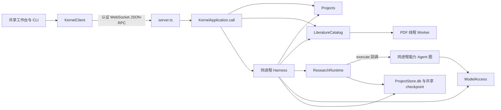

# 调查依据

## 当前事实与复用选择

调查日期：2026-10-19。范围及授权见 [proposal](proposal.md)。除下述内存实验外，证据为本工作区代码、测试定义和锁定依赖的静态核对；没有运行整套产品测试或三平台故障验收。架构决策和已更新的设计文档描述目标，不能据此认定当前代码已经符合。

| 当前事实 | 来源与复用决定 |
| --- | --- |
| `KernelApplication` 直接创建所有模块，以 `call` switch 分派；harness 收到项目、文献及科研具体实现。 | [application.ts](../../../apps/kernel/src/application.ts)，构造器及 `call`；保留装配入口，提供者注册和公共能力替代跨模块实现引用。 |
| `Harness.execute` 在内核进程创建 LangGraph；`invoke_research_capability` 又创建一个独立 Agent 图，同步等待它完成。 | [harness/runtime.ts](../../../apps/kernel/src/harness/runtime.ts)，`execute`、`buildAgent`、能力工具；提取宿主记录与执行端，能力图必须独立受管，不能只把最外层搬到子进程。 |
| 模型访问同时持有应用内并发计数和每次 `create` 的 32 次请求预算；父图和能力子图复用同一模型实例。 | [models/minimax.ts](../../../apps/kernel/src/models/minimax.ts)，`create` 与 `call`；迁移需保持全应用并发 1、180 秒请求期限及最多两次安全临时重试，并把父子共享预算移到宿主，不能在每个进程复制计数器。 |
| 项目库包含会话、指令、运行、文件、成果等表；harness 和 research 直接访问 `ProjectStore.db`，research 尝试及工具结果等混存于 `meta`。 | [storage/schema.ts](../../../apps/kernel/src/storage/schema.ts)、[research/runtime.ts](../../../apps/kernel/src/research/runtime.ts)；保留物理库，拆仓储及表归属，不透传数据库连接。 |
| 项目备份使用 SQLite backup，恢复副本时项目模块直接改会话与执行表；备份明确省略 checkpoint。 | [projects/store.ts](../../../apps/kernel/src/projects/store.ts)，`makeBackup`、`restore`；保留整库备份与独立副本保护，改为各记录所有者完成恢复重绑定。 |
| 文件和目录操作已有真实路径、内容变化重读、稳定身份、保存协调、回收核查及部分成功保护。 | [projects/store.ts](../../../apps/kernel/src/projects/store.ts)、[projects/files.ts](../../../apps/kernel/src/projects/files.ts)；条件核对及实际保存一起迁入资源端临界区，领域规则和历史仍归项目模块。 |
| library 从装配回调取得项目授权和真实路径，附件原字节、材料版本、阅读记录及备份已有共同权威。 | [application.ts](../../../apps/kernel/src/application.ts)、[literature/catalog.ts](../../../apps/kernel/src/literature/catalog.ts)；项目材料通过 broker 取得受限引用与有界内容，保留库侧版本和发布前授权复查。 |
| WebSocket 认证、JSON-RPC、快照通知、重连及调试所有权已实现；内部 Node 执行 RPC 尚未建立。 | [server.ts](../../../apps/kernel/src/server.ts)、[client](../../../packages/client/src/index.ts)、[lifecycle.ts](../../../apps/kernel/src/lifecycle.ts)、[bootstrap.ts](../../../apps/kernel/src/bootstrap.ts)；复用协议和生命周期，提取通用双向 peer，不复建服务。 |
| DTO 已来自 schema；`Inputs/Outputs` 仍逐操作手工列举推导关系，client 另有只读名单及 PDF 等 35 秒等待分支。 | [business.ts](../../../packages/protocol/src/business.ts)、[client](../../../packages/client/src/index.ts)；删除重复枚举和语义分支，以同源操作声明推导。这里没有第二套完整 DTO。 |
| PDF 当前每项使用一个线程 Worker，活动计算 1、等待队列 8、期限 30 秒；本地 WASM 解析及已知空页处理可复用。 | [pdf-reading.ts](../../../apps/kernel/src/literature/pdf-reading.ts)、[pdf-worker.ts](../../../apps/kernel/src/literature/pdf-worker.ts)；改为受管计算进程，保留既有预算和材料核查，不新增 OCR。 |
| 默认多个尝试共用 `checkpoints.sqlite`，异常回退才隔离到尝试文件；`beforeModel` 在 checkpoint 前更新 consumed。空闲 `send` 只取最近 30 条消息，`resume` 单独恢复旧图。 | [harness/runtime.ts](../../../apps/kernel/src/harness/runtime.ts)，`send`、`resume`、指令中间件、`continuation`；需要私有 checkpoint、保存后确认消费、正常跨轮完整有效上下文及统一消息入口。 |
| 工作台已通过发送新消息接续，无独立继续按钮；CLI 仍有 `continue`，协议仍声明 `session.resume`。 | [cli.ts](../../../apps/kernel/src/cli.ts)、[business-session.tsx](../../../apps/desktop/src/renderer/src/workbench/business-session.tsx)、[界面设计](../../../docs/ui-design/README.md)；删除旧公开入口，保留现有布局及 composer。 |



图中关系依据上表源码静态核对。图不表示已完成故障隔离；独立 Zotero 宿主只有原型入口，尚未加载插件或连接共同内核，本次保留它的构建与 smoke 边界。

### 现有验证入口

- [根脚本](../../../package.json)提供 lint、typecheck、build、test:kernel、test:smoke、test:ui；测试读取 dist，包调整后先构建。`build:shared` 当前只选三个包，需改为包含其依赖闭包。
- [harness](../../../tests/kernel/harness.spec.ts)、[limits](../../../tests/kernel/harness-limits.spec.ts)、[sessions](../../../tests/kernel/sessions.spec.ts)覆盖指令、工具未知、checkpoint 回退、配置、归档和恢复，但使用应用内部对象、旧接续入口或旧文件路径，须沿新公开接口及专用故障夹具调整。
- [项目文件](../../../tests/kernel/project-files.spec.ts)、[文献整合](../../../tests/kernel/literature-integration.spec.ts)、[PDF](../../../tests/kernel/pdf-reading.spec.ts)、[科研能力](../../../tests/kernel/research-capabilities.spec.ts)是现有行为的回归入口。
- [transport-proxy](../../../tests/kernel/transport-proxy.ts)、[UI rpc-gate](../../../tests/ui/rpc-gate.ts)可复用为丢回执和通信故障边界；[生命周期](../../../tests/kernel/lifecycle.spec.ts)、[开发入口](../../../tests/kernel/development.spec.ts)和双宿主 UI 覆盖实际接线。
- [CI](../../../.github/workflows/checks.yml)已有 Linux／Windows／macOS 矩阵及目录分发包构建。测试定义不是本次实跑结果；真实模型检查仍是显式、独立的验收。

## 影响方案的未知项与实验

### checkpoint 保存后确认消费能否使用现有框架

锁定版本：LangGraph 1.5.0、checkpoint-sqlite 1.1.0、LangChain 1.5.16、deepagents 1.15.0。已读取本机安装版本的 `pregel/loop.js`、SQLite saver 的 `put/putWrites` 及 middleware `stateSchema`：同步 durability 等待 saver Promise，middleware 状态进入 checkpoint，saver 可通过公开继承点在实际保存后执行确认。

问题：不更换框架，能否保证指令身份已进入可读回 checkpoint 才确认消费，并在保存或确认失败时停止下一模型步骤？

输入与停止条件：本机当前 Node，`better-sqlite3 :memory:`，`FakeListChatModel`，一条稳定指令；仅核对正常、保存失败、确认失败三个分支，全部满足断言后停止。禁用追踪，无真实模型、网络或磁盘数据写入。以下命令在 `apps/kernel` 工作目录运行：

```sh
LANGSMITH_TRACING=false LANGCHAIN_TRACING_V2=false node --input-type=module - <<'JS'
import assert from 'node:assert/strict';
import Database from 'better-sqlite3';
import { SqliteSaver } from '@langchain/langgraph-checkpoint-sqlite';
import { FakeListChatModel } from '@langchain/core/utils/testing';
import { HumanMessage } from '@langchain/core/messages';
import { createDeepAgent } from 'deepagents';
import { createMiddleware } from 'langchain';
import { z } from 'zod';

for (const failure of ['none', 'save', 'ack']) {
  const db = new Database(':memory:');
  let consumed = false, modelCalls = 0, savedInstruction = false;
  class ProbeSaver extends SqliteSaver {
    async put(config, checkpoint, metadata, versions) {
      const ids = checkpoint.channel_values.instructionIds ?? [];
      if (ids.length && failure === 'save') throw new Error('probe-save-failed');
      const saved = await super.put(config, checkpoint, metadata, versions);
      if (ids.includes('instruction-1')) {
        const stored = await this.getTuple(saved);
        assert(stored.checkpoint.channel_values.instructionIds.includes('instruction-1'));
        savedInstruction = true;
        if (failure === 'ack') throw new Error('probe-ack-failed');
        consumed = true;
      }
      return saved;
    }
  }
  const saver = new ProbeSaver(db);
  const agent = createDeepAgent({
    model: new FakeListChatModel({ responses: ['done'] }),
    checkpointer: saver,
    middleware: [createMiddleware({
      name: 'ProbeInstructionBoundary',
      stateSchema: z.object({ instructionIds: z.array(z.string()).default([]) }),
      beforeModel: () => ({
        messages: [new HumanMessage({ id: 'instruction-1', content: 'probe' })],
        instructionIds: ['instruction-1'],
      }),
      wrapModelCall: async (request, handler) => {
        assert(consumed);
        modelCalls += 1;
        return handler(request);
      },
    })],
  });
  const config = { configurable: { thread_id: `probe-${failure}` }, durability: 'sync' };
  let error;
  try { await agent.invoke({ messages: [] }, config); } catch (cause) { error = cause; }
  if (failure === 'none') {
    assert(!error, String(error));
    assert(consumed && savedInstruction && modelCalls === 1);
  } else {
    assert(error);
    assert(!consumed && modelCalls === 0);
    assert.equal(savedInstruction, failure === 'ack');
    if (failure === 'ack') {
      const recovered = await saver.getTuple(config);
      assert(recovered.checkpoint.channel_values.instructionIds.includes('instruction-1'));
    }
  }
  console.log(JSON.stringify({ failure, savedInstruction, consumed, modelCalls, verified: true }));
  db.close();
}
JS
```

本轮规划调查已实跑，三个结果分别为：

| 分支 | checkpoint 含指令 | 已消费 | 模型调用数 | 结果 |
| --- | --- | --- | --- | --- |
| 正常 | 是 | 是 | 1 | 断言通过 |
| 保存失败 | 否 | 否 | 0 | 断言通过 |
| 保存后确认失败 | 是，重新读取仍在 | 否 | 0 | 断言通过 |

这证明所选公开接入点可建立保存后确认的顺序。它不证明磁盘耐久性、IPC 送达、进程强杀后的恢复、完整产品图兼容或跨资源原子性；这些分别进入实现任务。没有生成需保留或清理的实验文件，命令保存在本工件中供复核。

## 结论与承接

采用 [design](design.md) 的私有包、broker 和双向 RPC 组织，复用当前 SQLite、LangGraph、WebSocket、文件保护及测试基础，不增加第二套工具调用台账或框架后端。足以确定本次架构和任务依赖；系统级资源耗尽不承诺全应用仍可用，进程拆分不构成恶意代码沙箱。

尚未运行的进程退出／宿主失联、真实文件竞争、通信过载、旧数据提取和跨平台接线属于所选方案必须通过的实施验收，具体样本及完成依据进入 tasks。它们失败时修正对应平台适配或机制，不能以替身或代码阅读宣称保证已满足；如发现必须改变既定故障范围或依赖政策，再返回决策。
