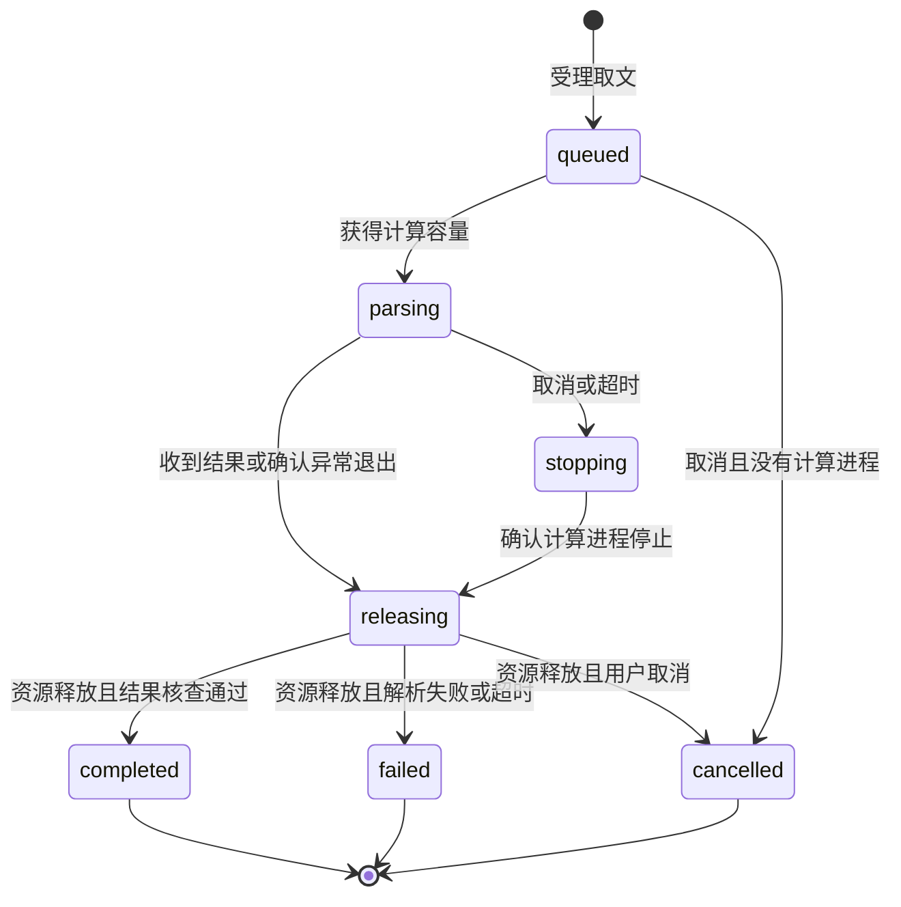

# Spec Delta

## MODIFIED Requirements

### Requirement: 独立有界 PDF 取文

系统 SHALL 根据稳定附件和材料版本引用检查 PDF 及读取指定页的正文，不要求打开 GUI。响应 SHALL 区分页数、请求页、实际返回文字及截断／下一位置；单页超出响应预算时允许按字符位置继续，不把部分文字表示为完整材料。无文字层、加密不支持、格式损坏、材料缺失／变化及范围无效 SHALL 可辨，不能把解析失败作为空白正文成功返回。读取 SHALL 有输入、响应、并发及执行时限边界；停止或超时不报告已完成，后续合法请求仍可执行。取文 SHALL 不改写原材料。

解析计算 SHALL 在独立受管的操作系统进程中执行，线程 Worker SHALL 不视为满足该隔离；解析进程阻塞或崩溃 SHALL 不影响宿主、文献库查询及无关会话，崩溃后的合法请求仍可执行。取消、超时或崩溃的收尾 SHALL 在确认本地计算进程停止并释放资源后，才上报本地取消或安排需要同一容量的新请求。取文及结果交付的权限复查 SHALL 沿用阅读授权要求。

#### Scenario: 阅读窗口从未打开
- **WHEN** 授权调用方按稳定材料引用读取 PDF 的第二页
- **THEN** 取得该版本第二页的有界文字及页信息，结果不依赖可见阅读窗口

#### Scenario: 超长或无文字层的页面
- **WHEN** 一页文字超过单次预算，或页面只有扫描图像
- **THEN** 前者明确截断及继续位置，后者明确没有可提取文字，均不宣称已经完成 OCR 或全文分析

#### Scenario: 材料或执行不可用
- **WHEN** 目标文件内容已变、PDF 损坏或读取超时
- **THEN** 返回对应结构化失败，保留附件与已存记录，不将错误缓存成成功正文

#### Scenario: 解析崩溃后恢复
- **WHEN** 某次取文的解析计算进程崩溃，随后按合法材料引用重新取文
- **THEN** 宿主与文献库未受影响，受影响请求返回可辨失败，新的合法取文正常执行

#### Scenario: 解析卡死时库与其他会话仍可响应
- **WHEN** 某次取文的解析进程阻塞或长时间占用
- **THEN** 宿主、文献库查询及无关会话仍正常响应，该请求按自身时限收尾，后续合法请求仍可执行
