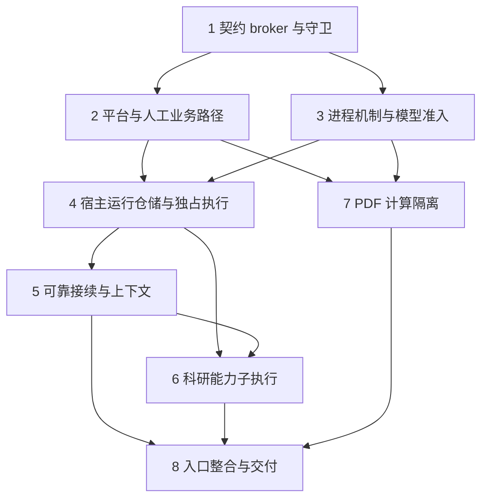

# 执行任务

契约见 [specs](specs/)，模块、文件清单和验证矩阵见 [design](design.md)。以下复选框只记录业务迁移的实际进度；建档和静态校验不完成这些实施任务。每组随成果更新开发说明与相关检查，失败或未运行的必要验证保留未完成。

主 Agent 负责同源协议、宿主装配、共享迁移及最终整合。1 组完成后，2、3 组可在明确的 packages/platform 子目录、领域包和模型包写入范围内并行；platform 公共接口变更仍由主 Agent 统筹。7 组可与 4–6 组并行，写 library 的 PDF 适配及对应测试，library 其他共享文件由其当前所有者整合；不安排重叠写入。

## 1. 契约、broker 与即时架构守卫

- [x] 1.1 将当前 protocol 操作按领域入口整理，声明副作用、返回模式和等待策略，派生参数／结果及注册签名；增加内部运行、模型准入、资源和事件契约，公共核心不反向依赖领域聚合。以参与真实 typecheck 的错误参数、错误提供者返回、越界操作及声明／类型映射不符反例和已有 client 校验场景验证；确需生成的映射继续引用原 schema，提供生成入口并复用键完整性与类型检查发现漂移。保留现有业务载荷，仅移除已确认的公开 resume 并升级协议为 2。
- [x] 1.2 交付 broker 的提供者注册、受限且类型化的消费端口、可信上下文及请求／结果／事件校验，宿主只启用实际配置满足的能力；公共类型接入口绑定 schema 与实际载荷类型，不能仅核对操作键，实例转赋值及联合操作调用仍保留该绑定和参数关联。验证重复／缺失提供者、越权消费、错误结果及事件局部拒绝，已发生副作用不被误报为未发生。核对消费端口只暴露所需操作，领域最终授权、业务顺序及宿主资源准入未被移入 broker。对应 module-runtime 的统一调用及同源契约要求。
- [x] 1.3 从现有 client/server 提取共同双向 peer 及 WebSocket 适配，使用同源契约决定等待和效果未知；扩展 client.spec 与 transport-proxy，验证反向调用、超时、非法响应、慢连接和控制保留容量。用小容量注入覆盖上限，记录默认容量的受控测量依据，维持 2 MiB 帧上限。
- [x] 1.4 建立唯一 architecture.json、TypeScript 依赖／系统访问检查器和 check:architecture 入口；真实违约夹具覆盖循环、反向依赖、类型／动态静态可分析引用、私有路径及系统访问，合法样本通过。对尚未迁入边记录具体例外及本任务表的移除位置，不全局豁免旧内核。
- [x] 1.5 新包逐个接入依赖图构建，调整 build:shared、工具类型检查及本地／CI 架构检查；将契约编译期反例和实际装配的生成映射一致性纳入既有本地／CI typecheck，不能仅经测试运行器转译。完成受影响 typecheck、build 和现有客户端测试，确认 CLI/bootstrap 与分发资源消费的是实际构建产物。

## 2. 平台资源与无 harness 人工业务路径

- [x] 2.1 提取现有范围检查、私有文件、锁、环境、网络和宿主选择等平台／适配入口，保留有界读取、真实路径与权限诊断；在真实临时文件系统运行 private-files、project-files 相关场景，验证越界、符号链接、损坏保护和资源释放，守卫拒绝普通模块绕行。
- [x] 2.2 将项目、文件身份、编辑及结构操作迁至 projects，保存临界区作为一次资源端操作，成果关联归 projects 公共接口；复用文件保护、移动／回收、未知操作及备份测试，验证同一文件竞争和目标身份变化不会覆盖后续内容。
- [x] 2.3 将题录、附件、阅读记录、批次和库授权迁至 library；通过 broker 使用项目材料引用与平台能力，替换装配中直接取得项目路径的回调。复用文献、附件、阅读和整合测试，验证撤权、材料版本、原字节和批次部分成功。
- [x] 2.4 交付不注册 harness 的实际人工组合，验证创建／查询题录、读取附件、保存阅读记录和编辑项目文件；这些动作不创建会话、不调用模型。清除对应旧实现及策略例外，完成模块独立测试、诊断入口和开发说明更新；独立测试可替换所需消费端口，不要求启动 broker、完整宿主或无关模块，生产组合仍验证真实 broker 接线。

## 3. 受管进程机制与统一模型准入

- [x] 3.1 交付按运行归属的控制辅助进程、Node IPC 适配、实际进程身份登记及平台停止机制；受控执行独占实际 Agent／计算进程，控制路径不执行 Agent。真实夹具验证忙循环、协作退出、升级终止、宿主强杀后的自动收尾和旧 PID 身份不符，进程回收不依赖被监督循环响应。
- [x] 3.2 接入独立于模型额度的进程容量和有界等待，保留必要控制处理；父子等待时实际进程仍计占用，不能安排子执行时返回资源限制。通过小容量及慢执行样本核对无死锁、拒绝发生在新工作受理前、普通流量不饿死控制，并记录默认容量依据。
- [x] 3.3 迁移 models 配置、凭据及执行侧 SDK 适配，宿主持有并发 1、180 秒期限、根推进 32 次及安全临时重试上限；模型流结束即释放并发，已使用预算不因子执行退出返还。复用 model-access、harness-limits 与外部 HTTP 模型夹具，验证跨进程并发、压缩／重试计数、撤权和旧实例拒绝。
- [x] 3.4 验证秘密只经受限内部适配交给对应执行，不进入 argv、普通协议、日志、项目、备份或完整继承环境；保留凭据损坏和权限保护，未选定模块不能取得凭据能力。完成相关类型／构建／行为检查及平台诊断说明。

## 4. 宿主运行仓储与独占 Agent 执行

- [x] 4.1 交付 harness 宿主仓储及项目容器 v2→v3 迁移：迁移运行 meta，创建自身运行实例记录；同时为 research 提供自己的尝试表，模块只访问所属记录。沿既有迁移链先备份、事务搬迁并核对稳定身份和完整结果，受控中断后只从原版本或已提交版本继续，不打开半迁移数据执行。
- [x] 4.2 将现有 LangGraph、上下文处理和 SDK 调用装配至独占执行入口，以所需领域契约及受限、类型化消费端口替代 ProjectStore、LiteratureCatalog 和 ResearchRuntime 实现引用及全产品操作集合依赖。模块测试可替换消费端口，生产工具经 broker 接入。无 GUI 场景经真实 CLI/WS、IPC、工具、文件及数据库完成已授权读写，复用 harness 现有成功和失败行为。
- [x] 4.3 实施宿主实例、执行尝试与运行实例资格核查，持久化归属后才放行；只允许当前有效实例提交推进、申请模型及新工具。故障夹具验证单执行阻塞／退出时宿主、库和另一会话仍响应，旧实例请求和迟到状态不能污染新实例。
- [x] 4.4 接通工具开始收据、完整结果及有界预览，记录先保存再执行、结果先保存再回图；保留旧工具记录读取。复用未知结果及结构操作测试，补实际效果发生但结果缺失、收据保存失败和非法结果不传播的稳定故障边界。
- [x] 4.5 将项目备份／副本恢复改为受控容器设施和各模块恢复入口协作，projects 不再改 sessions/runs，harness 不再写 artifacts。以包含归档会话、执行、科研记录、回收材料和成果的旧样本核查副本重绑定、授权清除及中断状态，当前项目和后续编辑保留。

## 5. 可靠消费、私有 checkpoint 与统一消息入口

- [x] 5.1 落实每尝试私有 checkpoint 和有效实例独占；旧共享及已有独立文件按所属尝试惰性提取，源文件保留。测试两个尝试互不损坏、兼容导入、namespace/pending writes 保留和损坏回退，旧写者未排除时拒绝接续。
- [x] 5.2 将 consumed 更新移到同步 saver 保存后的幂等确认，checkpoint 持有稳定指令身份与有界确认信息；使用真实磁盘及 IPC 注入指令受理、保存、消费确认间中断。验证保存失败不消费，确认丢失不重复注入，超过 100 条未完成指令仍全部可查及参与接续。
- [x] 5.3 统一发送消息、正常跨轮及异常后的内部推进，先处理最新指令和旧工具实际效果；兼容接续保留尝试及钉入模型配置，回退保留旧记录，正常新轮解析当前配置并继承有效上下文。将现有 resume 调用方和测试改用发送新消息，验证撤回旧目标不盲目重放、未知效果只暂停相关动作。
- [x] 5.4 为下一尝试接入最后有效图状态及必要 scratch 资源，保留工具完整内容、摘要、目标与约束，不再仅重建最近 30 条聊天。用超页约束、工具结果、框架压缩及关闭重开样本核对连贯行为；缺失时说明缺失，从持久材料回退，不把损坏误报为完整恢复。
- [x] 5.5 用实际文件工具验证工作形成时保存目标、依据、进展及成果；在不提供旧消息／checkpoint 的新会话从这些材料接续。必要记录保存失败阻止相关后继操作，普通上下文丢失不阻断可独立进行的领域工作，不新增通用工具台账或会话删除功能。

## 6. 科研能力子执行与取消整合

- [x] 6.1 迁移 research 内容、调用尝试和实际交付检查，向通用 harness 提供业务适配；以独占子进程替代现有内联能力图，使用公共项目／文献接口，不直接读会话或项目表。复用材料分析与科研能力测试，从真实产品入口核对输入、授权、稳定 invocation、尝试和实际报告。
- [x] 6.2 验证父子执行共用模型预算和取消归属，等待不持有模型名额，进程不足即时诊断；能力崩溃不拖垮宿主、重试沿原 invocation 建新尝试，缺报告及部分成功不误报 usable。
- [x] 6.3 整合父子停止、实例撤权、工具在途、已受理领域操作及迟到结果；真实取消场景须先确认相关单元及本地操作收尾才终态。验证文件已保存但关联失败只补关联、已停止推进不被后台结果自动唤醒，保留原始成果。

## 7. PDF 计算进程与既有阅读路径

- [x] 7.1 将现有 PDF Worker 解析接到受管计算进程，复用 WASM、空页处理、输入输出限制和活动 1／等待 8／30 秒预算；容量在读取材料前取得，结果交付前核对版本及授权。原字节、本地资源、页信息与截断行为沿现有 PDF、附件及阅读测试验证。
- [x] 7.2 真实注入解析阻塞、崩溃、取消和超时，确认计算进程停止及资源释放后才重用容量；核对宿主、库查询和无关会话仍响应，随后合法 PDF 请求成功。同步阅读模块与双宿主 PDF／阅读记录回归及开发说明。

## 8. 公共入口、平台与最终交付

- [x] 8.1 完成 KernelApplication、投影和分角色服务装配，删除大 switch、旧跨模块引用和已替代内核领域副本；清除本范围策略例外，真实入口运行架构检查、类型和构建。同步 Node、Electron 和浏览器的薄宿主适配，公共入口不暴露内部控制。
- [x] 8.2 删除公开 session.resume、CLI continue 及对应帮助／调用，维护协议 2 发现、认证、重连和范围刷新；通过真实 CLI 与代理核对旧协议明确拒绝且不抢占旧内核、缺可选能力局部不可用、未知回执可核查及草稿保留。
- [x] 8.3 运行既有调试内核所有权、生命周期及双宿主业务 e2e：普通关窗不停止执行，页面刷新不换实例，最后调试所有者退出或异常失联会回收本轮内核和执行单元，库及项目资料保留。浏览器与 Electron 使用同一真实业务和事件路径。
- [x] 8.4 完成 pnpm lint、pnpm typecheck、pnpm build、pnpm test:kernel 及 smoke／UI 检查；保留三平台 CI，并在实际目标平台核查文件保证、进程树与分发包中的 Node 子进程、原生依赖和 WASM 入口。按环境记录确定性响应、取消延迟、启动和传输开销；未运行的平台及失败项不得标为通过。本次目标按用户确认为 Linux，Windows／macOS 保留未验收记录。
- [x] 8.5 对共享契约、迁移保护、进程及恢复边界安排独立审查，核对本变更 specs、实际差异和运行证据；真实模型验收沿显式入口及有效凭据授权执行，明确受控模型与真实科研效果边界。更新实际开发说明、架构／接口文档及相关图源，正式规格同步时用链接替换对应初设内容，按实际关键约束维护项目 AGENTS。
- [x] 8.6 依据实际执行结果获取 delivery instructions，创建或更新 delivery.md，对应 proposal 六项完成判据记录命令、样本、真实接线、替身边界、结果、审查和未完成项；只有必要验证和交付依据均齐备后完成本项。

## 续做入口

当前 34/34 已完成，实际结果及审查见 delivery；用户确认本次以 Linux 验收，Windows／macOS 保留未验收记录。正式规格已同步，变更未归档、代码未提交。后续范围或实现变化仍先核对同一 specs／design／delivery，不能将本机结果扩大为其他平台通过。
