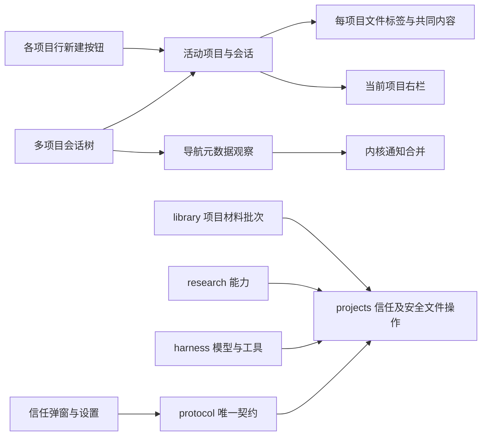
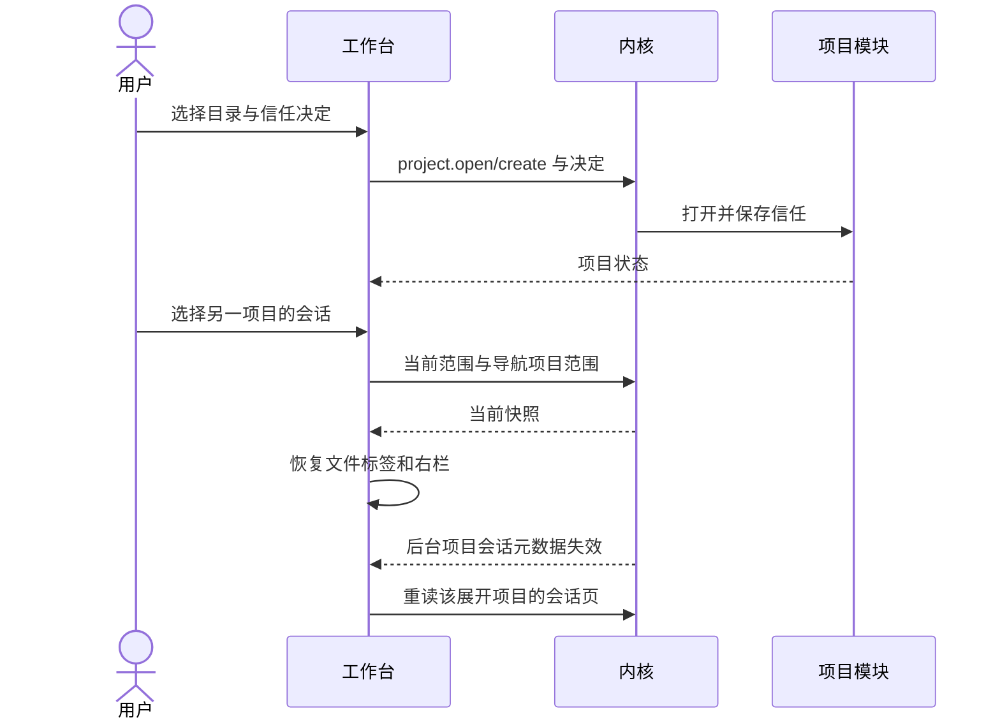

# 实现设计

## 变更总览

## 方案与接口

- `Project.trust` 为 `pending | trusted | restricted`，替换三项可配置布尔权限。`project.grant` 接受已确认 trust 和 autoBackup；`project.open/create` 可接收显式 trust，未提供决定的新项目为 pending。普通会话维持可聊天、无项目文件能力。
- 信任随现有项目 meta 保存。容器 v4 转换旧 grants，备份旧库后令普通项目 pending，保留 autoBackup；恢复副本也 pending。最近项目仅 pending 时提示；显式添加在信任步骤后才调用写操作。
- projects 集中判断信任，人工和 Agent 沿宿主固定的 CallContext 区分。Agent 入口及实际访问复查 trust，人工操作不要求 trust；真实路径、私有资料和并发保护沿原实现。撤信任不主动取消在途调用。
- library 项目摄取保存经宿主确认的 Agent 来源，在准备及提交前按来源检查。人工来源不能由 Agent 参数冒充，库授权独立核对。
- `workbench.watch` 增加有界 navigationProjectIds；`workbench.changed` 增加独立 sessionProjectIds 集合。活动正文只通知当前范围，后台流式正文不刷新导航。
- SessionList 不再按活动项目重建。项目组保留自身分页、展开及选择状态，只有展开组按需加载会话页；按项目和请求版本丢弃迟到结果。行点击只折叠展开，新建按钮固定在该行扩展菜单右侧并绑定所属 projectId，创建期间禁用重复新建。
- 全局顶部、折叠轨和中间空态移除新建入口。真实与样例项目行使用相同图标布局，普通会话也有独立新建按钮。紧凑菜单复用 ContextMenu 的视口定位、Esc、方向键和焦点归还，展示项目路径，并以分隔线区分打开与从侧栏移除；移除沿既有确认及失败反馈，不夹入表单。
- ContextMenu 只观察当前菜单自身尺寸及窗口 resize，在确认或错误增高时重新约束位置；超出视口高度的菜单内部滚动，关闭即释放监听，不跟随会话流式渲染读取其他 DOM。
- 普通项目名称只取当前 canonical root 的 basename，application 仍为普通会话；移除 project.rename、project.create.name、renameProject 及 meta.name 读取，不清理原数据库字段。文件夹在系统中改名后重新添加，复用稳定身份与仓储重定位。
- 复用项目标签缓存、Explorer 的范围监听及草稿存储，补齐 library/settings 全局标签分类。移出非当前项目不切换接收者，移出当前项目沿原回退规则。

## 文件变化

- 新增 change 规划工件和六项 delta specs，执行后新增 delivery。
- 修改 protocol 的 project-contracts、operations、core 与派生类型；projects store 及操作授权；kernel manual、server、容器迁移；harness/research 检查及 library 批次来源。
- 修改 SessionList、business-session、ProjectOnboarding、ProjectNavigation、Workbench 和相关类型、样式；新增共享 ProjectTrustDialog。
- 扩展现有 kernel/UI 测试与 fixture，删除失效三权限设置和断言。
- 更新 UI 设计、开发说明、授权决议 #22、PRD、初设及必要项目 AGENTS 约束。
- 项目行调整还修改 ActivityPane、ActivityRail、TabGroups、shell icons 与现有语义样式，删除全局新建传递；更新 project-contracts、派生 business-types、manual、projects/store，适配 tests/ui/fixture 与现有调用，扩展项目文件及目录重定位回归。

## 验证与风险

先验证信任、迁移、人工/Agent 区分及排队撤权，再验证导航通知和双宿主操作。运行 lint、架构、类型、构建、内核和 UI 测试，外部模型使用受控响应。授权、通知隔离和草稿保护安排独立审查。协议升级要求旧内核重启；不安装依赖、不提交或切换 Git。验收限当前 Linux 环境，不代表跨平台分发验证。
