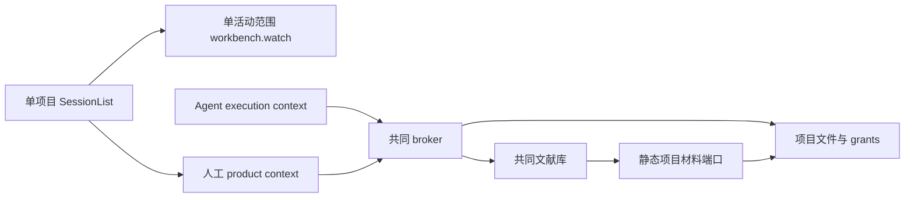

# 调查依据

## 当前事实与复用选择

本轮依据当前工作区源码静态调查，未将阅读测试定义当成实跑结果。仓库无 CodeGraph 索引。

- `packages/projects/src/store.ts` 已支持多个项目存储、最近登记、稳定身份；授权保存在项目 meta 的 grants，最近路径在配置目录 `projects.json`。
- `packages/harness/src/runtime.ts` 的会话记录已有 projectId；发送、执行排队后及每次模型调用都检查授权。`project-backend.ts` 复用领域文件端口。
- `apps/kernel/src/manual.ts` 通过 broker 绑定可信 CallContext。人工为 product/human，Agent 为 execution/agent；library 的静态项目材料回调当前没有传递摄取调用来源。
- `SessionList.tsx` 只渲染一个 ProjectNode；`business-session.tsx` 已保留按项目和会话隔离的草稿。`Workbench.tsx` 已缓存每项目文件标签组，共同材料阅读器跨项目保留。
- `apps/kernel/src/server.ts` 目前按单个活动项目过滤通知；仅扩展左栏不能更新后台项目状态。
- 现有项目、模型准入、科研能力、文件传输和双宿主 UI 测试可扩展；UI 测试使用隔离配置和端口 5174。

## 影响方案的未知项与实验

产品选择已在本会话明确；不需要额外原型或依赖。受限人工操作与 Agent 操作共用领域实现，须在调用上下文与实际授权检查处落实区分，不能仅隐藏 UI。后台库批次需要保存来源类型并在每项取用前检查，避免只在受理时判断。

## 结论与承接

项目行后续调查：当前顶部、折叠轨及空态均持有新建回调；真实项目行只在扩展菜单新建，样例项目行已有未正确显现的加号样式，可统一复用。菜单存在显示名表单，projects 在 meta.name 持久化别名，project.create.name 也能创建别名；只删 UI 重命名不能保证目录名成为事实源。方案同时移除这些写入及读取路径，旧 meta.name 保留原数据但不参与显示，不需要数据库迁移。目录重新添加沿现有稳定身份与运行时重定位流程验证。

复用现有项目、文件、草稿、标签组、菜单及 dialog。新增的是多项目导航投影、导航元数据通知和单一信任状态，不另建工作台或通用授权框架。实现测试与真实双宿主整合由 tasks 承接。
