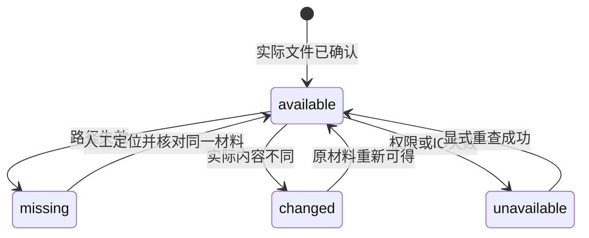

## MODIFIED Requirements

### Requirement: 有界取用与材料失效诊断

系统 SHALL 按附件引用有界查询状态及分段读取原字节，区别可读、缺失、内容已变和其他不可用原因。列表 SHALL 只检查当前分页对象，不扫描全库文件；实际取用 SHALL 核对材料版本。库读取授权控制取用；Agent 还需有效项目信任与库外发授权，模型请求及重试仍检查撤权。Agent 摄取只能从已信任项目根内的普通文件进入共同模块，不能借附件接口读取任意本机路径。

项目文件摄取 SHALL 保留宿主确认的调用来源；Agent 批次在后续准备及发布前复查信任，人工批次可从受限项目摄取，仍检查库授权。来源不能通过客户端参数自报提升。

#### Scenario: 撤回读取或外发
- **WHEN** 附件已存在，而用户撤回有效读取或 Agent 外发授权
- **THEN** 后续读取或模型请求被拒绝，既有附件与题录保留，不由继续执行自行重新授权

#### Scenario: 二进制分段读取
- **WHEN** 客户端按引用请求一个合法范围
- **THEN** 得到该材料版本在请求范围的原字节及实际总长度，不把二进制当成已解析正文

#### Scenario: Agent 摄取中撤销信任
- **WHEN** Agent 项目材料批次尚有未完成项，用户撤销项目信任
- **THEN** 后续材料取用或发布被拒绝，保留已确认成果；人工项目文件操作不被阻断
