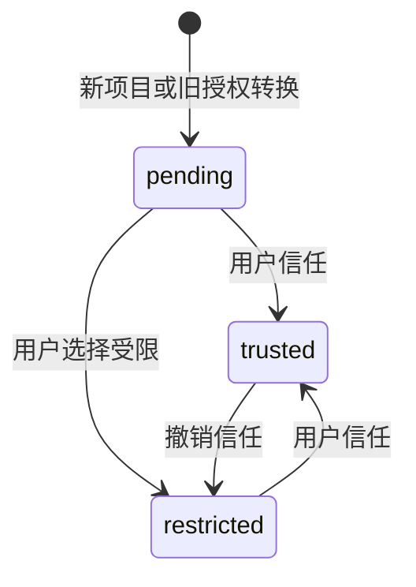

## MODIFIED Requirements

### Requirement: 项目创建与最近列表管理

系统 SHALL 支持创建不存在的项目目录和最近项目列表。普通项目名称 SHALL 始终为实际根目录末级名，不提供独立别名或项目重命名接口；旧持久别名 SHALL 不覆盖目录名。新建不得覆盖已有目录；移出列表不删除数据、不关闭在途执行使用的存储。再次打开 SHALL 保留会话与身份并重新登记；用户在文件系统中改名后重新添加 SHALL 使用新目录名并保留原项目身份和记录。

#### Scenario: 执行期间移出最近列表
- **WHEN** 用户移出一个正在执行的项目
- **THEN** 项目从最近列表移除，执行和磁盘内容保留，再次打开可查看结果

#### Scenario: 文件夹改名后重新添加
- **WHEN** 用户在文件系统中改项目根目录名称，再按新路径添加，项目曾保存独立别名
- **THEN** 显示新目录名，项目身份、会话与文件记录保留，旧别名不参与显示

### Requirement: 稳定文件引用与结构管理

系统 SHALL 按需登记稳定文件身份，支持创建目录、重命名文件及非空目录、回收及恢复。成果和撤销引用 SHALL 跟随应用确认的结构变更，历史路径与正文不被改写。人工结构操作 SHALL 使用共同文件保护，Agent 结构操作 SHALL 要求项目信任。操作 SHALL 与相交路径的保存协调，保留并失效旧读取依据，不自动重建已移走目标。

#### Scenario: 原路径复用
- **WHEN** 一个已登记成果被改名或回收，原路径随后创建另一文件
- **THEN** 成果仍指向原文件身份，不能打开或撤销另一文件

#### Scenario: 目录与保存竞争
- **WHEN** 人或 Agent 保存子文件的同时重命名父目录
- **THEN** 短暂提交按相交路径协调；旧依据保存拒绝或在已确认的原提交前完成，草稿与实际文件保留

## ADDED Requirements

### Requirement: 单一项目信任与人工访问

系统 SHALL 用 pending、trusted、restricted 表达项目的待确认、信任及受限状态，替换读取、写入、外发三项独立项目授权。信任 SHALL 允许 Agent 在项目范围内读取、修改和向所选模型发送材料；人工浏览和编辑 SHALL 不依赖项目信任，仍核对路径、私有资料及文件保护。自动备份及库授权 SHALL 独立管理。所有旧项目及恢复副本 SHALL 待重新确认，转换前保护原数据和备份设置；明确选择受限后不得因普通重开反复询问。撤销信任 SHALL 阻止后续 Agent 动作，不主动取消已在途调用，不回滚已保存内容。

#### Scenario: 受限人工编辑
- **WHEN** 项目待确认或明确受限，用户读取并保存项目文件
- **THEN** 人工操作可用，Agent 读取、写入及模型调用被拒绝，文件边界及内容保护仍生效

#### Scenario: 旧项目重新确认
- **WHEN** 打开具有任意旧三权限组合的项目
- **THEN** 原身份、会话和成果保留，项目为待确认，不自动继承 Agent 权限

#### Scenario: 撤销后续动作
- **WHEN** 用户撤销正在执行项目的信任
- **THEN** 新指令、排队后启动、后续模型和工具操作被拒绝，在途结果按实际保存，其他项目不受影响
