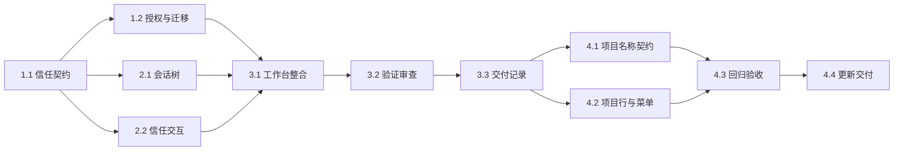

# 执行任务

## 1. 信任契约与领域执行

- [x] 1.1 主 Agent 更新 protocol 的项目、操作、通知与版本契约，派生类型一致，规划规格验证通过。
- [x] 1.2 主 Agent 实现单一信任、旧授权保护迁移、人工与 Agent 区分和库材料来源保留；相关内核回归验证通过。

## 2. 辅助 UI

- [x] 2.1 辅助实现多项目 SessionList：各组展开、分页、后台元数据更新和正确归属操作；主 Agent 接线并核对切换及迟到结果。
- [x] 2.2 辅助实现 ProjectOnboarding、ProjectNavigation 和共享信任弹窗：信任、受限、取消及设置操作正确；主 Agent 负责旧项目提示及 composer 接线。

## 3. 整合与交付

- [x] 3.1 主 Agent 完成导航通知、活动选择和文件标签/草稿整合，同步文档与项目关键约束。
- [x] 3.2 完成构建、类型、lint、架构检查、受影响内核与双宿主 UI 验证及独立审查，修复发现的问题。
- [x] 3.3 根据实际执行结果完成 delivery.md，核对本次完成判据及必要验证，再更新本项状态。

## 4. 项目行操作收口

- [x] 4.1 项目名统一取目录末级名，移除持久别名读取、project.rename 与创建别名参数，保留文件夹改名重新添加后的身份和记录。
- [x] 4.2 每个项目及普通会话行在扩展菜单右侧提供新建按钮，移除全局入口；菜单仅保留打开和确认移除，复用视口定位、键盘与焦点行为。
- [x] 4.3 调整现有测试调用，验证创建归属、迟到结果、菜单与目录改名，完成相关内核及双宿主验收和必要静态检查。
- [x] 4.4 同步 UI 设计和开发说明，按本轮实际结果更新 delivery，核对所有任务状态。

## 续做入口

从 `openspec instructions apply --change add-multi-project-workbench-and-trust --json` 获取当前任务；共享契约及设计以本 change 为准，执行证据进入 delivery。
