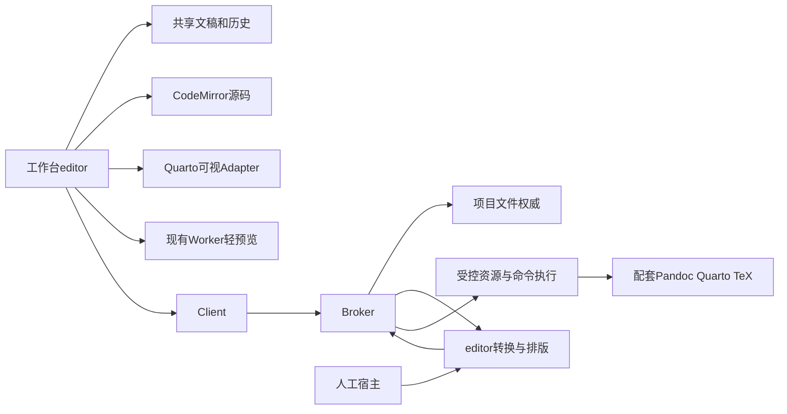
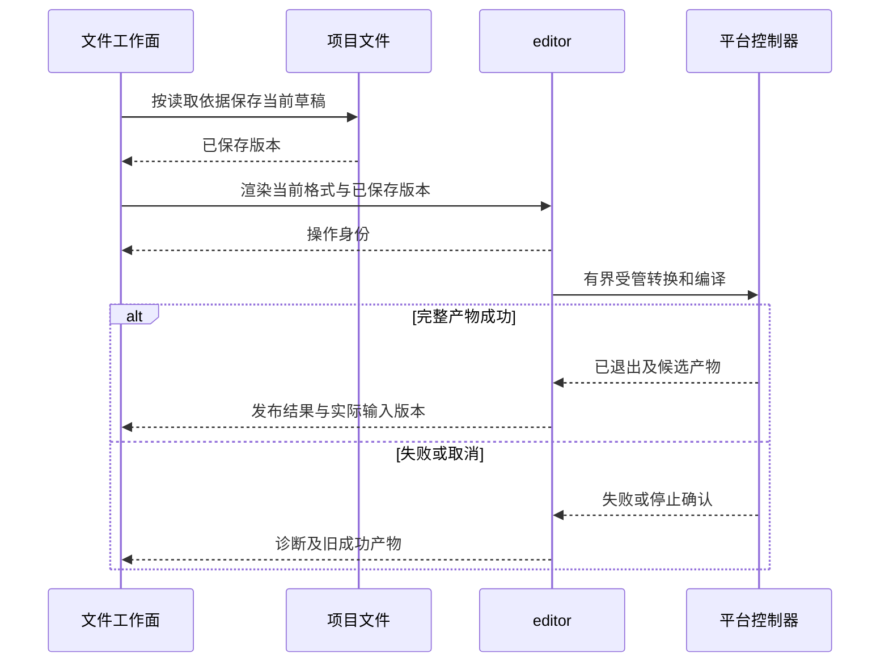

# 实现设计

## 变更总览

## 方案与接口

保留 `fileDocument` 和项目条件保存，编辑呈现抽到 workbench/editor。CodeMirror 使用文稿级状态和单一撤销历史，各视图投影事务并映射自身选区；外部内容更新避免逐次销毁编辑器。可视 Adapter 载入同一草稿，异步写回串行化并按版本防止迟到转换覆盖更新编辑；保存等待当前可视变更进入草稿。未识别语法或 metadata 阻止有损可视写回，源码仍可操作。

页面退出或可视实例卸载时，将尚未写回的 ProseMirror 状态同步保存到同一文件草稿的恢复记录，避免在高频输入时全量序列化文档。重开、路径变化及已有分屏读取当前恢复记录，经 Pandoc 还原为源码；共享文稿核对该记录仍未消费后发布，迟到恢复只读取最新正文。可视写回仅由当前转换视图发布，卸载失败释放该视图占用；旧保存回执只有在没有新转换或恢复记录时才能清理草稿。

`@scholoom/editor` 提供纯类型／格式计算出口、Node 转换／编译出口及 Quarto 浏览器 Adapter；Quarto 源码固定基线，保留必要包、资源及声明，不引入完整 VS Code、RStudio 或 Quarto editor-ui 的 Redux／Fluent UI。工作台提供既有风格的对话框、图片资源和 KaTeX 数学适配。

`packages/protocol/src/editor.ts` 是 editor 能力声明及派生类型事实源。共同入口包括工具状态、Pandoc 转换、项目书目查询、渲染开始／状态／取消／分块产物读取／显式导出。渲染输入携带项目、稳定文件身份或路径、格式及操作身份；结果携带输入依据、终态、诊断、最后成功产物。Pandoc AST 只作为开放格式转换载荷，不传递 ProseMirror 私有状态。

人工宿主注册 editor 提供者，通过 broker 绑定项目检查、文件读取／定位、受控执行和导出端口；模块不直接访问其他数据库。进程创建只在 platform 受控适配内发生，复用进程名额及独立控制器；内核拥有注册、生命周期及故障核查。工具路径由宿主提供或发现，GUI 不能提交任意 shell 命令。

普通预览构建必要输入的受控快照，不复制整个项目；保持引用路径关系，解析并选择被动配置，排除工程钩子、用户 Lua／扩展及 shell escape。未知可执行配置显式诊断，已有计算结果可复用。LaTeX 按明确主文件、包含文件和 bibliography 工作，编译临时文件与最后成功产物归 editor 操作所有。输入版本变化时结果只作为旧结果，不覆盖当前结果标识。显式导出通过项目现有受保护文件传输发布。

排版视图按稿件及已发现依赖筛选项目文件通知，同时有界监听稿件祖先目录中的 Quarto 配置；无关文件保存和产物导出不触发该稿件的自动编译。

## 文件变化

- 新增 `packages/editor/`：契约消费者、格式转换、调度、产物和受控快照；必要 Quarto 源码／Lua 资源及来源声明。
- 新增 `packages/protocol/src/editor.ts`，修改 operations、business 类型与 package 导出：传播共同契约。
- 修改 `packages/platform/`、`apps/kernel/src/manual.ts`、内核装配、`architecture.json`：受控执行、资源端口、生命周期及依赖守卫。
- 新增 workbench/editor，修改 project-ui、file-document、tab-state、TabGroups、Workbench 和 styles：整合编辑、模式及状态，删除被取代的内联编辑器逻辑。
- 修改相关 package.json、构建资产配置及锁文件：固定必要依赖与离线资源；安装前先取得具体授权。
- 修改 UI 设计、development、初设链接与 #39：记载已确认行为和真实运行入口；新增／扩展相关内核及双宿主测试。

## 验证与风险

先验证真实 Quarto 模块和 Pandoc 配套资源的独立接入，随后集成实际文件路径。已有文件测试负责条件保存与结构变更；新增转换语义、未知内容、任务终态、脚本禁止、产物完整性和无 harness 人工调用测试。双宿主从文件树经控件读取真实产物，测试环境隔离项目／配置／输出和进程归属。

使用已有短稿及约230KiB长稿、中文、公式、引文、图片与多文件LaTeX；测量输入响应和预览更新，区分转换／编译及实际显示。类型、架构、构建和受影响测试按现有脚本运行。Linux本机工具实跑不能代表其他平台分发，缺项或未运行检查保留在delivery，不将任务提前勾选。
