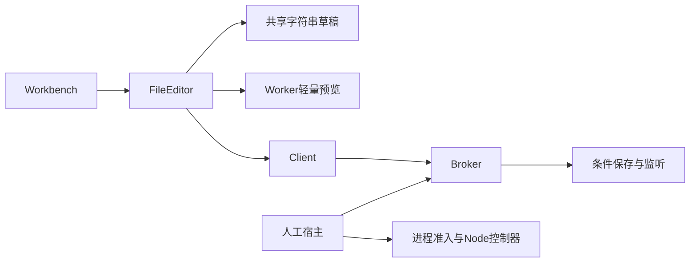

# 调查依据

## 当前事实与复用选择

- `apps/desktop/src/renderer/src/workbench/project-ui.tsx` 集中承担 CodeMirror 生命周期、保存、监听、差异、历史及预览；当前只有 Markdown 语言与默认键位。`file-document.ts` 已按稳定身份共享字符串草稿，但重新挂载会重建撤销历史。
- `tests/ui/file-workbench.spec.ts`、`file-explorer.spec.ts` 和内核文件测试覆盖条件保存、保存中继续编辑、结构变更、临时标签及监听，应扩展这些行为测试。
- `ManualApplication` 已经提供无 harness 的文件／文献基础组合。平台 `ManagedNode`、`ProcessAdmission` 与独立控制器已有进程树收尾，但只接受 Node 入口，没有人工编译服务或编译任务记录。
- 已确认技术路线为 CodeMirror 6 与 Quarto 的 ProseMirror／Pandoc 模块。固定 Quarto 源码 `a83c5cc597e61a28700ceacda86c15b9ef565e82` 的 editor 接受宿主 server/UI，提供 Markdown 载入、写回及未识别内容结果；使用底层 editor 与必要 UI，避免把整个旧应用作为依赖。来源和许可核对见 `.scratch/scholoom-foundations/research/quarto-visual-editor-host-boundaries.md`。
- 本机已有 Quarto 1.9.37、其配套 Pandoc 3.8.3、latexmk 4.87 和 MiKTeX 工具；PATH 的独立 Pandoc 2.12 不作为转换基线。版本检查不构成编译或离线分发验证。
- 既有真实预览实验已证明 `--no-execute` 仍可能运行工程钩子，编译失败可能删除原 PDF；必须使用受控输入配置并独立发布最后成功产物。旧实验的临时目录及耗时不能作为新实现的验收结果。

图中均为当前代码已核对路径；编译与可视转换尚未接线。

## 影响方案的未知项与实验

Quarto 独立构建、React 19 适配、离线资产及代表性稿件往返是实现验收项，先以真实模块夹具验证，不以静态接口可读宣称可用。新增依赖须先形成可审阅清单并取得安装授权。当前没有需要重新选择产品路线的未知项。

## 结论与承接

保留文件保存和标签权威，抽出编辑呈现；新增可独立装配的 editor 能力及受控执行适配。转换、源码编辑、编译与导出分别通过公开接口测试，最后由主 Agent 整合双宿主路径。实际结果随 tasks 和 delivery 更新。
