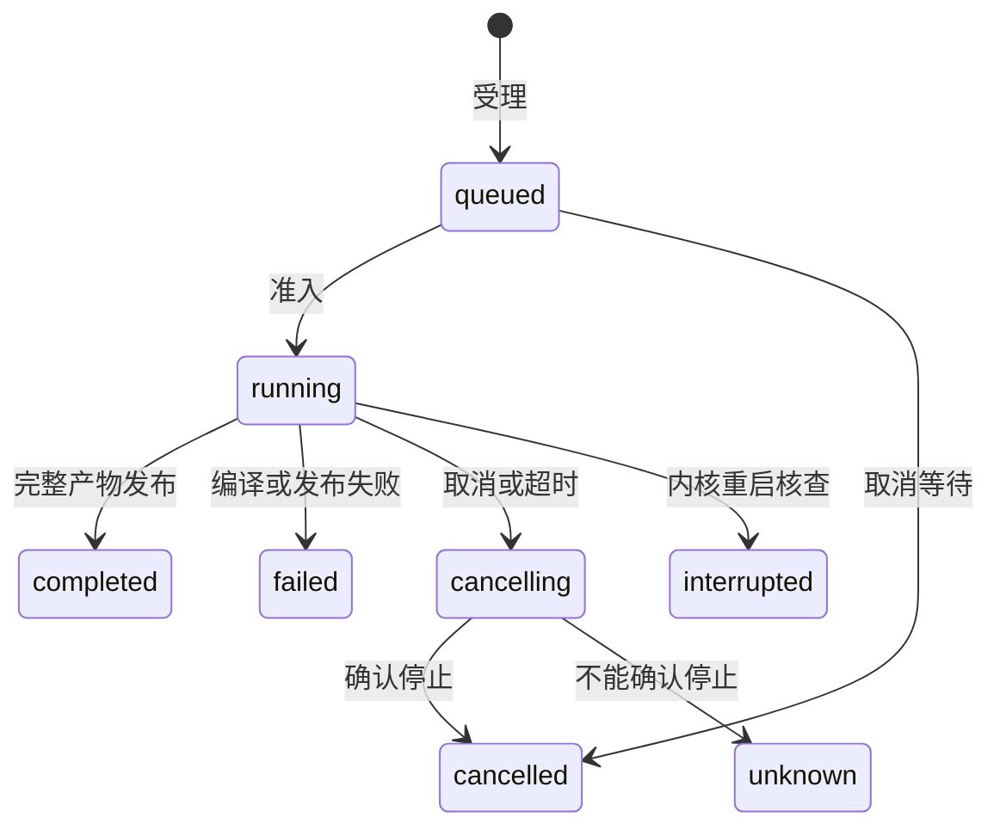

# Manuscript Rendering

## Purpose

为人工写作和共同调用方提供独立于会话及模型的受管格式转换、排版预览和导出能力，让用户从开放稿件得到可实际读取的 HTML、PDF 和 DOCX，并明确输入版本、编译状态、失败原因及最后成功产物的关系。

## ADDED Requirements

### Requirement: 共同转换与格式输出

系统 SHALL 在无需 Agent 会话的人工组合中转换 QMD／Markdown，生成 Quarto HTML／PDF／DOCX，并编译原生 LaTeX 多文件工程为 PDF。工具可用性、实际版本和依赖缺项 SHALL 可查询，失败仅影响相关能力。LaTeX 主文件明确选择，依赖路径保持原工程语义。GUI 与其他调用方 SHALL 使用共同契约与授权。

#### Scenario: 人工编译与导出
- **WHEN** 用户没有创建会话，打开稿件并选择排版或导出格式
- **THEN** 可查询真实编译状态并取得完整对应产物，不调用模型或要求会话身份

### Requirement: 草稿预览与保存后编译

轻量预览 SHALL 跟随当前草稿，完整排版 SHALL 基于已保存输入。打开完整预览或保存时自动更新当前查看格式；QMD 默认 HTML，查看 PDF 时更新 PDF，DOCX及其他格式手动导出。正文、书目、图片和实际配置依赖变化只刷新相关稿件；自动请求合并到最新版本，不形成无界积压，迟到结果不能冒充新版本。

#### Scenario: 连续保存及依赖变化
- **WHEN** 连续保存稿件或只修改其书目文件
- **THEN** 有界调度最终更新最新相关内容，当前结果显示实际对应版本

### Requirement: 普通预览执行边界

普通预览及导出 SHALL 使用应用控制的转换与排版配置，读取正文及已有计算结果，不自动运行科研代码、自定义工程钩子、可执行扩展或 shell escape。不能只用禁用代码单元选项代替完整边界。依赖额外工程执行才能生成的内容 SHALL 给出具体诊断及后续执行需要，不假装完整成功。

#### Scenario: 稿件声明工程脚本
- **WHEN** 稿件或项目配置声明自定义渲染钩子、过滤器或科研代码
- **THEN** 自动预览不执行这些步骤，能够保留的已有内容继续可见，必要缺项可诊断

### Requirement: 可核查的编译生命周期

编译 SHALL 立即返回稳定操作身份，可有界查询状态、日志、错误及产物，并支持取消与有限执行时限。仅确认所属进程和后代已停止后标记取消完成；请求等待结束不等于编译结束。内核退出及重启 SHALL 核查遗留归属，不自动重放未知副作用；原成果和无关执行保留。

#### Scenario: 取消与超时
- **WHEN** 编译超时或用户主动取消
- **THEN** 停止后续调度并按归属收尾，确认停止后给出终态及原因，保留已有产物

### Requirement: 最后成功产物与安全导出

成功产物 SHALL 在完整生成后发布，独立保留最后成功版本及其输入依据。失败或取消不得替换为半成品；旧结果 SHALL 明示其版本与当前状态。产物读取及资源传递 SHALL 有界分块，HTML 展示不得取得工作台权限或自动外发资源。显式导出 SHALL 写到用户选择的工作区位置并复用既有冲突、回收及未知回执保护。

#### Scenario: 编译失败后继续查看
- **WHEN** 已有成功 PDF 的稿件随后编译失败
- **THEN** 旧 PDF 仍可读且明确标为旧结果，修复成功后更新为新产物

#### Scenario: 导出目标已存在
- **WHEN** 用户导出到已经存在的路径
- **THEN** 经既有文件保护决定处理，不静默覆盖原目标
