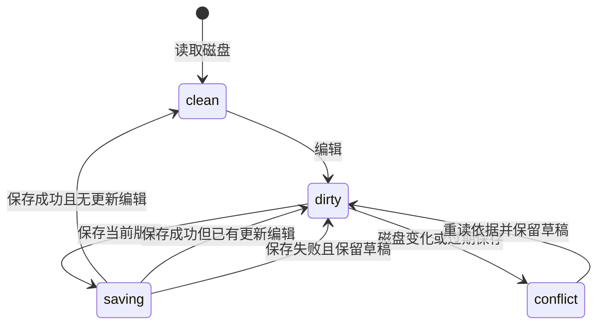

# Workspace Editor

## Purpose

为研究项目中的开放文本提供统一的源码与学术可视编辑能力，使用户在同一工作台中完成日常编辑、模式切换、引文及公式操作，并通过共同文件身份、草稿与条件保存机制保护自己和其他调用方已经完成的工作。

## ADDED Requirements

### Requirement: 有状态的源码编辑

编辑器 SHALL 提供行号、高亮、折叠、缩进、多光标、括号匹配、查找替换、跳行、撤销重做和保存快捷键，显示当前语言、光标及保存状态。Markdown／QMD、LaTeX／BibTeX、Python／R、JS／TS、JSON／YAML SHALL 有相应语言支持，其他 UTF-8 文本使用普通文本模式。现有整份文本编辑上限继续有效。

#### Scenario: 源码工具与保存
- **WHEN** 用户打开科研源码文件，查找替换并使用保存快捷键
- **THEN** 编辑及撤销可用，实际文件通过共同保存保护写入，语言与保存状态可读

### Requirement: 共享文稿与草稿保护

相同项目及稳定文件身份 SHALL 共享正文草稿和编辑历史，各视图保留自身选区与滚动。切换文件、项目、模式和分屏 SHALL 不丢草稿；编辑固定临时标签。保存过程中产生的新编辑 SHALL 保留；外部修改 SHALL 不覆盖本地草稿，旧依据保存被拒绝后提供重读与差异。

#### Scenario: 保存中继续编辑
- **WHEN** 用户提交保存后继续输入，旧保存结果随后返回
- **THEN** 磁盘保存结果与新草稿分别保留，新草稿仍可保存及撤销

#### Scenario: 两个视图编辑同一文件
- **WHEN** 用户在分屏编辑同一身份文件并切换视图
- **THEN** 正文与撤销一致，各视图自己的光标和滚动保持有效

### Requirement: 学术可视编辑与开放格式

QMD／Markdown SHALL 提供源码及可视编辑，支持结构、TeX 公式、表格、图片、脚注、组合引文及页码、交叉引用。源码继续是正文权威；模式切换不得隐式保存或丢失内容。无法安全表示的内容 SHALL 保留原稿及源码入口，不将未识别内容的规范化结果覆盖原文。LaTeX 使用原生源码，不转为可视文稿。

#### Scenario: 学术内容往返
- **WHEN** 用户可视编辑带引文、公式、表格及交叉引用的稿件，切回源码并保存
- **THEN** 内容按原格式语义保留，实际文件可由对应工具渲染

#### Scenario: 不支持的语法
- **WHEN** 可视载入遇到无法安全表示的内容或转换失败
- **THEN** 原文和草稿保留，可继续源码编辑，不发布有损正文

### Requirement: 项目书目与资源

引文选择与补全 SHALL 使用项目 `.bib` 或 CSL JSON，保留既有引用键和人工条目，不自动回写共同库。图片和书目读取 SHALL 经授权且有界，拒绝越界及私有资料；资源不可用不丢正文。资源选择和插入 SHALL 有键盘入口。

#### Scenario: 插入项目引文
- **WHEN** 用户从已有书目选择多项文献并填写页码
- **THEN** 稿件保存标准引文表达，原书目人工内容和引用键不被整份替换
