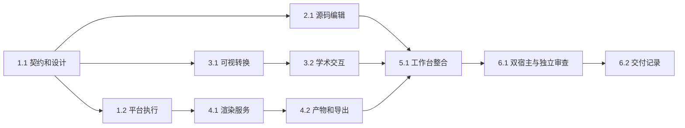

# 执行任务

## 1. 共同契约与受控执行

- [x] 1.1 定义 editor 同源契约、独立包和依赖策略，先更新 UI 设计；类型及架构守卫核对人工能力不依赖 harness。共享接口由主 Agent 负责。
- [x] 1.2 复用进程准入与独立控制器接入受控编译命令，验证启动、有限日志、取消、超时、退出及停止未知状态，不影响其他执行。

## 2. 源码编辑

- [x] 2.1 抽出 CodeMirror 源码模块，接入已批准语言、查找替换、折叠、多光标、跳行、保存及状态；共享文稿历史和视图状态，通过相关文件测试验证。
- [x] 2.2 核对源码、预览与切换标签的草稿保护，保存期间新编辑、外部冲突及结构变化继续通过既有测试。

## 3. 学术可视编辑

- [x] 3.1 固定吸纳必要 Quarto 源码及许可、Pandoc Lua 资源，通过真实独立夹具验证配套转换、可视载入和写回，不能以静态接口判断代替。
- [x] 3.2 接入学术编辑命令、项目书目与图片、数学和工作台对话框，验证标准语义往返、未知内容保护及模式切换后的最新草稿。

## 4. 编译与导出

- [x] 4.1 实现无 harness 的人工渲染服务、工具状态和受控输入配置；验证真实 Quarto HTML/PDF/DOCX、多文件 LaTeX PDF、依赖变化和禁止工程脚本。
- [x] 4.2 实现有界调度、版本结果、取消与重启核查、最后成功产物和分块读取；显式导出复用项目文件保护，覆盖失败、冲突和未知回执。

## 5. 工作台整合

- [x] 5.1 在既有文件标签及两组骨架内接通源码、可视、轻预览、完整排版和格式导出；保留会话/Agent面板/文件树路径，使用共同PDF显示和受限HTML展示。
- [x] 5.2 同步开发说明、初设链接和#39已确认行为，验证浅深主题、键盘/可访问名及长文档输入和预览性能。

## 6. 整合与交付

- [x] 6.1 运行类型、架构、构建、受影响内核测试及浏览器/Electron真实内部接线；安排数据保护与执行生命周期独立审查，处理发现的问题。
- [x] 6.2 根据实际执行结果完成 delivery.md，核对完成判据、实际产物与必要验证，保留未完成项及未验收平台，再更新本项状态。

## 续做入口

使用 `openspec instructions apply --change add-research-writing-editor --json` 获取当前进度；已有实际结果时先读 delivery.md。具体依赖安装及测试服务器授权按用户规则处理。
