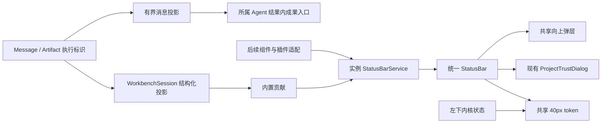

# 实现设计

## 变更总览

## 方案与接口

沿 investigation，状态栏属于 renderer UI，领域事实仍由当前 session/client 提供。新建纯状态服务与 React 接入，内置执行、通知、信任项走相同注册入口。

`StatusBarItem` 包含 id、text、alignment、priority、可选 icon、tooltip、ariaLabel、tone、announce。展示描述仅为数据；注册时另传可选激活动作。`StatusBarService.registerItem(owner, item, activate?)` 返回句柄，提供 `update(patch, activate?)`、`show`、`hide`、`dispose`；update 的第二参数 null 清除动作、undefined 保留动作。服务提供 `getSnapshot`、`subscribe`、`activate(owner,id)`、`disposeOwner`、`dispose`。同 owner/id 重复报错；终结句柄不可再修改新注册。无变化更新不通知订阅者。左右分组各按优先级降序、owner/id 稳定排序，右组从右边缘开始排列。React hook 负责卸载清理，动作读取最新回调，工作台间无全局单例。StrictMode 重挂不能终结仍使用中的服务。

通知为 `{id, severity, summary, content}`；content 仅属于内置 React 详情，不进入标准条目描述。执行状态独立投影字符串，保留“执行状态”的可访问名。通知按 error、warning、info 排列，同级保持来源顺序；计数不含执行与信任项。无通知保留可打开的零计数入口及空态。popover 复用 Menu 行为，用受控开合衔接标准条目的激活动作；长内容限高滚动，按项目/会话重置。

左区跨两行保留内核状态；中间、右区及其竖直分隔柄在上行，状态栏覆盖下行中间至右侧。固定高度、横向内边距及同一边框避免 padding 改变高度。状态栏不裁剪向上详情，层级高于 Agent overlay、低于居中弹窗。窄窗口截断摘要，右侧贡献组粘附工作台可视右边缘，避免防挤压骨架溢出时裁掉通知数量及操作入口。左区折叠轨保留同高底部空段。

信任条目仅在当前非 application 项目待确认/受限时显示，激活现有请求弹窗回调；信任选择仍走共同客户端 `project.grant`，失败由弹窗单独处理，不重复投影为全局通知。新增/旧项目自动询问与关闭、受限重开的规则不改变。

## 文件变化

- 新增 `workbench/statusbar.ts`、`StatusBarContext.tsx`、`shell/StatusBar.tsx`：纯服务、React 生命周期及呈现；`ArtifactNotice.tsx` 承接成果核查反馈。
- 修改 `session.ts`、`business-session.tsx`：结构化通知、执行与信任投影，删除旧提示呈现。
- 修改 `Workbench.tsx`、`shell/AgentOverlay.tsx`、`shell/menu.tsx`：接入与受控弹层，移除重复通知。
- 修改 `styles.css`：共享 token、网格与状态栏；核对 ActivityPane 的展开/折叠底部。
- 修改 `docs/ui-design/README.md`、`docs/development.md`、必要项目约束入口：先更新设计再实现。
- 新增 `tests/kernel/statusbar.spec.ts` 与 `tests/ui/statusbar.spec.ts`，扩展 `conversation.spec.ts`、`harness.spec.ts`、`file-workbench.spec.ts`、`workbench.spec.ts`；复用现有 UI fixture，不建立产品旁路。内核重试用例先显式创建活动会话，再验证该会话的草稿恢复。
- 修改 protocol 的 `harness-record-contracts.ts` 与 harness 的 `runtime.ts`：声明并保存正文消息可选执行标识；修改 `projection.ts`、`MessageContent.tsx` 使入口归入所属执行；新增 `tests/kernel/message-artifacts.spec.ts` 验证归属，扩展内核 harness 实跑核对执行标识。

## 验证与风险

成果归位：删除 `WorkbenchSession.artifacts` JSX 插槽、`Workbench` 顶部成果区及 `AgentOverlay` 尾部汇总。`projection.ts` 一次有界遍历按执行标识将 protocol Artifact 数据投影至同执行最后一条正文回复的 metadata，无正文时使用工具结果。Message schema 增加可选 runId，harness 写入模型消息时记录；历史工具消息已有 tool.runId，作为明确归属的回退，不猜测正文或消息 ID。未加载归属消息的成果仍可在状态栏查询其保存／登记通知，不串到其他回复。`MessageContent` 复用消息文件打开能力呈现成果入口；`ArtifactNotice.tsx` 管理详情内的核查忙碌及错误，业务投影提供共同客户端动作。状态栏通知保留登记核查动作及失败反馈，移除消息内的重复状态。更新投影测试和双宿主 harness 回归，核对打开成果、草稿保留、重载及轮次隔离。

纯服务测试覆盖生命周期、排序、隔离、动作及无变化更新；双宿主测试从用户入口核对归档恢复和补交等真实行为。UI 测试允许外部模型边界受控响应，内部接线真实。运行 OpenSpec validate、pnpm lint、桌面类型检查、pnpm build 和上述受影响测试。视觉检查两主题、960px 窗口、侧栏折叠与 overlay；几何断言仅用于用户明确要求的高度及边线对齐。

不涉及持久化迁移。主要风险是 StrictMode 注册泄漏、状态变化导致旧点击回调、Esc 同时关闭多层及迟到回执串入新会话，通过句柄身份、最新回调和既有捕获阶段关闭机制处理。
