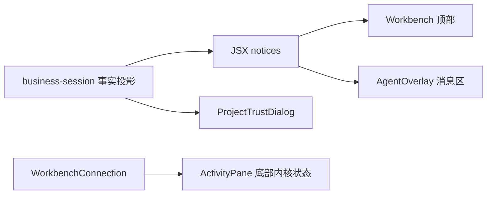

# 调查依据

## 当前事实与复用选择

- 静态核对 `Workbench.tsx`：dock 模式在 tab 组前呈现 `session.notices`，overlay 模式交给 `AgentOverlay` 消息滚动区。`business-session.tsx` 用整块 JSX 生成全局提示及执行状态，需要结构化投影以获得摘要和数量。
- `ActivityPane.tsx` 的内核状态已为底部单行，详情 hover/focus 展开；`styles.css` 当前用 padding 形成约 40px 高度，可统一为固定语义 token。左区保留全高，其他区新增底部网格行。
- `shell/menu.tsx` 已有向上弹层、外点／Esc 关闭及焦点归还；复用交互并只处理状态栏自身节点。`ProjectTrustDialog.tsx` 已实现居中确认、忙碌与失败反馈，保留其授权路径。
- `WorkbenchSession` 是 renderer 内的 UI 投影；未找到工作台通用条目注册或插件 UI 协议。标准贡献服务放在工作台内，不向领域协议加入展示专用操作。
- 现有 `tests/ui/conversation.spec.ts`、`harness.spec.ts` 覆盖归档恢复及待核查指令；`workbench.spec.ts` 覆盖连接及草稿；`tests/kernel/tab-state.spec.ts` 提供纯前端状态测试模式。现有测试配置支持浏览器与 Electron。

图示来自上述源码静态阅读；未把定义中的测试视为本轮实跑结果。

## 结论与承接

成果区域续做核对：`Workbench.tsx` 在 dock 模式把整块 session.artifacts 插在 TabGroups 前，`AgentOverlay.tsx` 将同列表放在 Messages 后；这解释了顶部残留。成果有 runId，工具消息有 tool.runId，正文 Message 尚未公开 runId，不能靠文件名或消息 ID 猜归属。采用同源可选执行标识和有界消息投影；历史工具的明确关联可复用，不跨 DOM 或额外查询全部历史。

用户已确认布局、详情交互及纯数据条目接口；无影响方案的阻塞未知。采用实例注册表、共享弹层及现有信任弹窗，不新增依赖。高度、焦点优先级、异步操作及真实双宿主接线由实施和 delivery 验证。
