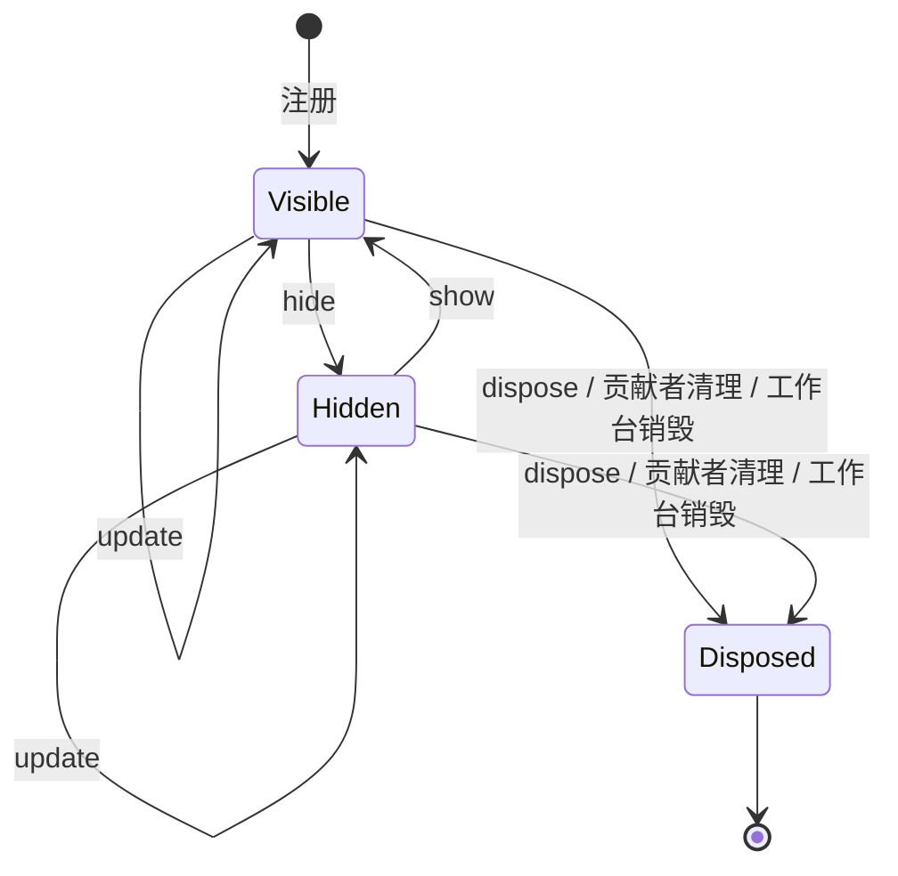

## ADDED Requirements

### Requirement: 统一底部状态栏与通知

工作台 SHALL 提供从中间区贯通右区的固定单行状态栏，与左下内核状态区同高且上下边线对齐。左右栏折叠、拖动及 Agent dock/overlay 切换 SHALL 保留底栏，overlay 不遮挡底栏。状态栏 SHALL 常驻当前执行状态，以摘要及数量集中呈现归档、待核查指令与全局错误；错误优先于需用户处理事项，后者优先于普通信息。同级通知保持来源顺序。全部通知与原有操作 SHALL 可在向上展开、限高滚动的详情层中访问；失败留在所属通知内可重试。关闭详情层 SHALL 不改变项目、会话、草稿或发送行为。

项目信任决定 SHALL 使用居中确认弹窗；底栏只显示待确认/受限状态及重新打开入口，不计入通知数量。明确受限项目普通重开 SHALL 不重复弹窗。局部表单、编辑阅读反馈和成果入口 SHALL 保留所属上下文。底栏和详情层 SHALL 支持两套主题、键盘操作及文字截断；窄窗口保留通知入口和数量。Esc SHALL 优先关闭当前详情层并归还焦点，而不同时收起 Agent overlay。项目/会话切换 SHALL 移除旧通知与动作。

#### Scenario: 双形态与底边对齐
- **WHEN** 用户折叠任一侧栏、展开 Agent 或调整窗口宽度
- **THEN** 底栏始终单行可见，展开左栏时与内核状态区上下边线一致，内容和发送入口不被遮挡

#### Scenario: 查看和处理通知
- **WHEN** 多条通知同时存在，用户打开详情并执行恢复或补交
- **THEN** 摘要按优先级显示且数量准确，原操作沿共同接口执行，失败可原地重试，草稿保留且不自动重复发送

#### Scenario: 重新进入信任决定
- **WHEN** 用户点击待确认或受限状态条目
- **THEN** 打开居中信任弹窗，失败留在弹窗；取消不授信，明确选择受限后普通重开不重复询问

### Requirement: 标准状态栏贡献接口

工作台 SHALL 提供实例级、贡献者隔离的统一条目接口，内置执行状态、通知和信任入口 SHALL 使用同一接口。条目 SHALL 声明稳定身份、文字、左右位置、排序优先级及可选图标、提示、语义和可访问名；展示描述 SHALL 为纯数据，点击经独立激活动作适配。调用方 SHALL 能更新、隐藏、重新显示和释放条目，并按贡献者统一清理。重复的同贡献者身份 SHALL 明确拒绝；不同贡献者或工作台互不覆盖。同侧按优先级及完整身份稳定排序，右侧从右边缘开始排列。组件卸载或工作台销毁 SHALL 清理贡献，释放后的旧句柄 MUST NOT 修改后来注册的同名条目。无变化更新 SHALL 不产生重复订阅通知。

#### Scenario: 贡献者更新与清理
- **WHEN** 两个贡献者注册同名条目，其中一个更新、显隐后释放
- **THEN** 更新只作用于所属条目，另一贡献者不受影响，旧句柄不能复活或覆盖新条目

#### Scenario: 组件与工作台生命周期
- **WHEN** 组件重挂、卸载，或另一个工作台同时存在
- **THEN** 自动接入不重复注册，卸载清理自身贡献，各实例状态独立；动作读取最新处理函数

## MODIFIED Requirements

### Requirement: 成果直接打开

已保存成果 SHALL 在所属执行的 Agent 结果消息中提供打开实际项目文件的入口，复用普通文件读取、授权、编辑和草稿保护；尚无正文结果时可使用同执行工具结果。消息与成果 SHALL 使用明确执行标识关联，历史记录及分页未加载的归属消息 MUST NOT 导致成果挂到其他执行回复。工作台 MUST NOT 在 tab 上方或消息流末尾另设成果汇总区。dock SHALL 保持进展摘要，成果入口随展开会话访问。保存与登记状态 SHALL 进入状态栏通知及详情；登记待核查 SHALL 保留核查并补齐入口，失败可重试。文件已缺失或不可读时 SHALL 显示相关错误。打开成果 SHALL 激活文件 tab，并使用户可见，不因 Agent overlay 遮挡而留下无反馈操作。

#### Scenario: 从会话查看产物
- **WHEN** 用户展开会话，点击所属结果消息中的成果打开入口
- **THEN** 文件 tab 显示当前实际内容，overlay 收起，未发送指令和当前会话保留，待登记事实不被文件存在替代，tab 上方不出现独立成果区域

#### Scenario: 多轮或历史消息中的成果归属
- **WHEN** 会话包含多个执行，或用户分页载入更早消息
- **THEN** 成果只出现在明确关联的执行消息中，每份成果只呈现一个打开入口；未加载归属消息时不附到当前回复

#### Scenario: 保存与登记反馈
- **WHEN** 成果已保存或登记结果待核查，用户查看状态栏通知详情
- **THEN** 详情显示对应文件和实际登记状态，待核查项能沿共同接口核查并补齐，失败可重试，草稿与接收会话保持

### Requirement: 会话整理与独立选择

左区会话区 SHALL 分别呈现各展开项目的活动会话，各项目按需沿内核游标追加加载下一页，不提供“活动／归档”切换与翻页控件；变更通知只重读已加载范围并按 id 去重，不改变当前会话选择。查找会话 SHALL 经左区顶部动作（及折叠轨会话入口）打开居中弹窗，跨最近项目全局搜索：空查询显示最近会话，输入经防抖后由内核一次有界合并查询；结果行显示状态、标题、项目名、归档标识与相对时间；迟到响应 SHALL 不覆盖新查询结果；选择结果后切换到对应项目与会话，草稿仍按项目／会话键隔离保存。归档会话 SHALL 集中在设置页按项目（含 `application` 范围）滚动列出并提供恢复；归档当前会话后状态栏提供归档摘要及详情内恢复入口，不替代设置页集中管理。折叠轨保留会话查找入口，新建时展开侧栏并使用所属项目行按钮。筛选、加载与列表刷新 SHALL 不改变当前指令接收者，异步结果按项目与查询范围隔离。归档当前会话 SHALL 保留历史视图与草稿，禁止发送／继续并提供恢复入口；新建会话回到可发现新会话的列表。空范围不得自行选择其他会话。

会话操作 SHALL 集中在会话整行的右键菜单（含 `Shift+F10`／ContextMenu 键盘入口），以“重命名”“归档/恢复”两个条目呈现，不再提供行尾“管理会话 …”入口；重命名 SHALL 在会话行原地编辑，Enter 保存、Esc 或失焦取消，失败时保持编辑并在行内显示错误；会话处于排队、运行或取消中时归档入口 SHALL 禁用并说明原因。归档或恢复失败 SHALL 在操作发生的菜单内显示错误且不静默关闭；设置页恢复失败 SHALL 留在对应行内；当前会话的恢复入口失败时 SHALL 在状态栏通知详情原地显示错误。归档状态下 composer 及其模型/推理强度选择 SHALL 禁用。

后台项目元数据变化 SHALL 只使相应列表失效，不能读取后台正文或刷新全部项目。各组的失败、分页和迟到结果 SHALL 独立处理。

#### Scenario: 多项目切换与后台状态
- **WHEN** 两项目驻留且后台项目会话状态变化，用户选择其中一条会话
- **THEN** 对应项目列表更新，选择同时切换项目与会话，旧异步结果不混入当前内容

#### Scenario: 查找期间仍保留当前工作
- **WHEN** 用户带草稿在搜索弹窗查询其他标题，或旧查询响应迟到
- **THEN** 当前会话、消息与草稿保留，迟到响应不覆盖新查询结果

#### Scenario: 搜索结果包含归档会话
- **WHEN** 搜索命中其他项目的归档会话
- **THEN** 结果行标识归档状态与所属项目，选择后切换到对应项目与会话

#### Scenario: 设置页恢复归档会话
- **WHEN** 用户在设置页恢复一个归档会话
- **THEN** 恢复成功后归档列表与左区活动列表刷新；失败时错误留在对应行内，可重试

#### Scenario: 归档当前会话
- **WHEN** 用户归档当前已停止会话
- **THEN** 历史仍可阅读、草稿保留，恢复前发送与继续不可用，恢复后不自行发送

#### Scenario: 归档或恢复失败
- **WHEN** 归档或恢复请求被内核拒绝或失败
- **THEN** 错误显示在操作发生的菜单或设置页行内（当前会话恢复失败显示在状态栏通知详情），菜单不静默关闭，可重试
