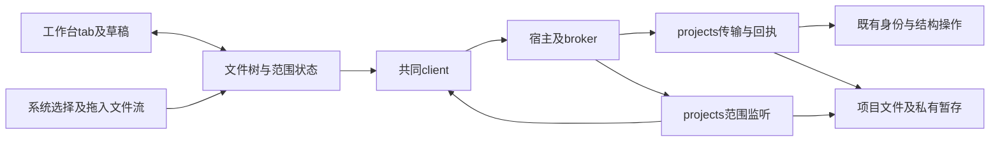
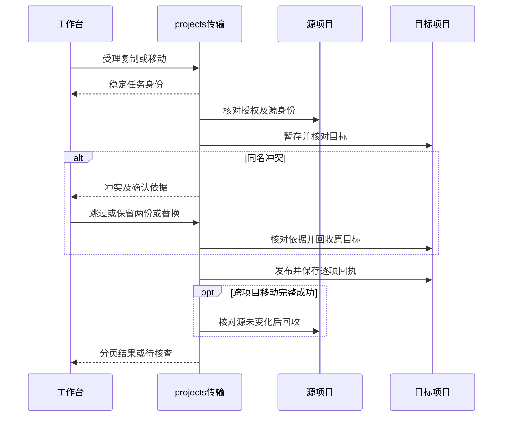

# 实现设计

## 变更总览

## 方案与接口

protocol为唯一契约源；新增文件传输声明并合并projectsOperations。传输由projects持有，目标项目保存任务及逐项收据。受理返回ID，随后分页读取进度／冲突，明确决定后继续，取消不撤销已完成内容。系统输入通过同一任务的256 KiB base64分块暂存，结束后进入共同发布流程。内核Manual只做装配和调用，权限在源目标领域实际执行端核对，不引入harness依赖。

移动在同项目保持身份，复用结构临界区；复制流写私有暂存，短暂发布阶段核对源依据和目标冲突，再以不覆盖方式发布。替换以既有trash保护原目标，目标在确认后变化需重新决定。跨项目复制完成后再次核查源，才用源项目trash回收；部分复制保留源树。递归合并逐项完成，不建立全局文件事务。重启不重放在途提交，先从回执、暂存和实际身份核查。

列表在单目录内排序和分页，返回目录版本；定位采用路径祖先和相关页，不循环加载所有前置页。范围观察由连接拥有，按项目和显式目录／文件注册，事件合并后带受影响路径；断线释放。刷新失败留旧列表，旧世代返回不得覆盖当前项目。系统监听只是线索，保存保护仍由原临界区承担。

UI使用Headless Tree 1.8.0处理选择、键盘操作和拖拽，树数据来自有界分页缓存；重命名使用自定义行内逻辑，复用共享菜单与固定行窗口化。临时tab通过FileTarget.openMode表达，TabItem.transient与Markdown的kind分离；Workbench维持活动组，renderFile传编辑回调且替换前查询草稿。文件树选择不代替会话附加材料。

## 文件变化

- 新增`packages/protocol/src/file-explorer-contracts.ts`，修改 project-contracts/projects/operations 及派生类型映射。
- 新增`packages/projects/src/transfers.ts`与`file-watch.ts`，修改 files/store/node 及架构登记：传输、暂存、核查及范围监听；传输记录使用既有 projects meta，无物理 schema 迁移。
- 修改`apps/kernel/src/manual.ts`、`server.ts`：实际提供者、连接范围订阅与事件，复用共同 client。
- 新增工作台`file-explorer/`，入口为`Explorer.tsx`：文件树、控制状态和传输呈现；修改 ProjectNavigation 并移除旧树表单，复用共享菜单与固定行窗口化。
- 修改 session、Workbench、TabGroups、project-ui、business-session：打开意图、临时 tab 固定、草稿检查和活动文件定位；新增`tab-state`。
- 修改 styles.css、docs/ui-design/README.md及docs/development.md，并在根 AGENTS.md 添加入口引用；新增`tests/kernel/file-transfers.spec.ts`、`tests/kernel/file-watch.spec.ts`、`tests/ui/file-explorer.spec.ts`及 tab-state 测试；没有修改旧 project-files 测试。

## 验证与风险

既有tests/kernel/project-files.spec.ts覆盖身份、旧依据、回收与未知结果；在其入口扩展或增加同配置传输测试。UI复用真实fixture和RPC gate，不mock内部业务；browser和Electron共同运行。核对文本／二进制、目录合并与替换恢复、重启及取消，人工组合测试不加载模型。万行窗口化记录DOM和交互P95，目标100 ms；注明环境。运行lint、架构、typecheck、build、相关kernel、双宿主UI及独立数据保护审查。保存/替换期间外部写入仍可能竞态，不声称提供外部互斥或跨文件事务。用户已授权所选树依赖，未授权提交或发布。
