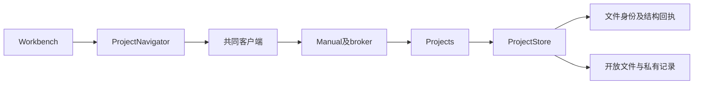

# 调查依据

## 当前事实与复用选择

- `ProjectNavigation.tsx`的ProjectNavigator直接维护每目录100条分页、选中行、表单、回收站和未知结构操作。共享`ContextMenu`、`ConfirmAction`可复用，`library/useVirtualizedList.ts`已有固定行窗口化实现，但容器拖拽尺寸需要ResizeObserver。
- `project-contracts.ts`声明files.list/save/mkdir/rename/trash/restore/resolve/operation；`packages/projects/src/files.ts`负责稳定身份、相交路径协调及结构回执。rename只接受同父目录名称，没有复制和跨目录移动。`store.ts`的list按磁盘枚举顺序分页，没有外部文件监听。
- `Projects`持有多项目仓储；`Manual`经broker装配人工文件操作，不依赖harness。文件内容、结构回执和身份仍归projects。
- `Workbench.tsx`已有最多两组tab、fileId重绑定、项目状态保留；`file-document.ts`保存同一文档草稿。临时tab需独立于Markdown的preview种类。
- 文献库的导入只接受本机路径或项目材料，没有UI原始字节分块写入。可借鉴其暂存发布与256 KiB流块，项目传输直接用标准流，不依赖文献业务或复制其hash规则。
- RPC帧上限2 MiB，现有目录结构操作最多核查10000项。文本编辑上限256 KiB不适用于二进制搬移。
- 上一轮通过npm registry只读核对Headless Tree core/react 1.8.0，MIT许可，react绑定peer允许当前React版本。官方文档说明选择、拖拽、重命名、平铺和异步数据能力：https://headless-tree.lukasbach.com/getstarted/ 。本轮尚未运行交互证明。

以上为静态代码核对；规划上一轮的原生scout配置模型被账号拒绝，gpt-6-luna完成只读调查，主代理核对关键接口。

## 结论与承接

选择已由用户确认，无阻塞性产品未知项。复用projects、共享菜单、草稿与固定行窗口化；补齐传输领域和范围监听。UI设计中“右区上下排列”与现有页签漂移，先修正文档。实际数据保护、重启与双宿主证据由tasks执行并记录delivery。
