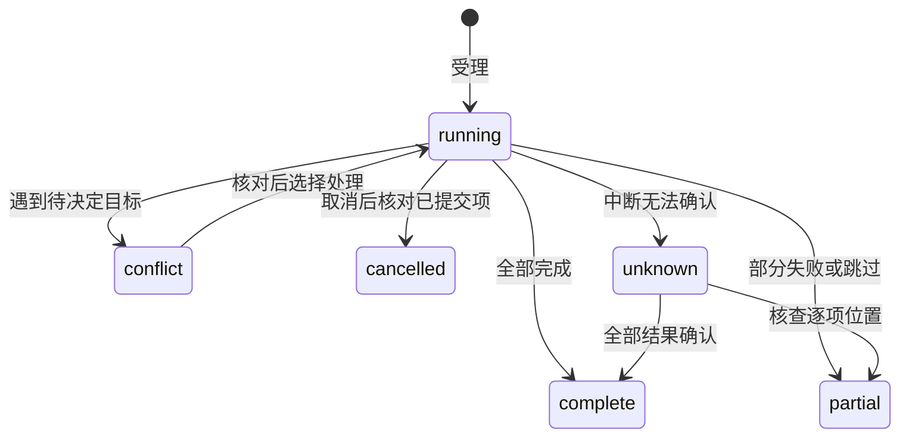

## ADDED Requirements

### Requirement: 排序分页与范围变化观察

目录列表 SHALL 先按目录优先及名称自然顺序排序再分页，携带目录版本，支持定位指定条目所在页。失效分页 SHALL 要求重读。文件变化观察 SHALL 限于显式订阅的目录和文件，合并通知并释放取消订阅的资源；通知只是核查线索，不提供外部写入互斥。

#### Scenario: 大目录定位及变化
- **WHEN** 用户定位尚未加载的文件，或已读目录在分页间发生变化
- **THEN** 只读取祖先及相关页，过期分页不能拼入当前列表，变化只刷新相关范围

### Requirement: 受保护的文件传输与递归合并

系统 SHALL 支持同项目及同一内核已登记项目间的文件、目录复制移动，源读取与目标写入分别授权，移动另需源写入。传输 SHALL 使用已保存磁盘内容，去除父子重复选择，拒绝越界、私有资料、链接和自身后代目标。目录同名 SHALL 递归合并并保留目标独有内容；子项冲突提供跳过、保留两份及确认替换，类型不同的冲突 SHALL 明确表达。确认替换前核对目标身份和内容，先完整回收原目标，再发布候选。内容或身份变化 SHALL 重新决定，不能沿旧确认覆盖。

同项目移动 SHALL 保留身份，复制及跨项目目标建立新身份。跨项目移动 SHALL 在完整复制并核查源未变化后回收源项；失败、跳过或效果未知时保留源项，原项目历史、成果引用和草稿仍归原项目。

#### Scenario: 目录合并与替换恢复
- **WHEN** 粘贴目录遇到同名目录及子文件，用户确认替换某个子文件
- **THEN** 目标独有内容保留，原子文件可从回收站恢复，其草稿仍绑定原身份

#### Scenario: 跨项目剪切部分失败
- **WHEN** 部分目标已经复制，另有冲突、权限撤销或源内容变化
- **THEN** 已完成目标及源项均保留，逐项说明结果，不把部分复制当作可回收整个源目录的依据

### Requirement: 可核查的传输生命周期与系统导入

传输 SHALL 立即返回稳定操作身份，提供有界分页进度、冲突决定、取消及中断后的核查。重复身份不同参数 SHALL 拒绝，已完成副作用不能重放。取消停止后续工作并保留已完成项；效果未知先核查。系统选择和拖入 SHALL 复制用户选定的文件与目录层级，不改写系统源项；字节传输分块，不能把整个大文件放入单个RPC帧。临时资源 SHALL 按归属收尾。普通二进制和大文件搬移不受文本编辑大小与UTF-8限制。

#### Scenario: 发布后回执丢失
- **WHEN** 文件已发布但回执丢失或内核重启
- **THEN** 按原操作身份核查实际位置，保留成功内容和待核查项，不再次搬移源项

#### Scenario: 大文件导入取消
- **WHEN** 分块导入大文件期间用户取消
- **THEN** 系统源文件不变，未发布暂存按归属清理，已完成项可查询
