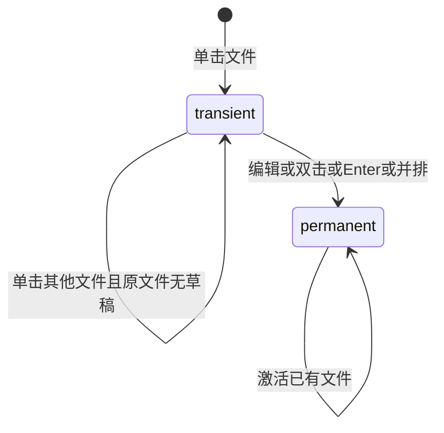

## ADDED Requirements

### Requirement: 完整文件树交互

右区 SHALL 沿现有文件、材料、任务页签呈现文件树，提供紧凑行、语义图标、工具栏、共享右键菜单及行内新建重命名。树 SHALL 支持键盘导航、名称定位、Ctrl/Cmd增减选择、Shift范围选择、已加载展开条目全选、F2重命名、复制剪切粘贴和回收确认。选择文件与附加会话材料分别表达。菜单支持右键、Shift+F10、Esc及焦点归还；输入确认后执行，取消无副作用。

拖拽 SHALL 提供目标反馈、悬停展开、边缘滚动及复制修饰键，粘贴提供同样的键盘替代。跨项目剪贴板 SHALL 在项目切换时保留，系统导入提供选择及拖入入口。进度、冲突和失败在操作相关位置可读，保留可继续决定或核查的身份。已展开目录状态、选择和滚动 SHALL 随项目保留，DOM仅渲染可见窗口及有限overscan。

#### Scenario: 纯键盘整理材料
- **WHEN** 用户使用键盘多选文件、打开菜单、新建重命名、剪切并切换项目粘贴
- **THEN** 同一真实文件规则执行，焦点可见，材料附加状态及指令接收者不被文件选择改变

#### Scenario: 流式工作期间浏览大树
- **WHEN** 后台传输及Agent输出持续更新，用户浏览万条已加载树行
- **THEN** 树DOM及刷新范围有界，输入、选择和滚动保持响应，不逐次重读全项目

### Requirement: 临时文件tab与活动文件定位

单击文件 SHALL 在当前活动组临时打开，每组至多一个临时tab；双击、Enter打开、首次编辑及并排查看 SHALL 固定文件。相同稳定身份已打开时激活原tab。临时状态 SHALL 与Markdown预览模式分开，替换前核查草稿，未保存内容固定并保留。激活文件tab SHALL 定位树中对应条目，只读取祖先和相关分页；文件身份变化不得把原草稿移给同路径新文件。

#### Scenario: 连续临时打开及编辑
- **WHEN** 用户依次单击两个文件，再编辑后单击第三个文件
- **THEN** 第一个临时tab被替换，第二个因编辑固定，第三个临时打开，全部草稿保留

#### Scenario: 项目切换与文件改名
- **WHEN** 用户切换项目后返回，或激活已改名的文件tab
- **THEN** 原项目tab与草稿恢复，活动文件按稳定身份定位当前树位置
